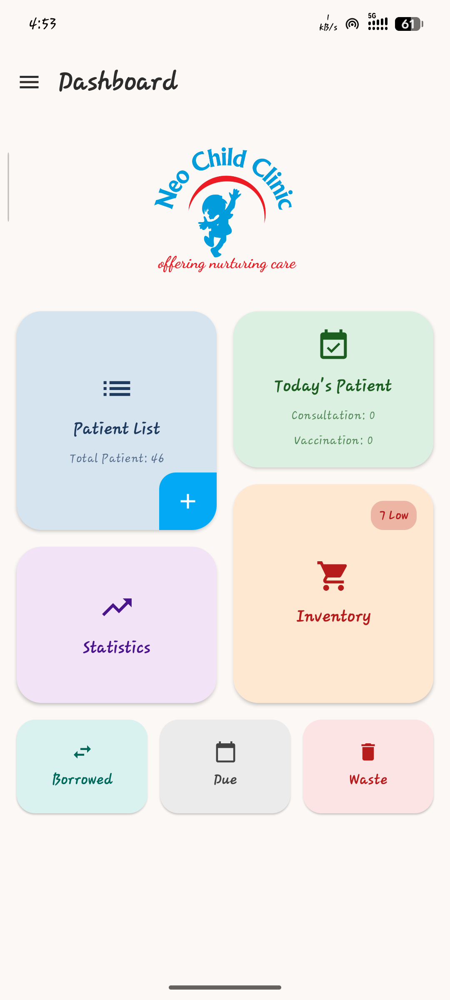
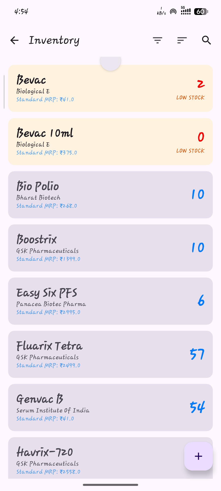

# Neo Child Clinic — Vaccine Manager

[](https://github.com/CyferBoy/Neo_Child_Clinic/releases/latest)
[](LICENSE)
[](#project-status)
[](app/src/test/java/com/neochildclinic)

Neo Child Clinic is a robust, offline-first Android application designed for pediatric clinics and healthcare providers. It coordinates patient clinical records, multi-vial vaccination administration, doctor consultations, dynamic inventory/batch tracking, due reminders, and financial ledgers.

---

## 🧭 Developer Navigation & Documentation Map

| Area | Primary Guide | Description |
|---|---|---|
| **Code Placement** | 🧭 [Where Things Belong](docs/architecture/where-things-belong.md) | Practical guide: where to place screens, ViewModels, DAOs, migrations, and tests |
| **System Architecture** | 🏛️ [Architecture Overview](ARCHITECTURE.md) | High-level package boundaries, clean architecture, and dependency flow |
| **Getting Started** | 🚀 [Developer Onboarding](docs/getting-started/onboarding.md) | Environment setup, JDK 17, Android Studio, `.env.local` keys, and first build |
| **Offline Synchronization** | 🔄 [Offline-First Sync](docs/architecture/offline-first-sync.md) | In-depth synchronization engine, queue mechanics, and conflict resolution |
| **Cache Architecture** | ⚡ [In-Memory Cache](docs/architecture/cache-architecture.md) | LRU cache specs, generation counters, and session boundary clearing |
| **Database Architecture** | 🗄️ [Schema Overview](docs/database/schema-overview.md) | Room schema v33, foreign keys, cascade rules, and Supabase RLS |
| **Features Matrix** | 📋 [Features Overview](docs/features/overview.md) | Detailed capability matrix across all 20 clinic business modules |
| **Disaster Recovery** | 🛡️ [Backup & Restore](docs/operations/backup-restore.md) | `.nccb` AES-256-GCM container format, Cloudflare R2 worker, and safety rollback |
| **Releases & Deployment** | 📦 [Release Runbook](docs/operations/release-management.md) | APK signing, ProGuard/R8 shrinking, in-app updates, and FCM alerts |
| **Contributing** | 🤝 [Contributing Guidelines](CONTRIBUTING.md) | Coding conventions, TDD requirements, and Git PR standards |
| **Security Policy** | 🔐 [Security Policy](SECURITY.md) | Responsible disclosure process and verified security controls |
| **Obsidian Vault** | 📚 [Knowledge Base](docs/Knowledge_Base/) | 66 interconnected notes verified with strict citation validators |

---

## 📱 Application Overview & Screenshots

- **Target SDK**: Android 15 (API 35) · **Compile SDK**: 35 · **Minimum SDK**: Android 10 (API 29)
- **Local Persistence**: Encrypted Room (SQLite v33) via SQLCipher + Android Keystore
- **Cloud Backend**: Supabase PostgreSQL + Auth + Realtime + Storage
- **Edge Infrastructure**: Cloudflare Worker + R2 Storage for offsite encrypted backups

<table>
<tr>
<td align="center"><a href="design/assets/screenshots/dashboard.png" target="_blank"><br><b>Clinic Dashboard</b></a></td>
<td align="center"><a href="design/assets/screenshots/patient%20details.png" target="_blank"><br><b>Patient Records</b></a></td>
<td align="center"><a href="design/assets/screenshots/due%20vaccination.png" target="_blank"><br><b>Due Vaccinations</b></a></td>
</tr>
<tr>
<td align="center"><a href="design/assets/screenshots/inventory.png" target="_blank"><br><b>Vial Inventory</b></a></td>
<td align="center"><a href="design/assets/screenshots/borrow%20vaccine.png" target="_blank"><br><b>Borrowed Vaccines</b></a></td>
<td align="center"><a href="design/assets/screenshots/app%20drawer.png" target="_blank"><br><b>Navigation Drawer</b></a></td>
</tr>
</table>

---

## 📂 Repository Directory Tree

```text
Neo_Child_Clinic/
│
├── app/                                 # Android application module (:app)
│   ├── src/main/
│   │   ├── java/com/neochildclinic/
│   │   │   ├── app/                     # App entry point, MainActivity, NavHost, sealed Routes
│   │   │   ├── core/                    # Shared infrastructure (di, sync, cache, security, ui)
│   │   │   ├── data/                    # Room DB (v33), 21 DAOs, 21 entities, remote sources, backup
│   │   │   ├── domain/model/            # 33 Pure Kotlin business domain models (no Android imports)
│   │   │   └── feature/<name>/          # 20 Self-contained business features (patient, inventory, etc.)
│   │   ├── res/                         # Android drawables, colors, strings, themes, widget XML
│   │   └── AndroidManifest.xml          # Component declarations, permissions, auth deep links
│   ├── src/test/java/                   # 344 JVM-based unit tests
│   ├── src/androidTest/java/            # Android instrumentation tests (Room migrations, DAOs)
│   ├── schemas/                         # Room database version schema JSONs (v33)
│   └── build.gradle.kts                 # Application build script and dependency configurations
│
├── supabase/                            # Supabase cloud backend
│   ├── migrations/                      # Tracked SQL schema, trigger arithmetic, & RLS migrations
│   ├── functions/                       # Deno Edge Functions (manage-staff, notify-update)
│   ├── tests/                           # SQL regression tests (e.g., stock_trigger_arithmetic.sql)
│   └── config.toml                      # Local Supabase CLI configuration
│
├── cloudflare/                          # Cloudflare edge infrastructure
│   └── backup-worker/                   # TypeScript Cloudflare Worker for R2 cloud backups & Vitest suite
│
├── design/                              # Design assets and design system
│   ├── design-system/                   # Design system documentation & contrast checkers
│   └── assets/screenshots/              # Full-resolution application screenshots
│
├── docs/                                # Documentation and Knowledge Base
│   ├── getting-started/                 # Onboarding, environment setup, and quickstart guides
│   ├── architecture/                    # System architecture, sync models, placement guides
│   ├── features/                        # Business feature specifications and matrices
│   ├── database/                        # Database schema, relationships, and indexing documentation
│   ├── operations/                      # Backup, restore, release, and deployment runbooks
│   ├── quality/                         # Security audits, bug audits, and compliance registers
│   └── Knowledge_Base/                  # Linked Obsidian vault with 66 interconnected notes
│
├── scripts/                             # Repository tooling & verification scripts
│   ├── validate_docs.py                 # Strict documentation and citation validator
│   └── test_validate_docs.py            # Regression test suite for documentation validation
│
├── .github/                             # GitHub Actions CI/CD workflows
├── README.md                            # Primary project overview and navigation guide
├── ARCHITECTURE.md                      # High-level architecture summary
├── CONTRIBUTING.md                      # Developer contribution workflow
└── SECURITY.md                          # Vulnerability reporting policy
```

---

## ⚡ Quick Start for Developers

```bash
# 1. Clone the repository
git clone https://github.com/CyferBoy/Neo_Child_Clinic.git
cd Neo_Child_Clinic

# 2. Configure credentials in .env.local
cat << 'EOF' > .env.local
SUPABASE_URL=https://YOUR_PROJECT_ID.supabase.co
SUPABASE_PUBLISHABLE_KEY=YOUR_SUPABASE_ANON_KEY
BACKUP_WORKER_URL=https://YOUR_BACKUP_WORKER.workers.dev
EOF

# 3. Build debug APK
./gradlew assembleDebug

# 4. Run unit tests (344 tests)
./gradlew testDebugUnitTest

# 5. Run documentation validation
python3 scripts/validate_docs.py --strict
```

See [docs/getting-started/onboarding.md](docs/getting-started/onboarding.md) for full setup instructions.

---

## 🔒 Security & Privacy

This application handles sensitive medical, immunization, and financial data for children.
- Never commit credentials, signing keystores (`*.jks`), service-role keys, or `google-services.json`.
- Cloud access is strictly governed by Supabase Row Level Security (RLS) policies checking active staff credentials.
- Report any security vulnerabilities privately by following our [Security Policy](SECURITY.md).

---

## 📄 License

This project is licensed under the Apache License, Version 2.0. See [LICENSE](LICENSE) for details.
