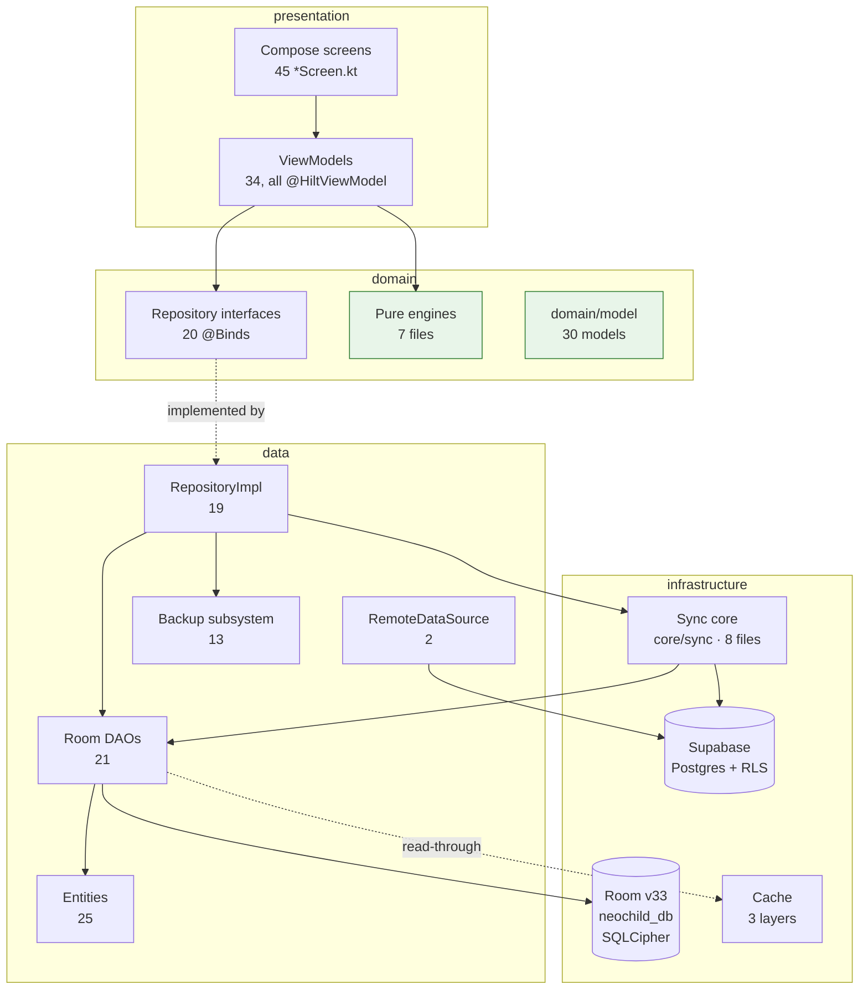
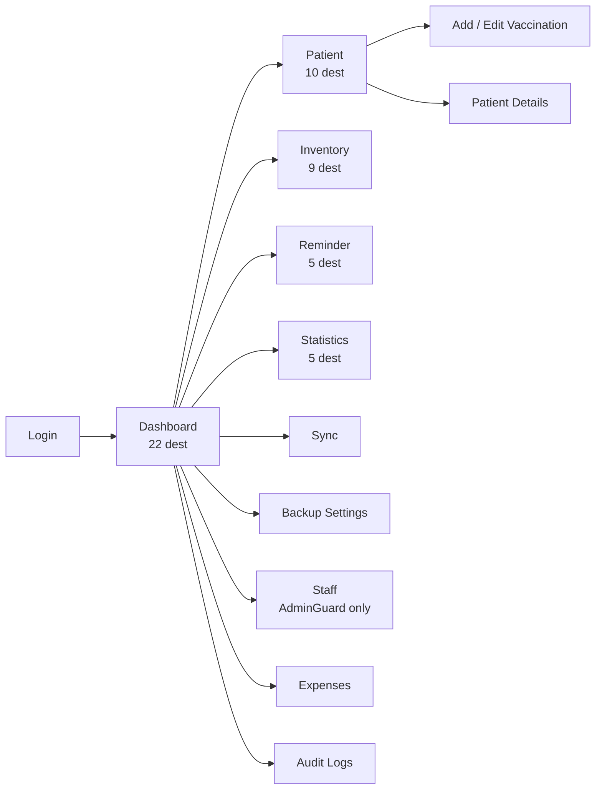
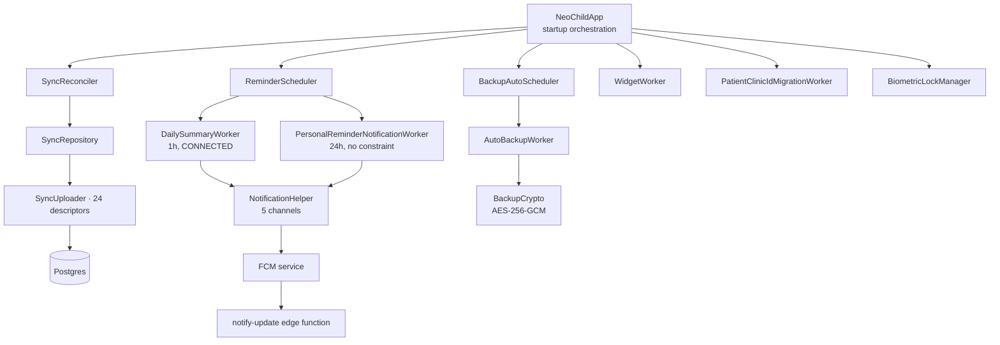

# Architecture Map

> The verified wiring between screens, ViewModels, repositories, Room and Supabase.
> Structural view. Behaviour lives in the feature notes — see [[Home]] for the index.
> Companion: [[Clean Architecture]] (principles) · [[Data Flow]] (runtime paths)

## Package layout

`app/src/main/java/com/neochildclinic/` — 354 Kotlin files, feature-first.

| Package | Files | Role |
|---|---|---|
| `app/` | 9 | `NeoChildApp`, `MainActivity`, `NavHost`, 5 route graphs, `Routes` |
| `core/` | 52 | cache, di, logger, network, notification, preferences, security, sync, ui, common |
| `data/` | 61 | `local/` (entities + 21 DAOs), `remote/`, `backup/` (13 files) |
| `domain/model/` | 36 | pure Kotlin models, no Android imports |
| `feature/*/` | 21 packages | `data` · `domain` · `presentation` each |
| `test/` + `androidTest/` | 49 | 41 unit + 8 instrumented |

## The layer graph

✅ **The dependency rule holds**: no `presentation` file imports a `RepositoryImpl`, and no
`domain` file imports anything Android. Verified by grep.

⚠️ **One deliberate exception**: `core/sync/SyncUploader.kt` (677 lines) holds a static
registry of **24 entity descriptors** and reads Room directly through the whole
`AppDatabase`. It is the de-facto fourth layer, and adding a table means editing it.

## Navigation — 51 destinations, flat

`app/Navigation.kt:83-91` — a single `NavHost` with 5 graph-builder functions.
**No nested graphs** (`grep "navigation("` returns nothing). **No bottom navigation** —
navigation is a `ModalNavigationDrawer` (`DashboardScreen.kt:208`) plus back app bars.

### Route typing

Routes are plain `const val` strings (`app/Routes.kt`), **not** `@Serializable` type-safe
navigation. `Routes.kt:59-67` documents the exact failure mode and fixed it for `brandName`
only (3 params use the `enc`/`dec` helpers). 22 `navigate()` calls still interpolate ids raw.

### Authorization gates — four different idioms

| Gate | Where | Protects |
|---|---|---|
| `AdminGuard` composable | `NavigationDashboardGraph.kt:32-34` | `MANAGE_STAFF`, `STAFF_DETAILS`, `ADD_STAFF`, `EDIT_STAFF` |
| Drawer-item visibility | `AppDrawer.kt:138` | hides staff/audit items when not admin |
| `hasAccess` | `NavigationStatisticsGraph.kt:21` | statistics |
| Server RLS | Postgres | everything, authoritatively |

⚠️ `Routes.AUDIT_LOGS`, `EXPENSES`, `SYNC` and `BACKUP_SETTINGS` have **no navigation
guard** — see [[Known Bugs]] §4.11.

## Dependency injection

| Module | Provides |
|---|---|
| `DatabaseModule.kt:39-137` | `AppDatabase` `@Singleton`, 20 DAO providers — no `BackupDao` provider (`DatabaseModule.kt:139-142`) |
| `SupabaseModule.kt:32` | 7 singletons: client, `Auth`, `CurrentUserProvider`, `Functions`, `Postgrest`, `Realtime`, `Storage` |
| `RepositoryModule.kt:48` | 20 `@Binds` |
| `RemoteDataSourceModule.kt:10` | 1 `@Binds` |

✅ 34 ViewModels, **all** `@HiltViewModel`. Zero `ViewModelProvider.Factory`, zero
`ServiceLocator`.

Two documented exceptions: `AppDatabase.getDatabase()` double-checked locking *and*
`@Singleton`; `BiometricLockManager` is an `object` singleton with mutable global state.

## Feature packages

| Package | ViewModels | Repos | Domain engines |
|---|---|---|---|
| `patient` | 2 | `Patient`, `PatientTodo`, `Document` | `MergePatientsUseCase`, `SearchPatientsUseCase` |
| `vaccination` | 1 | `Vaccination` | `ClinicalVaccinationService`, `VaccinationEditEngine`, `EditReconciler` |
| `consultation` | 1 | `Consultation` | `ConsultationEditEngine` |
| `inventory` | 5 | `Inventory` | `InventoryUtils`, `InventoryStockMovement` |
| `reminder` | 2 | `Reminder` | `ReminderDueListProcessor` |
| `personalreminder` | 2 | `PersonalReminder` | — |
| `borrowed` | 1 | `Borrow` | `BorrowBatchSelection` |
| `waste` | 1 | `Waste` | — |
| `statistics` | 5 | — | `ClinicStatsManager`, `FinanceCalculator`, `ExpenseCalculator` |
| `doctor` | 1 | `DoctorAvailability` | `GetAvailableSlotsUseCase` |
| `finance` | 2 | `Finance`, `Expense` | `ExpenseValidator` |
| `staff` | 1 | `StaffManagement` | — |
| `dashboard` | 1 | — | — |
| `audit` | 1 | `AuditLog` | — |
| `profile` | 1 | `Profile`, `Device` | — |
| `settings` | 3 | `Backup` | — |
| `auth` | 1 (`AuthViewModel` lives in `core/security`) | — | — |
| `search` | 1 | — | — |
| `sync` | 1 | `Sync` | — |
| `update` | 1 | — | — |
| `widget` | — | — | — |

✅ The 7 pure engines are the best-tested code in the app — see [[Testing]].

## Cross-cutting modules

✅ `NeoChildApp` uses `dagger.Lazy` for 6 startup dependencies with a comment explaining
that field injection froze cold start — audit finding #16.

## Where to look for a change

| Changing… | Touches |
|---|---|
| A database column | `data/local/entity/*`, `AppDatabase.kt` (new migration), `SyncUploader.kt` descriptor, and the Postgres migration |
| Sync behaviour | `core/sync/SyncRepositoryImpl.kt`, `core/sync/SyncUploader.kt`, possibly `core/di/RepositoryModule.kt` |
| A screen's empty/error state | the ViewModel's `UiState` data class, then the screen's `collectAsState` block — see [[MVVM]] |
| An inventory calculation | `InventoryStockMovement.kt` (pure) and `InventoryUtils.kt` — both tested |
| A RLS policy | `supabase/migrations/` — remember the migration history is now tracked |

## Related

- [[Clean Architecture]] — why the packages are shaped this way
- [[Data Flow]] — what happens at runtime
- [[Source File Index]] — every file and what it does
- [[Database Relationships]] — the entity graph
- [[Offline Synchronization]] — the sync machinery in depth
