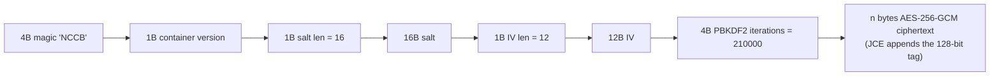
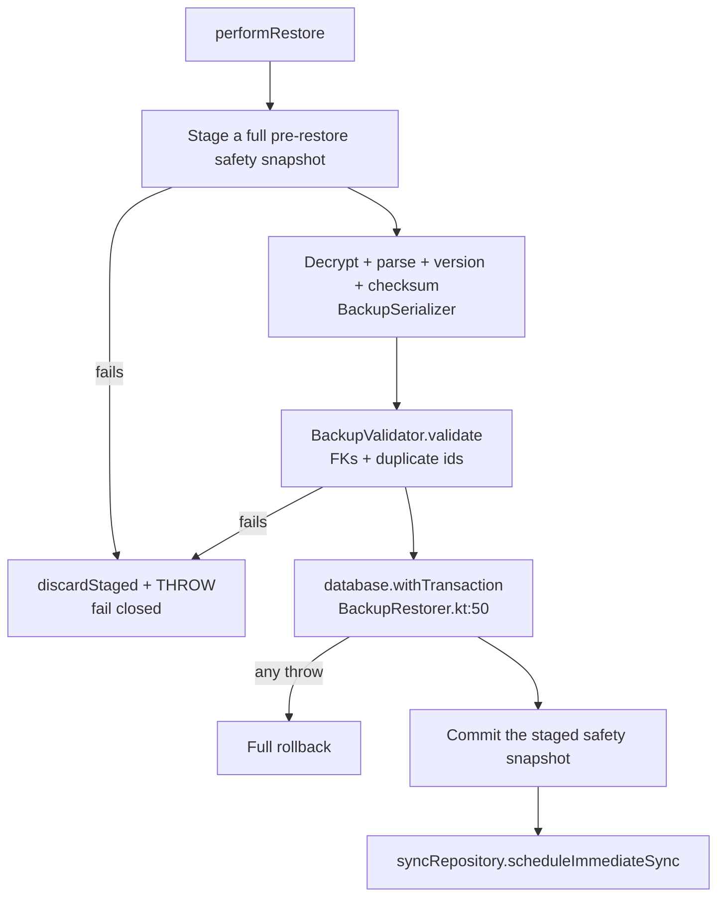

# Backup and Restore

> `data/backup/` — 13 files. The `.nccb` format, its crypto, scheduling, and restore
> conflict resolution. Related: [[Offline-First Architecture]] · [[Room Database]] ·
> [[Supabase]]

## Format

A single JSON envelope, encrypted. `data/backup/BackupModels.kt:29-51`:

```kotlin
@Serializable
data class BackupPayloadV1(
    val profiles, vaccines, vaccineBatches, doctorWeeklySlots, doctorSlotExceptions,
    val patients, visits, vaccinationItems, consultations, reminders,
    val personalReminders, borrowRecords, borrowReturns, wasteRecords,
    val inventoryTransactions, inventoryDeductions, financeTransactions, expenses,
    val patientNotes, consultationTodos, vaccinationTodos, auditLogs
)
```

**22 tables.** ✅ The Room `@Serializable` entities **are** the wire format — there is no
parallel DTO layer, and `@SerialName` produces the same snake_case used for Supabase sync.

Deliberately excluded (`:22-26`): `sync_queue`, `widget_due_cache`, `backup_history`.
✅ `ProfileEntity.fcmToken` is stripped to `null` at collect time
(`BackupCollector.kt:20-21`) — the export carries no push tokens.

Envelope (`:96-109`): `backupVersion` (`CURRENT_BACKUP_VERSION = 1`, `:13`), `backupId`,
app/db versions, `createdAt`, `deviceInfo`, `recordCounts`, `checksum`, `data`.

`BackupSerializer.json` (`data/backup/BackupSerializer.kt:13-18`): `ignoreUnknownKeys`,
`encodeDefaults`, `coerceInputValues` — all three, which is the right combination for forward
compatibility. `BackupMigrator` (`:90-94`) is a no-op extension point.

## Crypto — the strongest code in the repo

`data/backup/BackupCrypto.kt`. Container layout (`:27-40`, `:70-77`):



| Property | Value | Source |
|---|---|---|
| KDF | `PBKDF2WithHmacSHA256`, **210 000** iterations, 16-byte random salt, 256-bit key | `:131-140`, `:49` |
| Cipher | AES-256-GCM | `:70-77` |
| IV | 12 random bytes from a shared `SecureRandom` | `:63` |
| Password clear | `spec.clearPassword()` in a `finally` | `:137` |
| Tag failure | `AEADBadTagException` → `BackupException.WrongPassword` | `:111-115` |
| Buffer underflow | → `Corrupted` | `:116-117` |

✅ Three defences worth calling out:

1. **DoS guard on the file-controlled iteration count** — `:102-104` rejects anything below
   10 000 or above 1 000 000, so a hostile file cannot force a 4-billion-iteration hang.
   Rationale documented at `:50-53`.
2. **`saltLen`/`ivLen` are rebased to unsigned** at `:97`/`:99`, defeating the classic
   negative-length allocation trick.
3. **`MIN_CONTAINER_SIZE`** bounds check at `:57`, `:84`.

`SafetyBackupStore.kt` uses a **separate, device-bound** Keystore AES-256-GCM key
(alias `neochildclinic_backup_safety_key`, `:81-92`), deliberately distinct from the
portable password cipher (rationale at `:18-23`). It uses the correct
**stage → rename → commit** pattern (`:39-55`), so a crash mid-write cannot destroy the
previous good snapshot.

### Weaknesses — all "needs review", none exploitable

| # | Issue | Severity |
|---|---|---|
| 1 | **No AAD.** The header (magic, version, salt, IV, iterations) is not bound into the AEAD, so an attacker can rewrite it. The outcome is a different derived key → tag failure → `WrongPassword`. Envelope integrity is still covered by the tag plus the separate SHA-256 checksum. | Low |
| 2 | **Empty salt is accepted** (`:98` — `saltLen` may be 0). PBKDF2 with an empty salt is valid but weakens the salt. | Low |
| 3 | 7 tests, **none** for malformed `saltLen`/`ivLen` or a truncated container | Low |

## Scheduling

`BackupAutoScheduler.kt:26-50`: `PeriodicWorkRequest<AutoBackupWorker>` at 24 h or 168 h,
with `setRequiresBatteryNotLow(true)` and — **only if cloud is enabled** —
`NetworkType.CONNECTED` (`:36-37`). `ExistingPeriodicWorkPolicy.UPDATE`.

Re-armed once at startup: `NeoChildApp.kt:122-128`.

The unattended-run password is persisted in `EncryptedSharedPreferences`
(`BackupRepositoryImpl.kt:307-317` → `SecurityUtils.saveBackupPassword`,
`core/security/SecurityUtils.kt:83-91`, AES256-SIV keys / AES256-GCM values). The
unavoidable `String` boundary is documented at `:309-311`.

Local destination: app-private `filesDir/backups/automatic/<backupId>.nccb` (`:351-353`),
rotated by mtime (`:374-377`), retention `coerceIn(1, 30)`
(`BackupSettingsManager.kt:50`).

⚠️ **Was: enabling Automatic Backup did not enqueue the worker until the next process
start.** `BackupAutoScheduler.schedule()` had **zero call sites** —
`grep` found only the class declaration, a KDoc mention, and `NeoChildApp.kt:124`
(`rearmIfEnabled`). ✅ Resolved: `BackupViewModel` now calls
`backupAutoScheduler.schedule(...)` at `:209` (`enableAutomaticBackup`) and `:215`
(`updateAutomaticBackupSettings`), and `cancel()` at `:221` (`disableAutomaticBackup`).
Status: [[Quality/Bug Register]] — `NCC-011`.

## Restore — fails closed by design

`BackupRepositoryImpl.performRestore` (`:139-186`), shared by the local and cloud paths:



✅ The staged snapshot is committed **only after** a successful restore (`:175-176`), and a
failed rename there is logged rather than surfaced — *"rather than reporting the already-
applied restore as failed."*

`BackupValidator.kt:47-84` re-checks the same `ForeignKey(...)` declarations the entities
make, plus duplicate-ID detection for 7 tables (`:39-45`). Every failure throws
`BackupException.BrokenRelationships` (`:86-88`).

## Conflict resolution

`BackupRestorer.kt:126-149`, documented at `:20-35`:

| Mode | Tables | Rule |
|---|---|---|
| **Last-write-wins** | `profiles`, `vaccines`, `vaccine_batches`, doctor slots, `patients`, `visits`, `consultations`, `reminders`, `personalReminders`, `expenses`, todos, `wasteRecords` | strict `>` on the entity's timestamp (`:137`) — **equal timestamps keep the local row**, the safe direction |
| **Insert-if-absent** | `borrowRecords`, `borrowReturns`, `patientNotes`, `financeTransactions`, `inventoryTransactions`, `inventoryDeductions`, `auditLogs` (`:204-249`) | append-only ledgers are never overwritten |
| **Follow parent** | `vaccination_items` (`:183-190`) | only re-applied for visits this merge actually wrote |

FK ordering is delete-child-first / insert-parent-first (`:62-86`, `:95-118`), verified to
mirror the entity declarations.

Post-restore resync (`:277-317`) re-enqueues only rows whose `isSynced == false` **and**
that were actually written (`:286`), as `UPDATE` so it upserts by id and cannot create
duplicates. `profiles`, `vaccines`, `vaccine_batches` and `vaccination_items` are excluded
because they carry no `isSynced` column (`:265-270`).

Undo: `restoreSafetyBackup` (`:383-411`) validates the snapshot through the **same**
`BackupValidator` before applying (`:397-400`), then `clear()`s it (`:404-406`).

## Cloud

`CloudBackupApi.kt`: Ktor CIO, 60 s request / 15 s connect timeouts (`:74-77`). Every call
carries the Supabase access token as Bearer (`:92-94`).

✅ **The app never sends an account id the server must trust** (`:33-38`) — the server derives
identity from the token. One automatic session refresh + retry on 401/403 (`:109-117`).

⚠️ Client and server `MAX_BACKUP_BYTES` = 200 MB, checked **before** upload (`:170`) and
before download buffering (`:224-226`) using the real `Content-Length`.

⚠️ **Was: the local-file path had a TOCTOU check.** `readBytesFromUri` queried
`OpenableColumns.SIZE` and compared it against the 200 MB ceiling, then called
`it.readBytes()` **unbounded** — a provider that reported a small size and streamed more
defeated the check. ✅ Resolved: the metadata check (`:432-440`) is still advisory, and the
read itself is now bounded (`:441-459`), throwing `TooLarge` as soon as the running total
crosses `MAX_BACKUP_BYTES` (`:454-455`). Status: [[Quality/Bug Register]] — `NCC-037`.

## The DAO

`data/local/dao/BackupDao.kt` (272 lines) is a **second DAO over 22 tables** that other
DAOs own — 22 × get-all / insert-all / clear-all. Its header (`:12-25`) says this is
deliberate, though the prose at `:16` still says "20 feature DAOs" while the DAO has 22
`getAll…ForBackup` methods (`:32`–`:244`).

✅ It has **no `@Transaction` method**; the atomicity guarantee comes entirely from
`BackupRestorer.kt:50`'s `database.withTransaction`. That makes the invariant invisible if
you only read the DAO.

## Confirmed findings

| # | Finding | Severity | Evidence |
|---|---|---|---|
| 1 | `BackupRestorer` — 318 lines, the most destructive path in the app — has **zero tests** | High | `data/backup/BackupRestorer.kt` |
| 2 | ✅ Auto-backup enable/disable did not schedule until next process start | Medium | was: `BackupAutoScheduler.schedule()` had 0 callers; now called at `BackupViewModel.kt:209`, `:215`, `cancel()` `:221` — `NCC-011` |
| 3 | `BackupCollector`'s FCM-token strip — the only privacy guarantee in the export — is untested | Medium | `BackupCollector.kt:20-21` |
| 4 | ✅ `readBytesFromUri` size check was TOCTOU | Medium | was metadata-only `:432-440`; read now bounded `:441-459` — `NCC-037` |
| 5 | No AAD on the container header | Low | `BackupCrypto.kt:70-77` |
| 6 | Empty salt accepted | Low | `BackupCrypto.kt:98` |
| 7 | `SafetyBackupStore` stage/commit/discard atomicity untested | Medium | `SafetyBackupStore.kt:39-60` |

## Related

- [[Room Database]] — the 22 exported tables
- [[Offline-First Architecture]] — post-restore resync
- [[Architecture Decisions]] — why insert-if-absent for ledgers
- [[Quality/Bug Register]] — current status of every finding above
- [[Known Bugs]] — the 2026-10-16 audit record (superseded in part)
