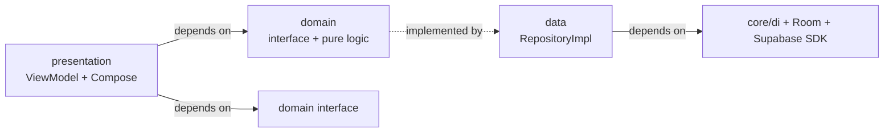

# Clean Architecture

> Layer boundaries as they actually exist in `com.neochildclinic`, verified by reading every
> package in `app/src/main`. Related: [[MVVM]] · [[Offline-First Architecture]] ·
> [[Room Database]] · [[Architecture Decisions]]

## The shape

The app uses a **feature-first** layout, not a strict layer-first one. Clean Architecture
rules are applied *within* each feature rather than across the whole codebase.

```
com.neochildclinic/
├── app/                  NavHost, 5 route graphs, Application, MainActivity
├── core/                 cross-cutting: cache, di, logger, network, notification,
│                         preferences, security, sync, ui, common utils
├── data/                 concrete persistence + backup
│   ├── local/            entities, dao/, database/
│   ├── remote/           PostgREST data sources
│   └── backup/           13 files: crypto, collector, restorer, cloud API
├── domain/model/         36 pure Kotlin models, no Android imports
└── feature/<name>/       data · domain · presentation   ← the Clean Architecture layers
```

Each feature package contains its own `data/` (repository impl), `domain/` (repository
interface + pure engines) and `presentation/` (ViewModel + Compose screen). There are
**21 feature packages**.

## The dependency rule



The rule holds: **presentation and domain never import a repository implementation.**
`presentation` and `data` are siblings that both depend on `domain`. Verified: no
`*ViewModel.kt` imports a `*RepositoryImpl`.

## The one architecture-breaking exception

`core/sync/SyncUploader.kt` (677 lines) sits in `core/`, not in any feature's `data/`, and
it reaches **directly into Room** via the whole `AppDatabase`:

```kotlin
// core/sync/SyncUploader.kt — descriptor.fetch(database, …), descriptor.download(database, …)
```

It holds a static registry of **24 entity descriptors**, each with its own fetch, download,
updatedAt-extractor and delete-filter. This means the sync layer knows about every entity
table in the app. It is the de-facto fourth layer that the package structure hides.

Consequence: adding a table means editing a 677-line file in `core/` plus the Room
migration plus a sync descriptor. See [[Technical Debt]].

## Layer responsibilities as coded

| Layer | Package | May import | Contains |
|---|---|---|---|
| Presentation | `feature/*/presentation` | `domain`, `core/ui`, Compose | ViewModels, screens, `UiState` data classes |
| Domain | `feature/*/domain`, `domain/model` | Kotlin stdlib only | Repository **interfaces**, pure engines, models |
| Data | `feature/*/data`, `data/` | Room, Supabase SDK, Hilt | Repository implementations, DAOs, entities |
| Core | `core/` | everything | DI, sync, cache, security, notification, backup |

`domain/model/` is genuinely pure — 36 model files, no Android imports. The pure-domain
engines (`VaccinationEditEngine.inventoryDiff`, `EditReconciler.classifyItems`,
`InventoryStockMovement.deducted`, `ReminderDueListProcessor`, `AddVaccinationLogic`) are
also dependency-free, which is exactly why they are the only well-tested code in the app.
See [[Testing]].

## Dependency injection

4 Hilt modules, all `@InstallIn(SingletonComponent::class)`:

| Module | File | Provides |
|---|---|---|
| `DatabaseModule` | `core/di/DatabaseModule.kt:39-137` | `AppDatabase` (singleton), 20 DAO providers — no `BackupDao` (`DatabaseModule.kt:139-142`) |
| `SupabaseModule` | `core/di/SupabaseModule.kt:32` | 7 singletons: client, `Auth`, `CurrentUserProvider`, `Functions`, `Postgrest`, `Realtime`, `Storage` |
| `RepositoryModule` | `core/di/RepositoryModule.kt:48` | 20 `@Binds`, interface → impl |
| `RemoteDataSourceModule` | `core/di/RemoteDataSourceModule.kt:10` | 1 `@Binds` |

34 ViewModels, **all** `@HiltViewModel`. Zero `ViewModelProvider.Factory`, zero
`ServiceLocator`, zero `::class.get()` hacks. See [[MVVM]].

### Two DI smells

1. **`AppDatabase` has two competing singletons.** `AppDatabase.getDatabase()` uses
   double-checked locking (`AppDatabase.kt:81-82`, `:442-443`) *and* `DatabaseModule.kt:33-37`
   wraps it in `@Singleton`. Harmless today, but the DB is unreachable in tests without
   reflection.
2. **`BiometricLockManager` is an `object` singleton** (`core/security/BiometricLockManager.kt:7`)
   holding mutable global state and a mutable callback, assigned from `NeoChildApp.kt:90`.
   It bypasses DI entirely.

## Navigation

`app/Navigation.kt:83-91` — a **flat** `NavHost` with 5 graph-builder functions and
**51 destinations**. No nested graphs (`grep "navigation("` returns nothing).

Routes are plain `const val` strings (`app/Routes.kt`), not type-safe `@Serializable` nav.
22 `navigate()` calls interpolate ids raw. `Routes.kt:59-67` documents exactly why that
breaks (a brand name containing `/` makes a destination silently never open) and fixed it
for `brandName` only — every id is still raw. Today all ids are UUIDs so it is latent.

`Routes` literals are also duplicated inside the drawer dispatcher
(`DashboardScreen.kt:218-233`), where **4 of 10 branches are dead** — the drawer only emits
6 routes.

## Clean Architecture verdict

| Aspect | State |
|---|---|
| Layer separation within a feature | ✅ Holds |
| `domain` purity | ✅ Holds — real pure logic |
| Presentation → data leakage | ✅ None |
| Repo-wide consistency | ⚠️ `core/sync/SyncUploader` crosses every boundary |
| Navigation typing | ⚠️ String routes, documented fragility |
| DI purity | ✅ Hilt, with 2 documented exceptions |

## Related

- [[MVVM]] — the presentation layer in detail
- [[Offline-First Architecture]] — the sync layer that breaks the pattern
- [[Architecture Decisions]] — the reasoning behind these choices
- [[Technical Debt]] — duplication and dead code across these layers
