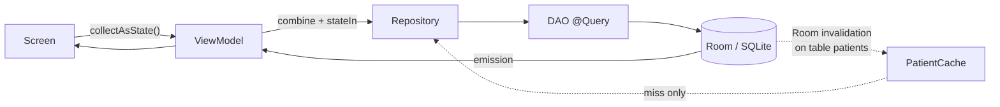
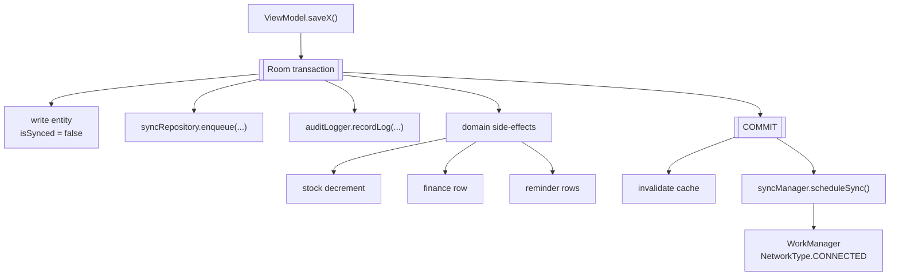
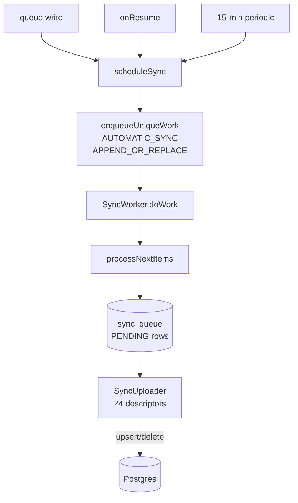
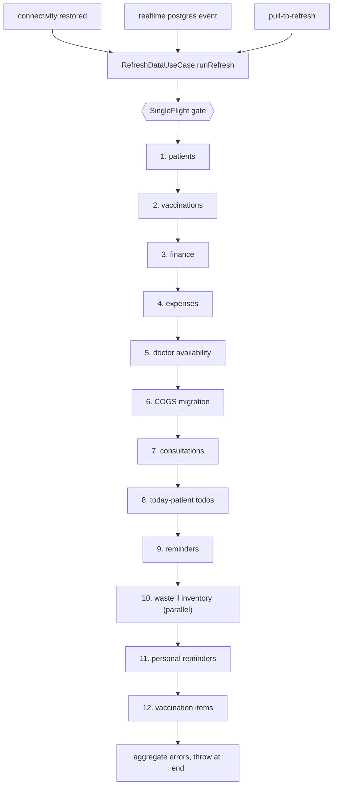
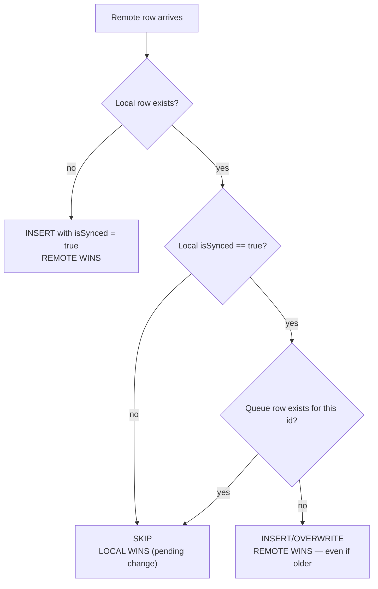
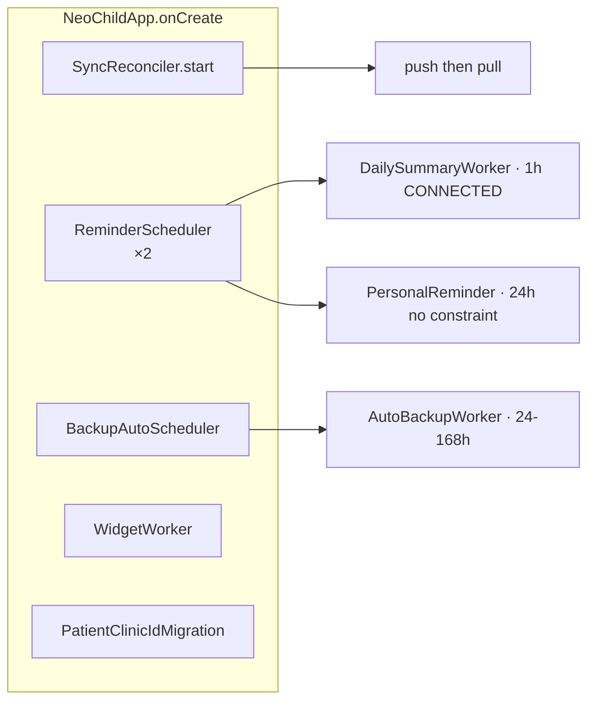
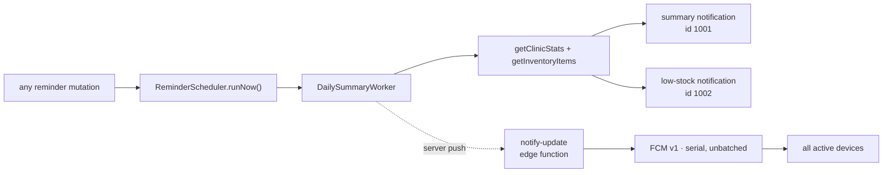
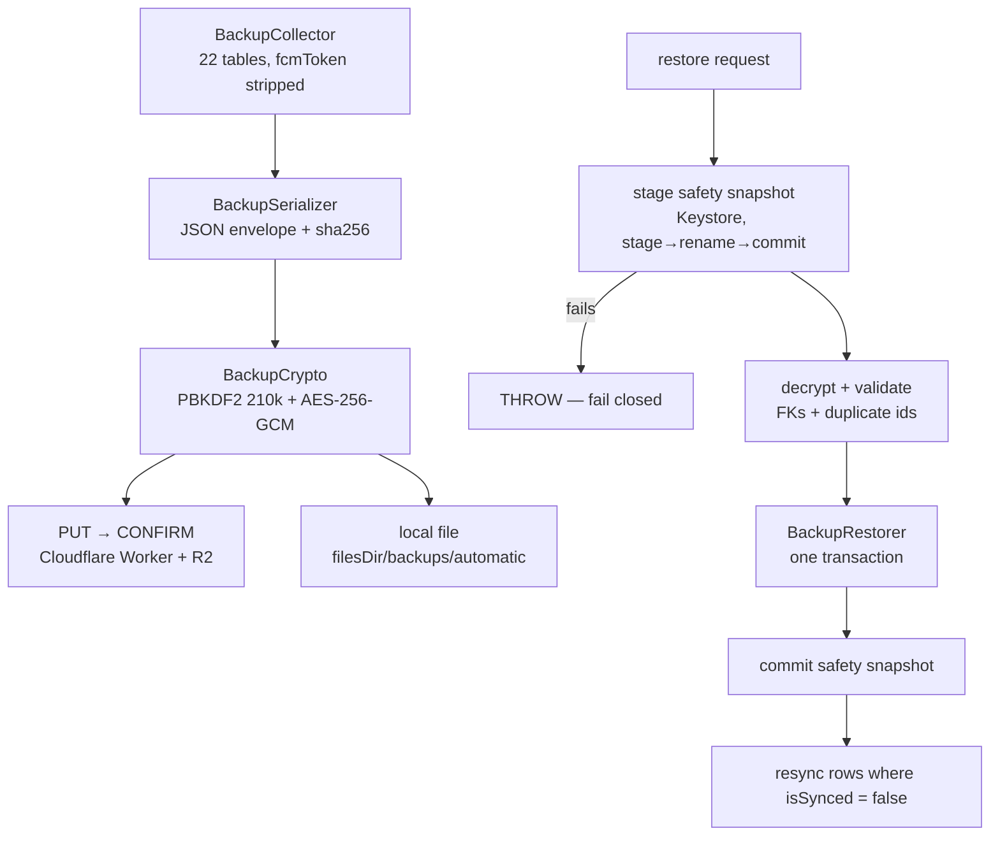

# Data Flow

> What actually happens at runtime, for each class of operation. Verified paths only.
> Companion: [[Offline Synchronization]] (the machinery) · [[Data Flow]] → [[Architecture Map]]

## Read paths — never touch the network

✅ Every list screen reads a live Room `Flow`. A read is network-independent by
construction — the repository returns `Flow<T>` from the DAO and never awaits HTTP.

| Screen | Source |
|---|---|
| Patient list | `PatientRepositoryImpl.kt:86` `allPatients` Flow |
| Dashboard | 4-level `combine` over `ClinicStatsManager` (`DashboardViewModel.kt:223-299`) |
| Due list | `ReminderDueListProcessor.process()` |
| Inventory | `InventoryRepositoryImpl.getInventoryItems` (`getAllVaccines` + `getAllBatches`) |
| Statistics | `FinanceCalculator` / `ExpenseCalculator` over DAO Flows |

### Cache read-through

`PatientCache` (`feature/patient/data/PatientCache.kt`) is the only domain-object cache.
A miss falls through to Room (`PatientCacheTest` covers it). It is invalidated on Room
invalidation of **table `patients` only** — so a vaccination edit does not clear it.

## Write paths — the canonical shape

✅ **Atomic**: the row write, the sync-queue enqueue, the audit row and the domain
side-effects all commit together. A crash mid-write leaves nothing partial.

✅ **Offline**: nothing in this path touches `Postgrest`, `Auth` or `Realtime`.

The best example is `ClinicalVaccinationService.recordVaccination`
(`:52-122`) — **9 tables** in one transaction.

Two writes that used to escape the transaction are now inside it — kept for history:

| Location | What changed |
|---|---|
| `AddVaccinationViewModel.kt:685-695` | reminder loop removed; reminders pass into `recordVaccination` as `reminderSpecs` (NCC-004) |
| `InventoryRepositoryImpl.addStockBatch` (`:250`) | batch loop now wrapped in `transactionRunner.run` (NCC-018) |

Both are in [[Known Bugs]].

## The seven transactional write paths

| Path | Tables | Transaction |
|---|---|---|
| `recordVaccination` | 9 | ✅ `ClinicalVaccinationService.kt:52` |
| `addPatient` | 2 + queue | ✅ `PatientRepositoryImpl.kt:157` |
| `deletePatient` | cascades + queue | ✅ `:208` |
| `deleteVaccination` | 6 + stock reversal | ✅ `VaccinationRepositoryImpl.kt:392` |
| `recordConsultation` / `editConsultation` | 3 | ✅ `ConsultationEditEngine.kt:23` |
| `addBatch` / `deductStockFromBatch` / `reverseDeduction` | 3 | ⚠️ **caller must wrap** |
| `recordWaste` / `saveBorrowedItem` | 3 | ✅ wrapped by the caller |

## Sync trigger flow

⚠️ `scheduleSync()` fires **per queued row** and uses `APPEND_OR_REPLACE`, so one
`deletePatient` can chain dozens of work requests. See [[Known Bugs]] §3.1.

## Pull / refresh flow

13 steps in FK-safe order (`feature/sync/domain/RefreshDataUseCase.kt:57-127`). Each is
wrapped in `runRefreshStep` so **one failure does not abort the rest**; errors aggregate
and throw at the end.

⚠️ Two pull paths have **no tombstone application** — a row deleted on device B survives on
device A: `ReminderRepositoryImpl.refreshReminders()` and
`PersonalReminderRepositoryImpl.refresh()`. See [[Known Bugs]] §3.6.

## The conflict rule, in one diagram

✅ **There is no clock comparison on the pull side.** "Last puller wins" — see
[[Offline Synchronization]] and [[Architecture Decisions]] §4.

## Background work

⚠️ Both `ReminderScheduler`'s schedule methods and `BackupAutoScheduler.schedule()` have
**no call site after startup** — settings changes do not reschedule. See [[Known Bugs]]
§2.4 and §2.5.

## Notification flow

⚠️ `runNow()` is **non-unique**, so N reminder mutations enqueue N workers, each doing a
full stats recompute.

## Backup / restore flow

## Where flows can break

| Flow | Weakest link | Bug |
|---|---|---|
| Read | `PatientCache` not cleared on vaccination edit | stale object for up to 5 min |
| Write | reminder loop now inside the visit transaction | §1.3 (fixed) |
| Sync push | `SingleFlight` wrapper discards the result | §2.3 |
| Sync pull | no tombstones | §3.6 |
| Realtime | `.catch {}` kills the subscription permanently | §3.7 |
| Stock | lost-update race, no `@Version` | §3.3 |
| Backup | `BackupRestorer` untested, 318 lines | — |

## Related

- [[Architecture Map]] — static structure
- [[Offline Synchronization]] — sync internals
- [[Inventory Management]] — the most consequential write path
- [[Backup and Restore]] — export/restore internals
- [[Known Bugs]] — every flow's failure mode
