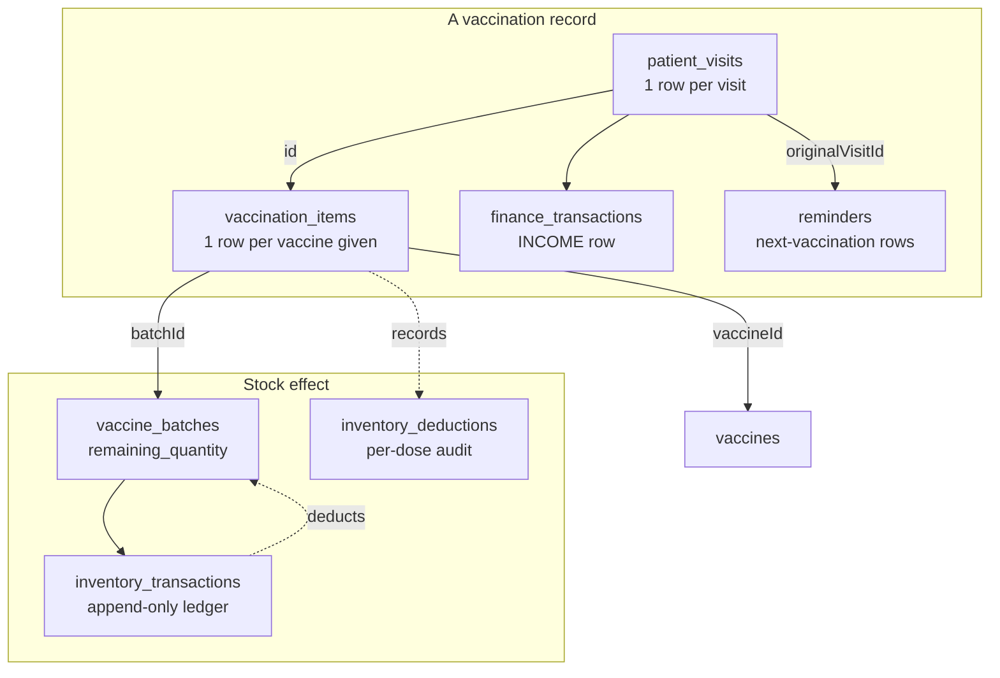
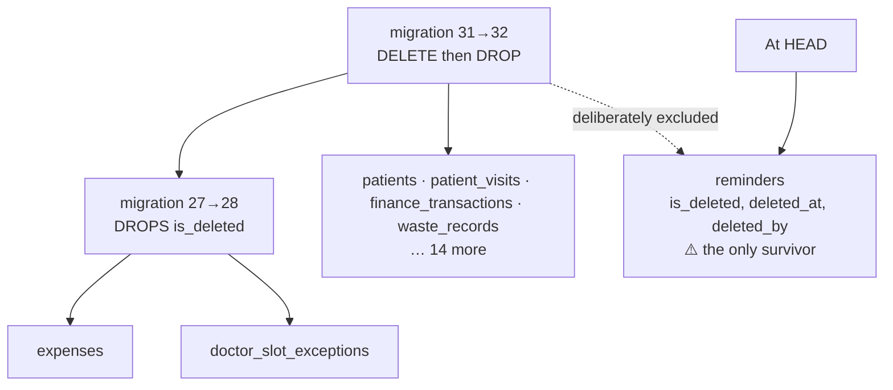
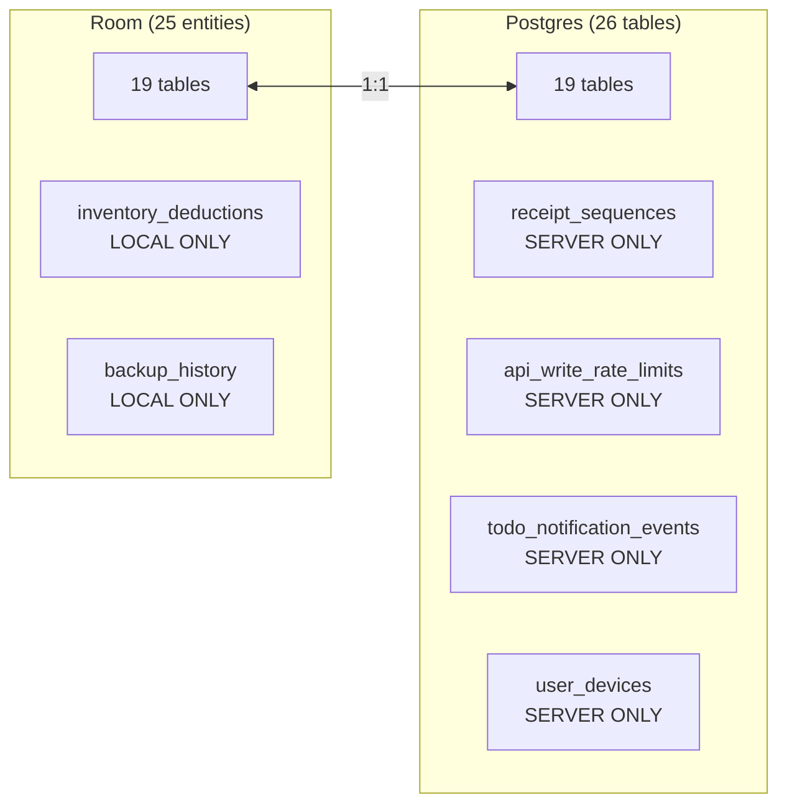

# Database Relationships

> The verified entity graph, foreign keys, and the Room ↔ Postgres correspondence.
> Companion: [[Room Database]] (local detail) · [[Database Schema]] (server detail)
> · [[Row Level Security]]

## Entity relationship diagram

Derived from `foreignKeys` declarations and the exported `app/schemas/…/33.json`.

```mermaid
erDiagram
    PATIENTS ||--o{ PATIENT_VISITS : "id (CASCADE)"
    PATIENTS ||--o{ REMINDERS : "patientId (CASCADE)"
    PATIENTS ||--o{ PATIENT_NOTES : "patientId (CASCADE)"
    PATIENTS ||--o{ CONSULTATIONS : "patientId (CASCADE)"
    PATIENTS ||--o{ PERSONAL_VACCINE_REMINDERS : "patient_id (CASCADE)"
    PATIENTS ||--o{ FINANCE_TRANSACTIONS : "patientId (no FK)"

    PATIENT_VISITS ||--o{ VACCINATION_ITEMS : "vaccinationId (CASCADE)"
    PATIENT_VISITS ||--o{ INVENTORY_TRANSACTIONS : "visitId (no FK)"
    PATIENT_VISITS ||--o{ INVENTORY_DEDUCTIONS : "vaccinationId (no FK)"
    PATIENT_VISITS ||--o{ REMINDERS : "originalVisitId (no FK)"
    PATIENT_VISITS ||--o{ FINANCE_TRANSACTIONS : "visitId (no FK)"
    PATIENT_VISITS ||--o{ CONSULTATIONS : "visitId (CASCADE)"
    PATIENT_VISITS ||--o{ WIDGET_DUE_CACHE : "derived"

    VACCINES ||--o{ VACCINE_BATCHES : "vaccineId (CASCADE)"
    VACCINES ||--o{ VACCINATION_ITEMS : "vaccineId (CASCADE)"
    VACCINES ||--o{ INVENTORY_TRANSACTIONS : "vaccineId (no FK)"
    VACCINES ||--o{ WASTE_RECORDS : "vaccineId (no FK)"
    VACCINES ||--o{ BORROW_RECORDS : "vaccineId (CASCADE)"
    VACCINES ||--o{ PERSONAL_VACCINE_REMINDERS : "vaccine_id (SET NULL)"

    VACCINE_BATCHES ||--o{ VACCINATION_ITEMS : "batchId (CASCADE)"
    VACCINE_BATCHES ||--o{ INVENTORY_TRANSACTIONS : "batchId (no FK)"
    VACCINE_BATCHES ||--o{ BORROW_RECORDS : "batchId (CASCADE)"
    VACCINE_BATCHES ||--o{ WASTE_RECORDS : "batchId (no FK)"
    VACCINE_BATCHES ||--o{ BORROW_RETURNS : "batch_id (CASCADE)"

    BORROW_RECORDS ||--o{ BORROW_RETURNS : "borrow_record_id (CASCADE)"

    PROFILES ||--o{ USER_DEVICES : "user_id (no FK, server only)"
    PROFILES ||--o{ DOCTOR_WEEKLY_SLOTS : "doctor_id (no FK, server)"
    PROFILES ||--o{ DOCTOR_SLOT_EXCEPTIONS : "doctor_id (no FK, server)"
```

> `CASCADE` = the entity declares `onDelete = CASCADE`. `no FK` = the column exists and is
> used in queries, but the entity declares **no** foreign key — referential integrity is
> the application's responsibility.

## Foreign keys actually declared

✅ Every `@Entity` that expresses a relationship **does** declare `foreignKeys`. Zero cases
of an implied-but-missing FK.

| Child table | Parent | On delete |
|---|---|---|
| `patient_visits` | `patients` | CASCADE |
| `reminders` | `patients` | CASCADE |
| `patient_notes` | `patients` | CASCADE |
| `consultations` | `patients` | CASCADE |
| `consultations` | `patient_visits` | CASCADE |
| `personal_vaccine_reminders` | `patients` | CASCADE |
| `personal_vaccine_reminders` | `vaccines` | **SET NULL** |
| `vaccination_items` | `patient_visits`, `vaccines`, `vaccine_batches` | CASCADE |
| `vaccine_batches` | `vaccines` | CASCADE |
| `borrow_records` | `vaccines`, `vaccine_batches` | CASCADE |
| `borrow_returns` | `borrow_records`, `vaccine_batches` | CASCADE |

### Tables with reference columns but **no** declared FK

| Table | Columns | Note |
|---|---|---|
| `inventory_transactions` | `vaccineId`, `batchId`, `visitId` | Ledger rows outlive their references deliberately |
| `inventory_deductions` | `vaccinationId` | never synced; see [[Database Schema]] |
| `finance_transactions` | `patientId`, `visitId` | financial history must survive |
| `waste_records` | `vaccineId`, `batchId` | acknowledged in `VaccineDao.kt:118-121` |
| `consultation_todos`, `vaccination_todos` | `patient_id?` | optional by design |
| `doctor_weekly_slots`, `doctor_slot_exceptions` | `doctorId` | targets `profiles`, server-side only |

✅ **Room DOES enforce these at runtime in this project.** This was previously recorded as
🔍 unverified (`PRAGMA foreign_keys` is framework behaviour, not visible in source), and was
settled empirically on 2026-10-18: the first real execution of `androidTest` in CI failed 17
tests with `SQLiteConstraintException: FOREIGN KEY constraint failed (code 787)`.

Three consequences worth knowing:

1. **A child insert without its parent row fails.** Instrumented fixtures must seed parents
   in FK order — `reminders` needs a `patients` row; `vaccination_items` needs
   `patient_visits`, `vaccines` **and** `vaccine_batches`.
2. **The tables listed above without a declared FK are genuinely unenforced.** A dangling
   `finance_transactions.visit_id` or `inventory_deductions.vaccinationId` is accepted by
   SQLite; only the application's own logic keeps them honest. This raises the stakes on
   those columns being cleaned up deliberately.
3. **It is a real runtime constraint, not a lint suggestion** — an entity that declares an
   FK it cannot satisfy is a production crash, not a warning.

## The clinical core

**The rule**: `patient_visits` is the aggregate root. Deleting it cascades to
`vaccination_items`, `consultations` and (via the app) `reminders`, `finance_transactions`
and `inventory_deductions` — but **not** `inventory_transactions`, which is append-only.

⚠️ Deleting a visit reverses stock through `inventory_deductions`, not through the ledger.
That is deliberate: the ledger is history, the deduction table is the reversible
intent. Audit finding #3 (fixed) had this backwards — deleting a patient restored every
administered dose; the fix clears deductions before deleting visits.

## Soft-delete topology

✅ Nothing in `app/src/main` writes `is_deleted = 1`. Only `migration31_32`'s own
`DELETE FROM` references it (`AppDatabase.kt:408`). See [[Known Bugs]] §1.4 for the
filtering inconsistency that survives.

## Room ↔ Supabase correspondence

⚠️ **The drift that matters**: `inventory_deductions` has **no `SyncEntityDescriptor`** —
the per-dose audit trail of every dose that left a batch never reaches the server.
`sync_queue` and `widget_due_cache` exist in Postgres with RLS-on/zero-policies and are not
in the Room schema. See [[Database Schema]].

## Entity counts

| Layer | Count |
|---|---|
| `@Entity` classes in `data/local/entity/` | **25** across 21 files |
| `BackupDao` second surface over other DAOs' tables | 20 |
| `BackupPayloadV1` tables exported | 22 |
| Postgres tables | 26 |
| Room migrations registered | 16 (v17 → v33) |

## Related

- [[Room Database]] — every entity's fields and indices
- [[Database Schema]] — the Supabase/Postgres side, migrations, drift
- [[Row Level Security]] — who may read and write these rows
- [[Backup and Restore]] — restore must recreate the FK ordering
- [[Architecture Map]] — where these entities sit in the layer graph
