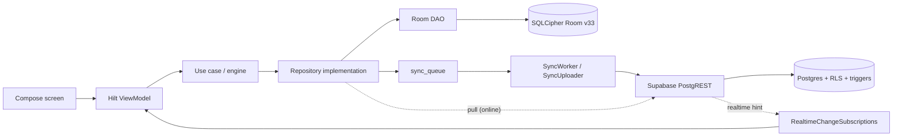
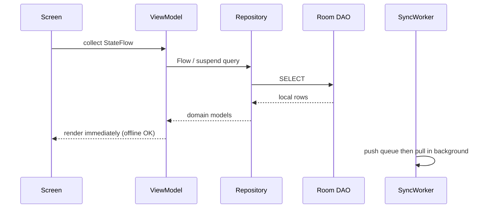
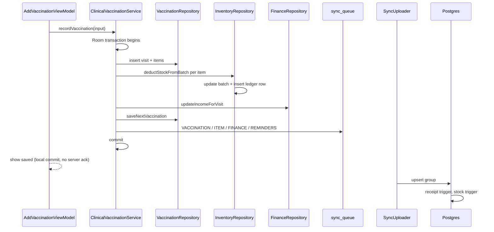
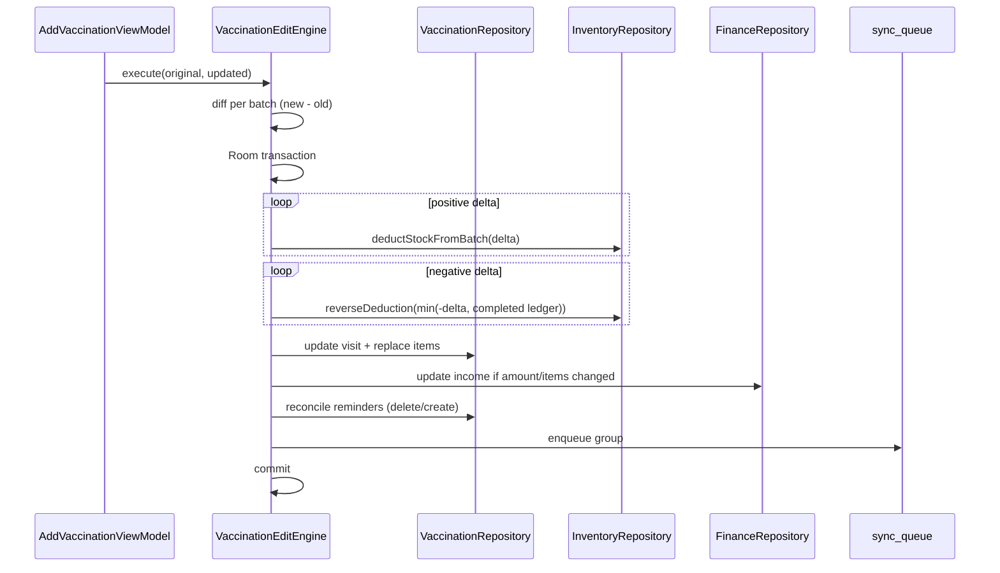
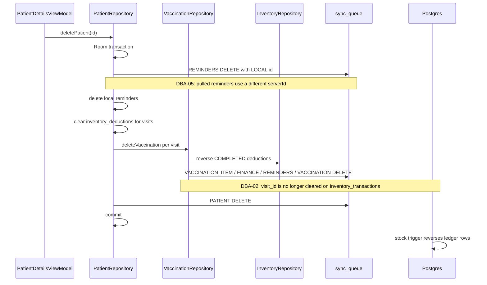
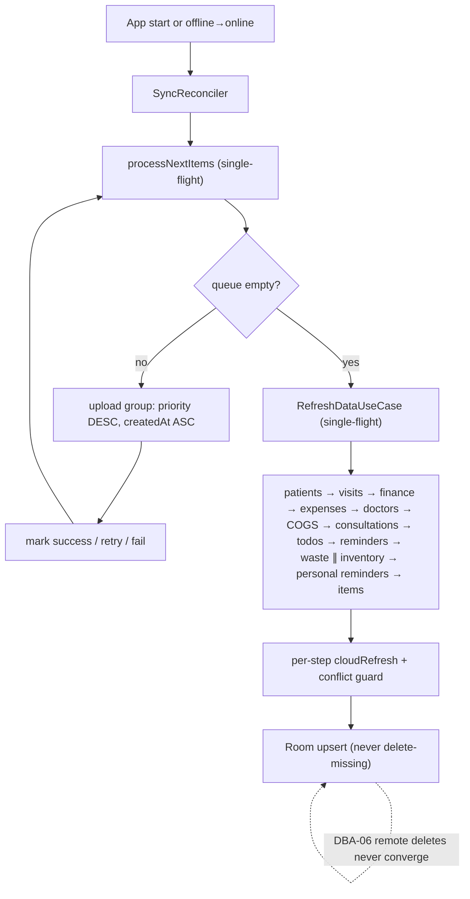
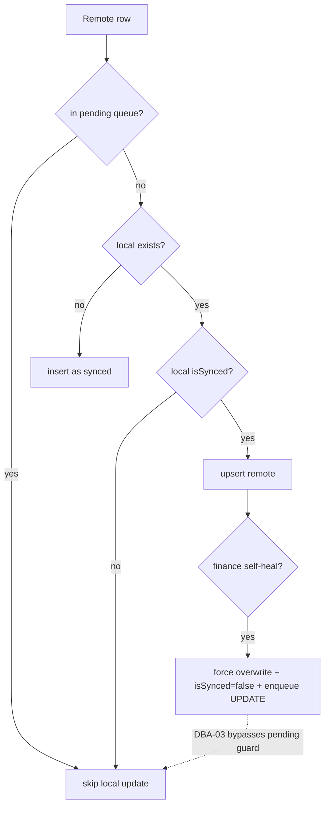
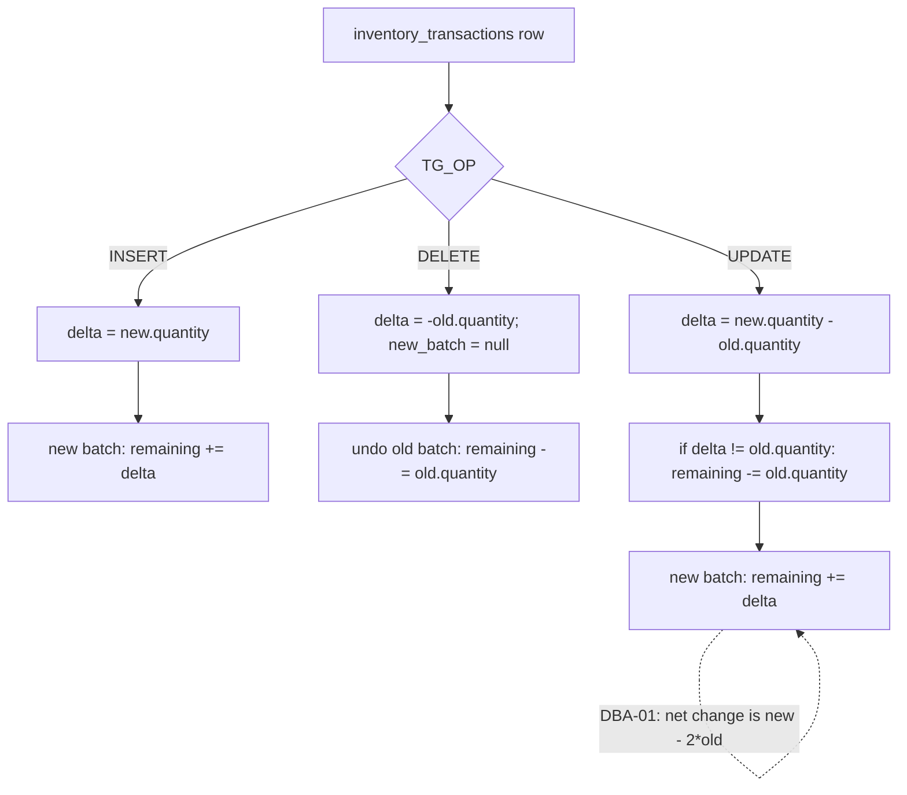

# Data-Flow Diagrams

All diagrams describe verified HEAD behavior. Red notes mark confirmed defects; they are not target-state designs.

## 1. Context

## 2. Local-first read

## 3. Vaccination create

## 4. Vaccination edit (diff-based)

Single-device double deduction is not present at HEAD: the diff is computed once, reversals are capped by COMPLETED deduction rows, and the whole edit is one transaction. The server retry path can still corrupt stock (DBA-01).

## 5. Visit / patient deletion

## 6. Startup / reconnect sync

## 7. Pull conflict decision

## 8. Stock trigger behavior (actual)

Correct behavior for an UPDATE is one of:

- same batch: `remaining += (new.quantity - old.quantity)` with no separate undo; or
- move: `old.remaining -= old.quantity` and `new.remaining += new.quantity`.
