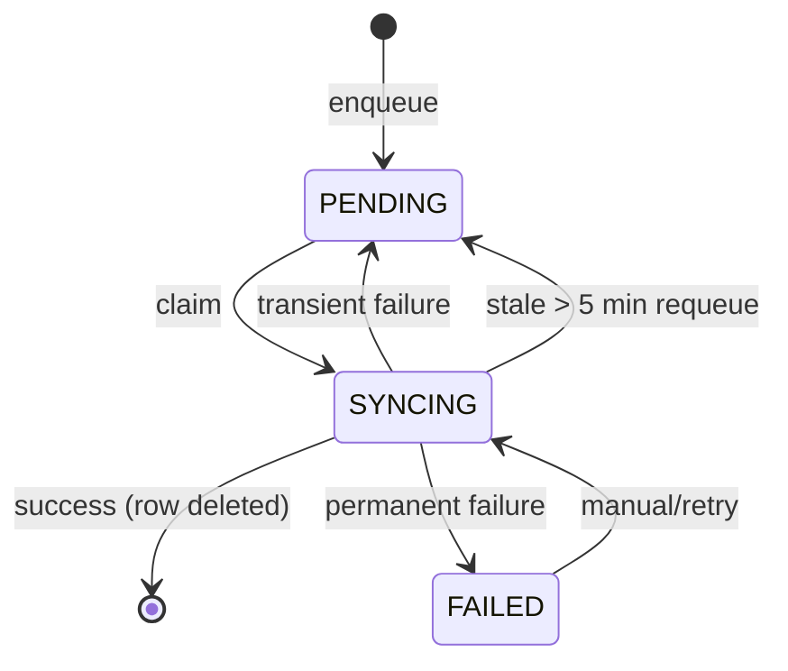
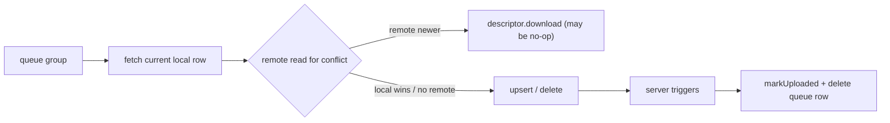

# Room ↔ Supabase Sync Model

## 1. Entity registry

| Queue entity | Remote table | Priority | Downloader | Notes |
| --- | --- | --- | --- | --- |
| `PATIENT` | `patients` | 1 | yes | pull guarded; clinic-id conflict branch bypasses guard |
| `VACCINATION`, `VISIT` | `patient_visits` | 2 | yes | receipt assigned on insert |
| `VACCINE` | `vaccines` | 1 | yes | catalog |
| `BATCH` | `vaccine_batches` | 2 | yes | stock owned by trigger on INSERT path |
| `DOCTOR_WEEKLY_SLOT` | `doctor_weekly_slots` | 2 | yes | owner/admin writes |
| `VACCINATION_ITEM` | `vaccination_items` | 3 | yes | child of visit |
| `WASTE` | `waste_records` | 3 | yes | stock movement |
| `BORROW` | `borrow_records` | 3 | yes | — |
| `CONSULTATION` | `consultations` | 3 | yes | shares visit header |
| `CONSULTATION_TODO`, `VACCINATION_TODO` | todo tables | 3 | yes | dashboard day list |
| `DOCTOR_SLOT_EXCEPTION` | `doctor_slot_exceptions` | 3 | yes | owner/admin writes |
| `TRANSACTION`, `INVENTORY_TRANSACTION` | `inventory_transactions` | 4 | **no** | upload-only append-only ledger |
| `FINANCE` | `finance_transactions` | 4 | yes | deterministic visit-income id |
| `EXPENSE` | `expenses` | 4 | yes | — |
| `BORROW_RETURN` | `borrow_returns` | 4 | yes | partial return |
| `REMINDERS`, `PATIENT_NOTE`, `AUDIT_LOG`, `PERSONAL_REMINDER` | respective tables | 5 | yes | audit is append-only |
| `PROFILE`, `STAFF` | `profiles` | 100 | **no** | UPDATE-only; no insert/delete policy |

Primary keys: most use `id`; inventory ledger uses local `transactionId`/remote `id` (`remotePkColumn`).

## 2. Queue schema and state machine

`sync_queue`: autoincrement `queueId`, `entityName`, `entityId`, `operation`, `priority`, `status`, `retryCount`, `lastError`, `transactionGroupId`, `createdAt`, `updatedAt`.

States:

- Claim + stale recovery are protected by `SingleFlight` inside one process.
- Dedupe: `deletePendingDuplicates(entity, id, operation)` then insert. **Not atomic** (`SyncRepositoryImpl.kt:68-83`).
- Success deletes the row and sets `isSynced=1` on the local entity where the schema has that column.

## 3. Ordering

`processNextItems` groups the queue and sorts:

1. **CREATE/UPDATE groups**: smallest priority first, then earliest `createdAt`.
2. **DELETE groups**: reversed dependency order (children/line items before parents).
3. **Shared `transactionGroupId`**: enqueue order, not priority order.
4. **Ungrouped items**: singleton groups sorted by priority/time.

This is covered by `SyncOrderingTest` (6 tests), including DELETE/child-unlink cases.

Known ordering hazards:

- Patient-delete reminder DELETEs are ungrouped and `LOW`, while the patient DELETE is `MEDIUM`; the parent can upload first.
- `AuditLogger` enqueues outside the business transaction and without a group.
- A queue duplicate for the same entity can upload twice; upserts are idempotent except for the stock trigger (DBA-01).

## 4. Outbound pipeline

- Uploads send the **current** local row, not the payload captured at enqueue time.
- `visitId`/nullable fields use an explicit-nulls encoder only for `FinanceEntity` and `InventoryTransactionEntity`.
- `VaccineBatchEntity` omits `remaining_quantity` on UPDATE because the server trigger owns stock.
- `AuditLogEntity` uses duplicate-tolerant INSERT (append-only RLS).
- `ProfileEntity` uses UPDATE (no INSERT policy for normal clients).
- Receipt number is read back after visit insert and written locally.

## 5. Inbound pipeline

`RefreshDataUseCase` runs 13 steps (waste and inventory in parallel), each wrapped in `cloudRefresh`. One failing step does not stop later steps; auth failures are always rethrown.

| Step | Pull | Conflict guard |
| --- | --- | --- |
| patients | all rows, `is_deleted=false` | pending set + `isSynced`; **conflict branch bypasses both** (DBA-23) |
| visits | all rows | pending set + `isSynced` + missing-patient skip |
| finance | all rows | pending set + `isSynced`, but heal branch overrides (DBA-03) |
| expenses | all rows | pending set |
| doctors | weekly slots + exceptions | pending set |
| COGS migration | local finance/vaccination read | idempotent local update |
| consultations | all rows | pending set; no parent-existence check |
| todos | all rows | pending set |
| reminders | all rows | pending set, orphan-visit skip |
| waste | all rows | pending set |
| inventory | vaccines + batches | pending sets |
| personal reminders | all rows | pending set; no parent check |
| vaccination items | all rows | grouped per visit; replace set |

Borrows are pulled only by the Borrowed screen (`refreshBorrows`), not by this pipeline.

## 6. Conflict policy

| Entity | Policy | Effective behavior |
| --- | --- | --- |
| Generic | local pending edit wins | pull skips if a queue row exists |
| Generic | otherwise newer remote timestamp wins | `isoToLong` comparison |
| Finance | no local timestamp | local always uploads; pull normally respects pending set |
| Finance + date mismatch | self-heal | **overwrites pending local row** and re-enqueues UPDATE |
| Inventory ledger | no downloader | pull not used; upload-only |
| Profiles | no downloader, UPDATE-only | no conflict read; last write wins |
| Audit logs | append-only | duplicate insert ignored |
| Deletes | no tombstones | remote deletion is invisible locally |

## 7. Server-side invariants

| Invariant | Mechanism | State |
| --- | --- | --- |
| Receipt assigned once | `neo_assign_receipt_number()` trigger, immutable on UPDATE | correct |
| Stock cannot go negative | guard in `update_batch_stock()` | correct guard, wrong UPDATE arithmetic (DBA-01) |
| Stock applied once per ledger row | one trigger + duplicate-trigger cleanup | code correct; live trigger count unknown |
| Audit append-only | RLS INSERT+SELECT only; client duplicate-tolerant insert | correct |
| Role/status checks | `is_active_staff()` | active staff only; no fine-grained role checks |
| Write throttling | `20260929001000_write_rate_limit.sql` | present; specifics in 08 |

## 8. Trigger deployment history

1. Legacy trigger `tr_update_batch_stock` applied by hand, not in a migration.
2. `20261016` installs a second trigger after checking only its own name → double application.
3. `20261017` drops the legacy trigger, rewrites the function with the negative guard, but introduces/retains the wrong UPDATE arithmetic.
4. `20261018` ensures the trigger exists, failing loudly if not installed.

Live state must be verified. The repository fixes do not prove the production database applied them, and `20261017` cannot repair historical corruption.

## 9. Idempotency analysis

| Operation | Retry behavior | Verdict |
| --- | --- | --- |
| Patient/vaccine/visit/item upsert | same PK, same payload | idempotent |
| Receipt-number visit insert | trigger preserves existing number | idempotent |
| Finance upsert | deterministic visit-income id; same payload | idempotent |
| Expense/waste/borrow/reminder upsert | same PK | idempotent |
| Stock ledger INSERT retry | PostgREST conflict → UPDATE → broken trigger | **not idempotent (DBA-01)** |
| Stock ledger DELETE retry | delete + trigger undo, second delete no-op | idempotent |
| Visit delete with ledger FK | can fail permanently if FK exists | **not convergent (DBA-02)** |
| Queue enqueue duplicate | extra upsert | harmless except stock path |
| Pull | upsert only | **not convergent for deletes (DBA-06)** |
