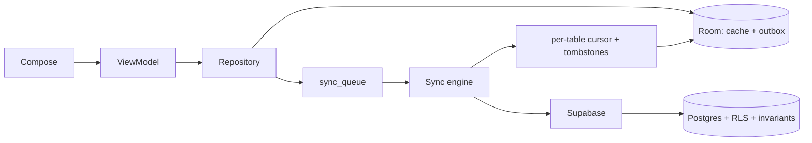

# Target Architecture

This is a minimal target, not a rewrite. The existing layers, outbox and transaction discipline are worth keeping. The changes below close the specific failure modes in the issue register.

## 1. Principles

1. **Room remains the UI source of truth.** No screen should query Supabase directly.
2. **The outbox remains transactional.** Every local business write and its queue row commit together.
3. **Server invariants are authoritative.** Stock, receipts and authorization must be correct even if the client is malicious or retries.
4. **Pulls have no business side effects.** A pull may upsert/delete cache rows; it must not enqueue writes, change pending edits, or “heal” data silently.
5. **Deletes need tombstones.** Upsert-only synchronization cannot converge.
6. **Append-only means append-only.** Stock corrections should be compensating ledger rows, not UPDATEs to historical rows.
7. **Reads stay open per product decision; writes/deletes follow a role matrix.**
8. **YAGNI.** Do not build a generic sync framework, conflict-merge engine, or CRDT layer. Fix the tables and paths that exist.

## 2. Data flow target



Rules:

- Repository reads are Room-only. A repository may expose `refresh()` but screens do not call it on composition; one coordinator owns refresh.
- Uploads use operation-aware semantics:
  - CREATE → `insert ... on conflict do nothing` (idempotent retry, no trigger UPDATE);
  - UPDATE → explicitly allowed and tested;
  - DELETE → idempotent.
- Pulls are cursor-based and apply tombstones in the same transaction as the upsert batch.

## 3. Stock model target

### Immediate (defense in depth)

Fix `update_batch_stock()` UPDATE arithmetic:

```sql
-- same batch
update vaccine_batches
set remaining_quantity = remaining_quantity + (new.quantity - old.quantity)
where id = new.batch_id;

-- moved row
update vaccine_batches set remaining_quantity = remaining_quantity - old.quantity
where id = old.batch_id;
update vaccine_batches set remaining_quantity = remaining_quantity + new.quantity
where id = new.batch_id;
```

Add a `CHECK (remaining_quantity >= 0)`-equivalent guard inside the function (keep the existing error code/message) and a trigger test matrix (T-01).

### Target

- Treat `inventory_transactions` as immutable. A quantity/batch correction inserts a **new** compensating row; it never updates the ledger.
- Give each client movement a stable idempotency key (`transactionId` already exists). Upload CREATE with `on conflict do nothing`; if the row exists, the movement was already applied.
- The trigger only needs INSERT/DELETE semantics; the UPDATE branch remains fixed as a safety net but is no longer exercised.
- Add a read-only reconciliation view:

```sql
create view inventory_reconciliation as
select b.id,
       b.remaining_quantity as recorded,
       coalesce(sum(t.quantity), 0) as ledger_total,
       b.remaining_quantity - coalesce(sum(t.quantity), 0) as drift
from vaccine_batches b
left join inventory_transactions t on t.batch_id = b.id
group by b.id, b.remaining_quantity;
```

`drift <> 0` is an operational alarm, not something the app silently repairs.

`vaccine_batches.remaining_quantity` remains a server-derived cached value. The client may display its local mirror but must not treat it as authoritative after a failed upload.

## 4. Delete and convergence target

Minimum viable tombstone design:

- Add `deleted_at timestamptz`, `deleted_by uuid` to synced business tables (some already have them).
- App deletes become soft deletes server-side. `DELETE` RLS remains admin-only and is not used by the app.
- Pull query: `updated_at > cursor OR deleted_at > cursor` (or a dedicated `sync_changes` view). Rows with `deleted_at != null` are tombstoned in Room (hard delete locally is fine once no pending child exists).
- Keep a retention/purge job (e.g. 90 days) only after all active devices have advanced their cursor. If cursor tracking is too much for the first iteration, a full-ID diff per table is acceptable as a stopgap:

```text
remoteIds = select id where deleted_at is null
for local in table where id not in remoteIds and id not in pendingQueue:
    delete local
```

The diff approach is O(table size) and network-heavy; the cursor/tombstone approach is the target. Do not hard-delete server rows until clients can observe tombstones.

## 5. Reminder identity

- Keep `id` (local) + `serverId` (remote), or simplify by making the client generate UUIDs and using them as both local and remote ids. The second option removes this class of bug permanently; it requires a migration of existing reminders.
- One cleanup helper: `deleteReminderEverywhere(reminder)` always uses `serverId ?: id`, always joins the parent's transaction group, and always orders child deletes before the parent.
- Align unique keys. Recommended server key: `(patient_id, original_visit_id, due_date, vaccine_name, type)`; the current server key ignores `due_date`, while Room includes it. De-duplicate existing rows before creating the index.

## 6. Conflict and timestamp model

- Server-stamp `updated_at = now()` on every write; never trust a client clock for conflict ordering.
- Preserve `created_at` on updates (trigger or explicit column list).
- Conflict policy:
  - if a local row has a PENDING queue entry, remote changes do not overwrite it; the eventual upload wins/last-writer-wins is resolved server-side;
  - otherwise apply remote.
- Remove “self-healing” writes from pulls. Repairs run as an explicit admin task with an audit record.

## 7. Refresh and cache target

- One `RefreshCoordinator` with per-table `SingleFlight` keys.
- Each table stores `last_pulled_at` and optionally an ETag/cursor in a small `sync_state` table (local-only).
- Screen refresh calls the coordinator, not repositories.
- Manual refresh surfaces a non-blocking “showing data from HH:mm” state; automatic refresh failures do not pretend to be current.
- Stock history reads Room once the ledger is pulled; until then it is explicitly labelled “online only”.
- Audit history may remain online-only but must show an offline state, not an empty success state.

## 8. Security target

Proposed role matrix (product decision required before SQL):

| Resource | Read | Write | Delete |
| --- | --- | --- | --- |
| Patients | all active staff | admin, doctor, receptionist | admin |
| Visits/items/consultations/reminders | all active staff | admin, doctor | admin (or doctor for same-day correction) |
| Finance transactions | admin, doctor | admin, doctor | admin |
| Expenses | admin, doctor | admin, doctor | admin, doctor |
| Vaccines/batches/ledger | all active staff | admin, inventory_manager | admin |
| Waste/borrow | all active staff | admin, inventory_manager, doctor | admin |
| Audit logs | all active staff | insert only (append-only) | nobody |
| Profiles | all active staff | self (guarded), admin via edge function | admin via edge function |
| Doctor schedules | all active staff | owning doctor, admin | owning doctor, admin |
| Backups/storage | admin | admin | admin |

Implementation notes:

- Keep `is_active_staff()` for SELECT.
- Add `is_admin()`, `has_role(text[])` helpers based on `app_metadata.role`.
- Use `WITH CHECK` on every UPDATE.
- Prefer explicit per-operation policies over `FOR ALL`.
- Test every role with SQL, including deactivated users.

## 9. Observability

Minimal, useful signals:

- Sync health: pending count, oldest pending age, failed count by entity, last successful pull per table.
- Stock drift: count of batches with `remaining_quantity != sum(ledger.quantity)`.
- Receipt gaps: sequence vs visits per financial year.
- Orphan check: reminders/consultations/items whose parent is missing.
- Pull errors by step, not just a generic snackbar.
- Log redaction: no patient names, tokens, keys, or full URLs with query parameters.

These can be a debug screen plus SQL views; no external monitoring stack is required for a single clinic.

## 10. Migration strategy

- **Expand/contract** for schema changes: add columns/tables first, deploy dual-read/write if needed, backfill, then remove old paths.
- Every destructive migration gets a preflight count and a loud abort if the assumption fails (the pattern already used for duplicate unique indexes).
- Server migration and Android release ordering:
  1. server accepts old+new clients;
  2. ship client that writes new fields;
  3. backfill;
  4. enable new constraints;
  5. remove old fields in a later release.
- Data repair (stock, finance dates, orphan reminders) is a separate, reviewed, backed-up operation — never bundled with a code release.

## 11. What not to build

- A full offline CRDT/merge engine: the product is single-clinic, last-writer-wins with pending protection is enough.
- A generic SQL abstraction or ORM replacement.
- Client-side authorization as the primary control.
- A new sync framework; keep `sync_queue` and add the missing constraints/cursors.
- Cross-device real-time stock reservations: a server-side guard plus reconciliation view is smaller and safer.
