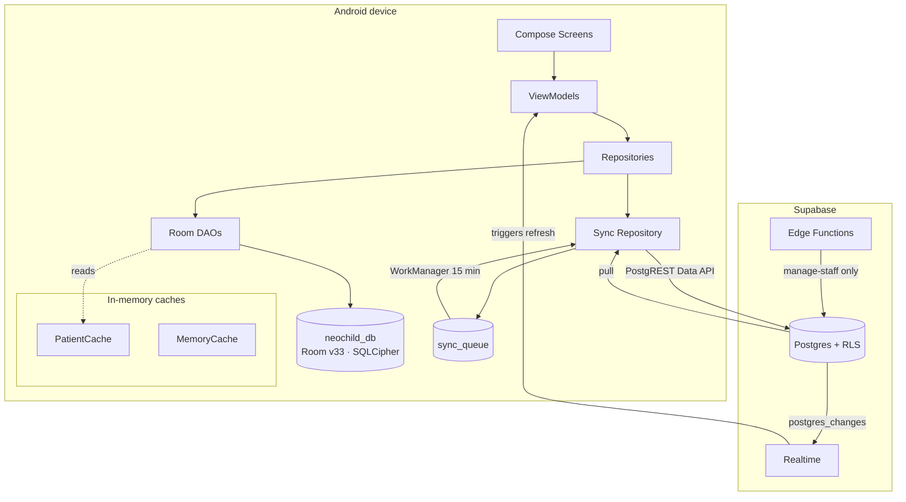

# Neo Child Clinic — Knowledge Base

> Index for the `Neo Child Clinic` Android app (package `com.neochildclinic`).
> Generated from source at commit state of **2026-10-16**. Every claim is cited to a file.
> See [[Neo Child Clinic]] for the original project hub.

## What this app is

An offline-first Android clinic app for a paediatric vaccination centre: patients,
vaccinations, batch-level vaccine inventory, finance, reminders, doctor availability,
consultations, and statistics. Kotlin + Jetpack Compose, Hilt, Room (SQLCipher), and a
Supabase/Postgres backend reached through the Data API.

## Start here

| If you want to… | Read |
|---|---|
| Understand the layering | [[Clean Architecture]] |
| Understand a screen end to end | [[MVVM]] |
| Understand data flow to/from the server | [[Offline-First Architecture]] |
| Understand why the app works with no network | [[Offline-First Architecture]] |
| Understand the local database | [[Room Database]] · [[Database Schema]] |
| Understand the backend | [[Supabase]] · [[Row Level Security]] |
| Understand the money/stock rules | [[Inventory Management]] |
| Find out what is broken | [[Known Bugs]] |
| Understand a decision that was made | [[Architecture Decisions]] |
| See what is untested | [[Testing]] |

## Architecture

- [[Clean Architecture]] — module layout, the data flow, what belongs where
- [[MVVM]] — the UI patterns actually used, and the four that coexist inconsistently
- [[Offline-First Architecture]] — sync queue, push/pull, conflict resolution, realtime
- [[Caching]] — the three cache layers and their invalidation rules
- [[Error Handling]] — every error idiom in the app, counted, and which ones lose data

## Data & Backend

- [[Room Database]] — v33, 25 entities, 21 DAOs, 16 migrations
- [[Database Schema]] — full table inventory, client/server drift
- [[Supabase]] — edge functions, triggers, migrations, rate limiting
- [[Row Level Security]] — the policy matrix, role tiers, and the gaps
- [[Backup and Restore]] — `.nccb` format, AES-GCM crypto, conflict resolution on restore

## Features

- [[Patient Management]]
- [[Vaccination Management]]
- [[Inventory Management]]
- [[Due Vaccination]]
- [[Statistics Dashboard]]

## Engineering

- [[Known Bugs]] — verified defects, ranked
- [[Architecture Decisions]] — what was decided and why
- [[Technical Debt]] — duplication, dead code, complexity
- [[Testing]] — what is covered and what is not
- [[Feature Roadmap]] — suggested order of work
- [[Release Notes]]

## Project facts (verified)

| Fact | Value | Source |
|---|---|---|
| Kotlin files (main) | 351 | `app/src/main/**/*.kt` |
| Kotlin files (test) | 43 | 38 unit + 5 instrumented |
| Lines of Kotlin (main / test) | ~47,230 / ~4,470 | `wc -l` |
| ViewModels | 34, **all** `@HiltViewModel` | `grep -rl @HiltViewModel` |
| `@Singleton` bindings | 46 | `grep -rl @Singleton` |
| DAOs | 21 | `data/local/dao/` |
| Room entities | 25 across 21 files | `AppDatabase.kt:16-40` |
| Room version | 33, 16 migrations registered | `AppDatabase.kt:42`, `:435-440` |
| SQL migrations | 21 files, **only 4 tracked in git** | `git ls-files supabase/migrations/` |
| Supabase edge functions | 2 | `manage-staff`, `notify-update` |
| Unit tests passing | 252, 0 failures (recorded 2026-10-16 14:33) | `app/build/test-results/` |
| Instrumented tests | 5, **no recorded result** | `app/src/androidTest/` |

## Mermaid — system at a glance

## Ground rules for this vault

- New notes link with `[[double bracket]]` wikilinks; every link must resolve to a real file in this vault.
- Claims carry a `path:line` citation. A claim without one is a hypothesis.
- Bugs go in [[Known Bugs]] with a severity and a reproduction.
- Architecture changes get an entry in [[Architecture Decisions]].

## Conventions used here

- ✅ **Confirmed** — provable by reading the cited code.
- ⚠️ **Suspect** — a real smell whose impact could not be proven from source alone.
- 🔍 **Unverified** — needs a live database, a device, or a build that was not run.
