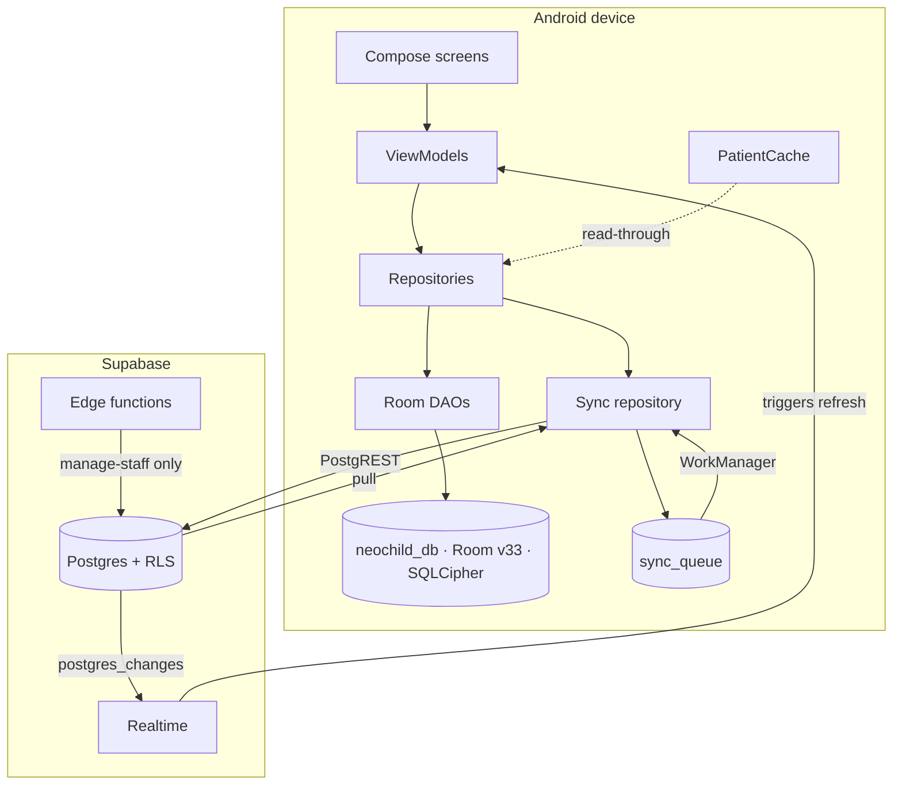

# Neo Child Clinic — Knowledge Base

> **Project dashboard.** Generated from source at **2026-10-19**, commit `0972ed9`.
> Every claim carries a `path:line` citation. Start at [[Architecture Map]] or
> [[Quality/Bug Register]].
> Conventions and evidence rules: [[Documentation Maintenance]].

## Status at a glance

| | |
|---|---|
| Version | **0.5.1** (`versionCode 3`) |
| Room schema | **33** — 25 entities, 21 DAOs, 16 migrations |
| Supabase | 26 tables, 29 migrations, 2 edge functions |
| Kotlin | 354 main files · 49 test files |
| Tests | **277 unit passing**, 0 failures (2026-10-18) · 56 instrumented in 8 files, 🔍 **green in CI 2026-10-18** |
| Open bugs | **4 confirmed open** · 37 fixed · 1 needs decision · 2 not a bug · 13 security · 7 hypotheses (2 refuted 2026-10-18) |
| 🚨 Deadline | **`auto_expose_new_tables` removed 2026-10-30** — see NSC-005 |

## Start here

| If you want to… | Read |
|---|---|
| Understand the whole system | [[Architecture Map]] |
| Understand what happens at runtime | [[Data Flow]] |
| Understand the backend | [[Supabase]] · [[Row Level Security]] · [[Database Schema]] |
| Understand the local database | [[Room Database]] · [[Database Relationships]] |
| Understand sync | [[Offline Synchronization]] · [[Offline-First Architecture]] |
| **Find out what is broken** | [[Quality/Bug Register]] |
| Understand a decision that was made | [[Architecture Decisions]] |
| Understand a screen end to end | [[MVVM]] · [[Clean Architecture]] |
| See what is untested | [[Testing]] |
| Ship something | [[Release Checklist]] |
| Change this vault | [[Documentation Maintenance]] |

## Architecture

- [[Architecture Map]] — packages, layers, DI, navigation
- [[Clean Architecture]] — the principles and where they break
- [[MVVM]] — the UI patterns actually used, and the four that coexist
- [[Data Flow]] — read, write, sync, pull, notification and backup flows
- [[Offline-First Architecture]] — the narrative of the sync design
- [[Offline Synchronization]] — the machinery: triggers, queue, conflicts, retries
- [[Caching]] — three cache layers and their invalidation
- [[Error Handling]] — 15 idioms counted, 60 unguarded launches
- [[Source File Index]] — every source root and what is load-bearing

## Data and backend

- [[Room Database]] — v33, entities, migrations, converters
- [[Database Relationships]] — the entity graph, FKs, client/server drift
- [[Database Schema]] — Postgres tables, migration timeline, drift
- [[Supabase]] — triggers, edge functions, rate limiting
- [[Row Level Security]] — the policy matrix, role tiers, gaps
- [[Backup and Restore]] — `.nccb` format, AES-GCM, restore conflict modes

## Features

- [[Patient Management]] · [[Vaccination Management]] · [[Inventory Management]]
- [[Due Vaccination]] · [[Statistics Dashboard]]

## Quality

- [[Quality/Bug Register]] — 44 tracked defects (37 fixed, 4 open, 1 needs decision, 2 not a bug), canonical status
- [[Quality/Security Concerns]] — 13 items, 5 need a live database
- [[Quality/Hypotheses]] — 7 unproven claims kept separate; 2 refuted on 2026-10-18
- [[Quality/Audit Reconciliation]] — ⚠️ **read before fixing anything**
- [[Technical Debt]] — dead code, duplication, complexity
- [[Testing]] — 277 tests and the 12 untested critical paths

## Audit archives

- [[Database-Audit/00_Index]] — 17-note database and data-access audit
- [[Full-Code-Audit/00_Index]] — whole-project code audit and remediation roadmap
- [[Quality/Karpathy Principles]] — the review principles used for the audits

## Delivery

- [[Feature Roadmap]] — 8 stages, every task linked to a bug ID
- [[Release Checklist]] — build, tests, migrations, security, docs
- [[Release Notes]] — version history

## System at a glance



## Verified project facts

| Fact | Value | Source |
|---|---|---|
| Kotlin files (main) | 354 | `app/src/main/**/*.kt` |
| Kotlin files (test) | 49 | 41 unit + 8 instrumented |
| Lines of Kotlin | ~47,749 main · ~5,642 test | `wc -l` |
| ViewModels | 34, **all** `@HiltViewModel` | `grep -rl @HiltViewModel` |
| `@Singleton` bindings | 46 | `grep -rl @Singleton` |
| Navigation entries | 51, in 5 `NavGraphBuilder` groups | `app/Navigation.kt:83-91` |
| Room entities / DAOs / migrations | 25 / 21 / 16 | `AppDatabase.kt:16-40` |
| Room version | 33 | `AppDatabase.kt:42` |
| SQL migrations | 29, all git-tracked | `git ls-files supabase/migrations/` |
| Supabase tables / edge functions | 🔍 26 / 2 | — |
| Unit tests passing | 277, 0 failures (2026-10-18) | `app/build/test-results/` |
| Instrumented tests | 8 files, 56 `@Test`, 🔍 green in CI 2026-10-18 | `app/src/androidTest/` |

## Validate this vault

```bash
python3 scripts/validate_docs.py --strict
```

Checks links, heading and block anchors, Dataview blocks, orphans, Mermaid blocks, required
sections, stubs, secret patterns and the bug register's status vocabulary. Its own tests:
`python3 scripts/test_validate_docs.py`.
Runs in CI as a **separate job** — the plain run blocks, `--strict` is advisory. See
[[Documentation Maintenance]].

## Ground rules

- ✅ **Confirmed** — provable by reading the cited code.
- ⚠️ **Suspect** — a real smell whose impact could not be proven from source alone.
- 🔍 **Unverified** — needs a live database, a device, or a build that was not run.

A claim without a citation is a hypothesis. **Never** mark a bug fixed without evidence
against the original reproduction — see [[Quality/Audit Reconciliation]] for why.

## Related

- [[Neo Child Clinic]] — the original project hub
- [[Welcome]] — Obsidian's own start page

## Development Dashboard

Requires the **Dataview** and **Tasks** community plugins, both installed
(`.obsidian/community-plugins.json`).

### Open Tasks

```dataview
TASK
FROM ""
WHERE !completed
```

### Recently Updated Notes

```dataview
TABLE file.mtime AS "Last Updated"
FROM ""
SORT file.mtime DESC
LIMIT 10
```
