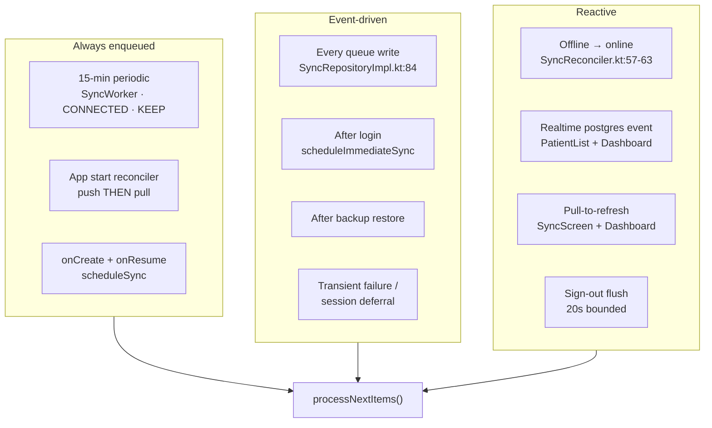
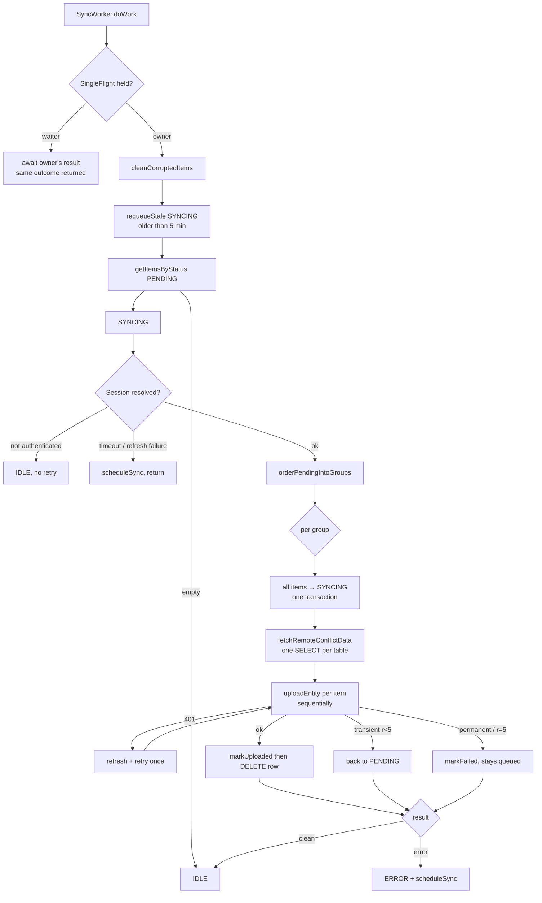
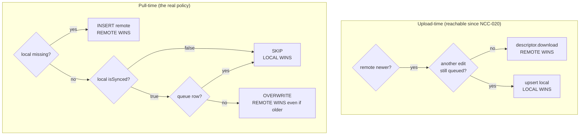
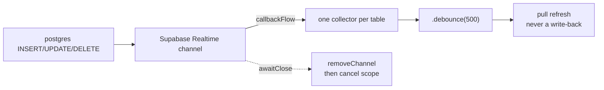

# Offline Synchronization

> The sync machinery in depth: triggers, queue, upload, pull, conflicts, retries,
> realtime, and where it breaks. Verified against source.
> Companion: [[Offline-First Architecture]] (narrative) · [[Data Flow]] (runtime)
> · [[Caching]]

## The guarantee

✅ A user can add, edit and delete a patient or a vaccination **with no network at all**.
Proven by trace: no path from a write to the database touches `Postgrest`, `Auth` or
`Realtime`.

## Trigger map



## Upload sequence



## Queue mechanics

`sync_queue` columns (`data/local/entity/SyncQueueEntity.kt:11-27`):
`entityName`, `entityId`, `operation`, `priority`, `status`,
`transactionGroupId`, `retryCount`, `lastError`, `createdAt`, `updatedAt`.

| Fact | Detail |
|---|---|
| Ack mechanism | the row is **deleted**, never written as `SYNCED` (`SyncQueueDao.kt:58-63`) |
| Dedup | `deletePendingDuplicates` + `@Insert(REPLACE)` — ⚠️ no unique index, documented `shortcut:` |
| Ordering | `orderPendingIntoGroups` (`:676-697`), re-sorted deterministically |
| Retry cap | **5 attempts**, then `FAILED` |
| Backoff | WorkManager only — **no per-item timer in the queue** |
| `FAILED` rows | retried only manually from the Sync screen |

### Group ordering — why it exists

`sync_queue` orders by `priority DESC` on a **TEXT** column, so `"HIGH"` sorts **last**
(`SyncQueueDao.kt:12`). Harmless, because `orderPendingIntoGroups` re-sorts:

1. group by `transactionGroupId ?: UUID.randomUUID()`
2. sort groups by `(min sortKey, min createdAt)`, negating the sort key for `DELETE`
3. within a group: exact enqueue order by `(createdAt, queueId)`

The negation exists because a server-side FK (`finance_transactions_visit_id_fkey`) rejects
a parent delete while children still reference it — so **children unlink before parents
delete**. This is why every delete path enqueues the parent last. See
[[Architecture Decisions]] §5.

Pinned by `SyncOrderingTest` (6 tests).

## Pull sequence

`RefreshDataUseCase.runRefresh()` (`:51-127`) — 14 steps in FK-safe order, each wrapped in
`runRefreshStep` so one failure does not abort the rest; errors aggregate and throw at the
end.

```
patients → vaccinations → finance → expenses → doctor availability
→ COGS migration → consultations → today-patient todos → reminders
→ (waste ‖ inventory, parallel) → personal reminders → vaccination items
```

✅ `CloudRefresh.cloudRefresh(tag, rethrow = true)` **always rethrows a session-shaped
failure** even when the caller asked to swallow errors — an expired token aborts the
refresh rather than silently leaving stale data. Covered by `CloudRefreshTest` (6).

## Conflict resolution — two mechanisms



⚠️ This branch used to be **unreachable**. It required `!isUnsynced(...)`
(`SyncUploader.kt:514-516`), but `processGroup` commits the item to `SYNCING` **before**
uploading (`SyncRepositoryImpl.kt:281-285` → `:297`), and `isUnsynced` matches
`status != 'SYNCED'` — true for the in-flight row itself. ✅ Resolved by excluding it:
`!isUnsyncedExcluding(entityName, entityId, queueId)` (`SyncUploader.kt:517-520`,
`SyncQueueDao.kt:76-77`), so remote-newer self-heal can now run. Status:
[[Quality/Bug Register]] — `NCC-020`.

**Effective policy**: a pending local change makes local authoritative until pushed;
otherwise **last puller wins, with no clock comparison.**

## Retry and failure classification

`isTransientSyncError` (`SyncRepositoryImpl.kt:582-600`):

| Condition | Classification |
|---|---|
| `IOException`, `HttpRequestException` | transient |
| `RestException` 408 / 429 / 5xx | transient |
| 401 | handled earlier — refresh + one inline retry, never classified |
| anything else | **permanent** → `markFailed` immediately |

⚠️ `check_violation` (the stock trigger's negative guard) arrives as HTTP **400** →
permanent → **the whole sync group is marked `FAILED`**. The visit never reaches the server
and nothing reconciles it automatically.

## Realtime

Only two subscription sites, both in `core/sync/RealtimeChangeSubscriptions.kt`:

| ViewModel | Channel | Tables | Action |
|---|---|---|---|
| `PatientListViewModel.kt:110-112` | `patients-db-changes` | `patients`, `patient_visits`, `consultations` | `.debounce(500)` → full `refreshDataUseCase()` |
| `DashboardViewModel.kt:215-217` | `todays-patients-db-changes` | `consultation_todos`, `vaccination_todos` | `.debounce(500)` → `patientTodoRepository.refresh()` |



✅ Setup removes any pre-existing channel with the same name first (`:44-46`).
✅ Teardown ordering is correct and documented (`:91-107`).

⚠️ `.catch { }` on each table flow used to **permanently terminate that subscription on
first error, with no resubscribe** — the screen kept a live-looking ViewModel with a dead
channel. ✅ Resolved in `RealtimeChangeSubscriptions.kt:59-82`: a retry loop with exponential
backoff that also treats a self-completing stream as a failure (`:67-70`). Status:
[[Quality/Bug Register]] — `NCC-024`.

## Cache interaction

Three layers, all in front of Room. Room invalidation of table `patients` clears
`PatientCache` (`PatientRepositoryImpl.kt:66-68`); a refresh clears it wholesale (`:154`).
See [[Caching]].

## Known failure modes

| # | Failure | Mechanism |
|---|---|---|
| 2.3 | ✅ waiter reported success | fixed: `processNextItems()` returns the flight's result (`SyncRepositoryImpl.kt:103-104`); `SingleFlight` hands waiters the owner's outcome (`SingleFlight.kt:27-35`) — register `NCC-009` |
| 3.1 | ✅ unbounded work chain | fixed: `APPEND_OR_REPLACE` + per-row scheduling replaced with `ExistingWorkPolicy.REPLACE` (`SyncManagerImpl.kt:37-41`, `:59-63`) — register `NCC-019` |
| 3.2 | ✅ conflict branch unreachable | fixed: the guard now excludes the in-flight row (`SyncUploader.kt:517-520`) — register `NCC-020` |
| 3.5 | `priority DESC` on TEXT sorts HIGH last | cosmetic, re-sorted downstream |
| 3.6 | ✅ absence reconciliation | fixed: synced rows the remote set no longer lists and no queue entry claims are pruned on every pull (`core/sync/RemotePrune.kt:29-59`; register `NCC-023`) — see `docs/SYNC.md` merge rules |
| 3.7 | ✅ realtime died permanently | fixed: `.catch {}` replaced by a retry loop with backoff (`RealtimeChangeSubscriptions.kt:59-82`) — register `NCC-024` |
| — | items stuck `SYNCING` invisible to the counter | `getPendingCount()` counts only `PENDING` (`SyncQueueDao.kt:42-43`) |
| — | ~~`Result.failure()` cancels appended dependents~~ | **refuted** — `REPLACE` leaves no appended chain ([[Quality/Hypotheses]] HYP-002) |

All detailed in [[Quality/Bug Register]] (authoritative status); finding text for the
pre-2026-10-18 state is preserved in [[Known Bugs]].

## Related

- [[Offline-First Architecture]] — the same system, narrated
- [[Data Flow]] — runtime paths
- [[Caching]] — the read-side acceleration
- [[Room Database]] — `sync_queue` lives here
- [[Quality/Bug Register]] — every sync defect with status
