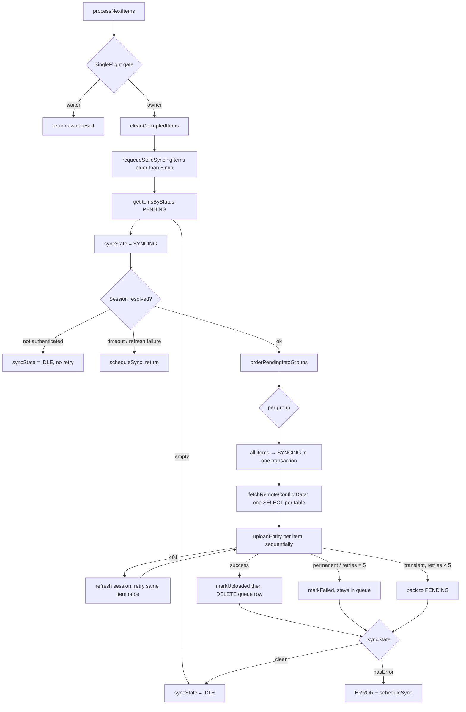

# Offline-First Architecture

> Sync, queue, conflict resolution, and the offline guarantees — traced end to end from
> source. Related: [[Caching]] · [[Room Database]] · [[Clean Architecture]] · [[Known Bugs]]

## The guarantee, stated first

✅ **A user can add, edit, and delete a patient or a vaccination with the network
completely unavailable.** No path from a write to a database touches `Postgrest`, `Auth`,
or `Realtime`. Proven by tracing the write paths below.

## Triggers — everything that starts a sync

| Trigger | Code | What runs |
|---|---|---|
| App process start | `app/NeoChildApp.kt:155-169` | `PeriodicWorkRequest<SyncWorker>` 15 min, `NetworkType.CONNECTED`, unique `"SyncWork"`, `KEEP` |
| App process start | `app/NeoChildApp.kt:83` | `SyncReconciler.start()` → push **then** pull |
| `MainActivity.onCreate` | `app/MainActivity.kt:87` | `scheduleSync()` |
| `MainActivity.onResume` | `app/MainActivity.kt:187` | `scheduleSync()` |
| After login | `core/security/AuthViewModel.kt:256` | `scheduleImmediateSync()` (expedited) |
| After backup restore | `data/backup/BackupRepositoryImpl.kt:183`, `:407` | `scheduleImmediateSync()` |
| **Every queue write** | `core/sync/SyncRepositoryImpl.kt:84` | `scheduleSync()` — i.e. once per row |
| Transient failure / session deferral | `SyncRepositoryImpl.kt:164`, `:171`, `:226`, `:242` | `scheduleSync()` |
| Offline → online edge | `core/sync/SyncReconciler.kt:57-63` | `processNextItems()` then `refreshDataUseCase()` |
| Realtime postgres event | `PatientListViewModel.kt:110-117`, `DashboardViewModel.kt:210-221` | `refreshDataUseCase()` / `patientTodoRepository.refresh()` |
| Manual pull-to-refresh | `feature/sync/presentation/SyncScreen.kt:98`, `DashboardViewModel.kt:422` | push + pull |
| Sign-out flush | `AuthViewModel.kt:298-302` | bounded by `withTimeoutOrNull(SIGN_OUT_FLUSH_TIMEOUT_MS)` |

## The upload path (local → cloud)

`SyncWorker.doWork()` (`core/sync/SyncWorker.kt:25-48`) → `SyncRepositoryImpl.processNextItems()`:



### Ordering guarantees

`SyncRepositoryImpl.orderPendingIntoGroups` (`:676-697`):

1. Group by `transactionGroupId ?: UUID.randomUUID()` — no group id means singleton group.
2. Sort groups by `(min sortKey, min createdAt)`; `sortKey` is negated for `DELETE`
   operations, so **children unlink before parents delete**
   (`finance_transactions_visit_id_fkey` is the reason).
3. Within a group: exact enqueue order by `(createdAt, queueId)`, deliberately **not**
   re-ranked by entity priority.

Pinned by `app/src/test/.../core/sync/SyncOrderingTest.kt` (6 tests).

### Retry and failure

`SyncRepositoryImpl.classifyAndRecordError` (`:350-364`):

- Transient = `IOException`, `HttpRequestException`, or `RestException` with 408 / 429 / 5xx.
- **5 attempts**, then `FAILED`. `FAILED` rows keep `lastError` and are retried only
  manually from the Sync screen (`:515-521`, `:529-532`).
- `401` never reaches the classifier — it is handled earlier with one inline retry.
- Backoff is WorkManager's (`EXPONENTIAL`, `MIN_BACKOFF_MILLIS`, `SyncManagerImpl.kt:24-28`).
  **There is no per-item backoff timer in the queue itself.**

### Session handling

`resolveSessionOrDefer()` (`:204-253`) waits out `SessionStatus.Initializing` for up to 5 s
(`:608-614`), then either defers (schedules a retry, returns false) or fails permanently
with **no retry scheduled**.

## The pull path (cloud → local)

`RefreshDataUseCase.runRefresh()` (`:51-127`) runs 14 steps in FK-safe order. Each step is
wrapped in `runRefreshStep` (`:134-142`) so one failure does not abort the rest; an
aggregated error is thrown at the end.

```
Patients → Vaccinations → Finance → Expenses → Doctor availability → COGS migration
→ Consultations → Today's-Patient todos → Reminders
→ (Waste ‖ Inventory, parallel) → Personal reminders → Vaccination items
```

`cloudRefresh(tag, rethrow = true)` (`core/sync/CloudRefresh.kt:18-31`) **always rethrows a
session-shaped failure** even when the caller asked to swallow errors — so an expired token
aborts the refresh instead of silently leaving stale data.

## Conflict resolution — two mechanisms

### 1. Uploader-side: "who wins when I upload this row"

`core/sync/SyncUploader.kt:486-524`. Requires **all three** conditions to let the remote win:

- **C1** remote `updated_at` strictly newer than local.
- **C2** local `updatedAt` parses to `> 0`.
- **C3** no *other* unacknowledged queue row for that entity —
  `!isUnsyncedExcluding(entityName, entityId, queueId)`.

⚠️ **C3 used to be permanently false, making the whole block dead code.** `processGroup`
commits the item to `SYNCING` (`SyncRepositoryImpl.kt:281-285`) *before* calling
`uploadEntity` (`:297`), and plain `isUnsynced` matches `status != 'SYNCED'`
(`SyncQueueDao.kt:65-66`) — which the in-flight row always satisfies. ✅ Resolved by
excluding that row from the check (`SyncQueueDao.kt:76-77`), so the remote-newer self-heal
is reachable and `fetchRemoteConflictData`'s batch read is consumed (`SyncUploader.kt:494`).
Status: [[Quality/Bug Register]] — `NCC-020`.

### 2. Pull-side: the real policy

Uniform across every repository, with **no timestamp comparison at all**:

```kotlin
if ((local == null || local.isSynced) && entity.id !in pendingIds) { insert remote }
```

`PatientRepositoryImpl.kt:97`+`:124`, `VaccinationRepositoryImpl.kt:105`+`:125`, and the
same shape in 10 more repositories.

| Local state | Result on pull |
|---|---|
| Row absent | remote wins |
| Row present, `isSynced = true`, nothing queued | **remote wins unconditionally** (even if older) |
| Row present, `isSynced = false` | local wins (skipped) |
| Row present, any queue row for that id | local wins (skipped) |

**Effective rule: a pending local change makes local authoritative until pushed; otherwise
last-puller wins, with no clock comparison.** See [[Quality/Bug Register]] for what this costs.

## Realtime

Only **two** subscription sites, both in `core/sync/RealtimeChangeSubscriptions.kt`:

- `PatientListViewModel.kt:110-112` — channel `"patients-db-changes"`, tables `patients`,
  `patient_visits`, `consultations`, `.debounce(500)` → full `refreshDataUseCase()`.
- `DashboardViewModel.kt:207-208` — channel `"todays-patients-db-changes"`, tables
  `consultation_todos`, `vaccination_todos` → `patientTodoRepository.refresh()`.

Events **do** trigger refreshes — but a refresh is a **pull**, never a write-back. Setup
removes any pre-existing channel with the same name first (`:44-46`); teardown runs in
`awaitClose` (`:91-107`).

⚠️ Each table flow used to carry `.catch { }` (`:52-54`) that **permanently terminated that
subscription on first error, with no resubscribe** — the screen kept a live-looking ViewModel
with a dead channel. ✅ Resolved in `RealtimeChangeSubscriptions.kt:59-82`: a retry loop with
exponential backoff that also treats a self-completing stream as a failure (`:67-70`), so the
subscription re-establishes instead of exiting. Status: [[Quality/Bug Register]] — `NCC-024`.

## The offline write path, proven

**Add patient** — `feature/patient/data/PatientRepositoryImpl.addPatient` (`:157-206`):

1. `database.withTransaction { }` (`:163`) — mint clinic ID (`:164-174`), insert with
   `isSynced = false` (`:181-183`), **and enqueue for sync in the same transaction** (`:187-192`).
2. Outside: `auditLogger.recordLog(...)` (`:196-203`) — local-only, fully try/caught
   (`AuditLogger.kt:54-96`).
3. `patientCache.invalidate(patient.id)` (`:205`).

No `Postgrest`/`Auth`/`Realtime` call anywhere. Same shape for `deletePatient` (`:208-266`),
`addVaccination` (`VaccinationRepositoryImpl.kt:260-360`) and `deleteVaccination` (`:392-511`).

**Sign-out guard** — `AuthViewModel.logout` (`:296-312`) blocks sign-out while
`syncQueueDao.getUnacknowledgedCountSync() > 0`, forcing explicit consent before erasing.

## Defects in this layer — history and status

These three were found by the 2026-10-16 audit and are all fixed in source now. Status,
severity and evidence live in [[Quality/Bug Register]] (`NCC-009`, `NCC-019`, `NCC-020`);
the findings are kept here for provenance.

1. **`SingleFlight` wrapper discards the failure result.** `SyncRepositoryImpl.kt:103-107`
   used to capture `anyFailed` in a local instead of using the flight's return value, so a
   waiter always reported `false`, and `SyncWorker.kt:37-40` reset `failure_count` and
   returned `Result.success()` — the "Some changes could not be synced" alert never fired for
   a coalesced call. ✅ `processNextItems()` now returns the shared result
   (`SyncRepositoryImpl.kt:103-104`) and `SingleFlight` hands waiters the owner's outcome
   (`SingleFlight.kt:27-35`); `SyncWorker.kt:29-36` takes `Result.failure()` when it is true.
   ⚠️ The register still records **no regression test** for the wrapper itself.
2. **Unbounded WorkManager chain growth.** `SyncManagerImpl.kt:32-36` used
   `ExistingWorkPolicy.APPEND_OR_REPLACE` while `scheduleSync()` fires **per queued row**.
   One `deletePatient` can enqueue dozens of rows (`PatientRepositoryImpl.kt:213-254`) inside
   one transaction; offline those accumulated, and on reconnect the whole chain ran
   sequentially. ✅ Both unique-work enqueues now use `ExistingWorkPolicy.REPLACE`
   (`SyncManagerImpl.kt:37-41`, `:59-63`), collapsing a pending chain to the newest request.
3. **The uploader's conflict branch was unreachable** — resolved by `isUnsyncedExcluding`
   (see Conflict resolution above).

## Related

- [[Caching]] — the in-memory layers that make reads instant offline
- [[Room Database]] — `sync_queue` and every other local table
- [[Supabase]] — the server side that receives these writes
- [[Known Bugs]] — the 2026-10-16 audit record (superseded in part)
- [[Quality/Bug Register]] — current status of every defect
- [[Architecture Decisions]] — why the queue is last-write-wins
