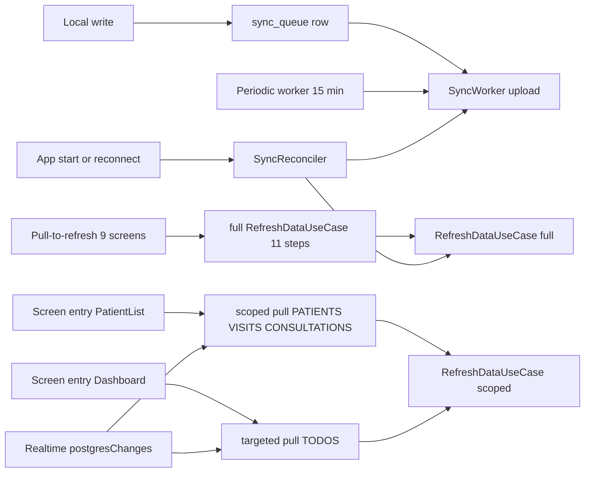

# Data Access Architecture Audit — 2026-10-20

> Phase 1 read-only audit of the complete data-access implementation of the Neo Child Clinic app
> (offline-first, Clean Architecture + MVVM, Room/SQLCipher/Supabase, Coroutines/Flow, sync queue).
> Every finding cites `path:line` verified against the checked-out commit. Read-only: no source,
> schema, or configuration file was modified by this audit — see the confirmation in
> [[Data Access Audit Summary 2026-10-20]].

**Environment state at audit time**

| Item | Value |
|---|---|
| Branch / HEAD | `main` @ `c6db012` ("Perf: dashboard load path (Phase 2 items 1–4)") |
| Working tree | clean before audit; still clean at the end of Phase 1 |
| User changes preserved | none existed to preserve (`git status --short` empty; `stash@{0}` untouched) |
| Untracked-but-ignored | `.env.local`, `app/google-services.json` — read counts only, **contents never read or printed** |
| Tests present | 46 JVM unit suites (`app/src/test`), 9 instrumented DAO/migration suites (`app/src/androidTest`) |
| Tests run during audit | none — running suites was not required for any claimed finding; all evidence is source-based |

## Source inventory (what data access actually consists of)

- **Local store** — `AppDatabase.kt:42` (Room v33, `exportSchema = true`, ~1990 lines of migrations
  `app/src/main/java/com/neochildclinic/data/local/database/AppDatabase.kt:84-430`), SQLCipher via
  `SupportOpenHelperFactory` (`AppDatabase.kt:500-507`), 21 DAOs under `data/local/dao/`, 22 entity
  files under `data/local/entity/`.
- **Remote store** — one Supabase project; client built once in `core/di/SupabaseModule.kt:44-66`
  (Postgrest, Auth, Functions, Realtime, Storage), anon key from `BuildConfig`, refresh token moved
  into Keystore-backed prefs (`SupabaseModule.kt:76-83`).
- **Repositories** — 19 interface/impl pairs; feature-owned contracts in
  `feature/<name>/domain/repository`, implementations in `feature/<name>/data`
  (`ARCHITECTURE.md` “Persistent-boundary status”).
- **Sync core** — `core/sync/`: `SyncWorker.kt:14` (upload worker), `SyncRepositoryImpl.kt:22`
  (queue drain/session gate/batch orchestration), `SyncUploader.kt:367` (per-entity upload +
  conflict policy), `SyncReconciler.kt:41` (online+authed reconciliation), `RealtimeChangeSubscriptions.kt:36`
  (Realtime→Flow bridge), `CloudRefresh.kt:18` (pull error policy), `SingleFlight.kt`.
- **Pull pipeline** — `feature/sync/domain/RefreshDataUseCase.kt:49` (11-repository pipeline with a
  scoped-refresh gate added 2026-10-19).
- **Background** — `NeoChildApp.kt:160-167` (15-min periodic `SyncWorker`, unique name `SyncWork`),
  `SyncManagerImpl.kt:37-63` (`AUTOMATIC_SYNC` + `IMMEDIATE_SYNC` one-time works), auto-backup
  (`data/backup/BackupAutoScheduler.kt:40-47`) and notification workers
  (`core/notification/ReminderScheduler.kt:53-84`).
- **Cloud backup** — `data/backup/` (13 classes): client-side AES-256-GCM with PBKDF2-210k
  (`BackupCrypto.kt:30-51`), upload through the Cloudflare Worker `cloudflare/backup-worker`
  (`CloudBackupApi.kt:165-186`) which verifies the caller’s GoTrue bearer token and derives the
  account server-side (`CloudBackupApi.kt:35-36`).
- **Presentation boundary** — no `feature/*/presentation` file injects a `*RepositoryImpl`;
  ViewModels receive interfaces only. The two exceptions are filesystem-layer by design:
  `feature/widget/data/WidgetWorker.kt:31-32` injects `ReminderRepositoryImpl`/`PatientRepositoryImpl`
  concretely, and `app/MainActivity.kt` handles the auth deep link (documented exceptions,
  `ARCHITECTURE.md` “Intentional infrastructure exceptions”).

## A. Read path (Room-first, verified)

Canonical shape for every screen: Compose → ViewModel (`stateIn(WhileSubscribed(5000))`) → use case
(or direct repository) → **Room Flow** → UI. There is no network dependency on the first render:
every `all*`/`get*` state flow is a Room observable, so offline screens paint local data immediately.

Verified instances (representative set):

- Patient list: `feature/patient/presentation/PatientListViewModel.kt:95` — combined Room flows,
  `stateIn`, search is a Room `LIKE` query (`data/local/dao/PatientDao.kt:44-48`).
- Patient detail: suspend read through `PatientCache` (`feature/patient/data/PatientRepositoryImpl.kt:49`)
  with the invalidation tracker clearing the cache on **any** `patients` write
  (`PatientRepositoryImpl.kt:46-53`) — matches `CACHE_ARCHITECTURE.md` exactly.
- Dashboard: tile counts are now SQL aggregates (`DashboardViewModel.kt:415-419` +
  `feature/inventory/data/InventoryTileCounts.kt`, `data/local/dao/BorrowDao.kt:28`,
  `feature/reminder/data/ReminderDueListProcessor.kt` — the 2026-10-19 perf work), the Today list is
  `patientTodoRepository` Room flows (`DashboardViewModel.kt:300`).
- Statistics / full report: Room flows combined in the ViewModel and aggregated **in memory**
  (`feature/statistics/presentation/StatisticsViewModel.kt:57-105`,
  `feature/statistics/presentation/FullReportViewModel.kt:80-128`) — see DA-04.
- Widget: independent Room table `widget_due_cache` via `WidgetDueDao`, refreshed by `WidgetWorker`
  (`feature/widget/data/WidgetWorker.kt:38-59`); full patients table is pulled into memory to map
  names (DA-06).
- Audit screen: the one deliberate exception — PostgREST-only paged reads, no local fallback
  (`feature/audit/data/AuditLogRepositoryImpl.kt:14-30`); offline = blank audit screen
  (DA-13, documented decision).

## B. Write path (durable + queued, verified)

Shape: UI → ViewModel → service/use case → repository → Room write **and** `sync_queue` enqueue
**in one transaction** → ack by upload → queue row deleted. Verified writers:

- `addPatient` mints the clinic ID and enqueues inside one transaction with an ABORT insert to
  fail loudly on ID collision (`PatientRepositoryImpl.kt:163-207`).
- `deletePatient`: one transaction deletes reminders, personal reminders, consultations, visits
  (children first) and enqueues every `DELETE` inside it (`PatientRepositoryImpl.kt:208-265`);
  ordering across those queued ops comes from the entity-priority heuristic
  (`core/sync/SyncRepositoryImpl.kt:676-697`), child-before-parent by construction.
- Waste record/update/delete and borrow returns wrap restore/deduct stock changes in the caller’s
  transaction (`feature/waste/data/WasteRepositoryImpl.kt:36-135`,
  `feature/inventory/data/InventoryRepositoryImpl.kt:557-634` — cross-batch borrow return relies on
  the caller’s transaction and says so).
- Deductions: read-modify-write guarded by `transactionRunner.run` + typed precondition failures
  (`InventoryRepositoryImpl.kt:450-514`, NCC-005/021 fixes visible in source).
- `updateProfile` writes and enqueues in one transaction because `profiles` has no `isSynced`
  column to guard pulls (`feature/profile/data/ProfileRepositoryImpl.kt:77-92`).

**Offline durability**: `sync_queue` is a Room table, so pending work survives process death and
reboot; the periodic + one-time workers pick it up (`SyncQueueDao.kt`, `NeoChildApp.kt:160`,
`SyncManagerImpl.kt:22-42`). The session gate refuses to upload anonymously and defers quietly
(`SyncRepositoryImpl.kt:204-253`); transient failures requeue with a bounded retry count (5) and
permanent ones stay FAILED and visible on the Sync screen with sanitized error details
(`SyncRepositoryImpl.kt:350-364`, `460-502`).

## C. Dependency boundaries (verified clean, two documented exceptions)

- Presentation → interfaces only (grep: zero `RepositoryImpl` references in `*presentation*`).
- Remote DTO leakage: entities are Room + kotlinx-serializable dual-purpose; `@SerialName`
  snake_case mappings exist in every entity that crosses PostgREST
  (e.g. `data/local/entity/PatientEntity.kt:18-36`), so remote rows decode correctly and remote
  PKs are explicit (`core/sync/SyncUploader.kt:41-53`).
- Known exceptions, all documented: `core/sync` and backup operate on Room directly
  (`ARCHITECTURE.md` “Intentional infrastructure exceptions”); the widget worker injects concrete
  repository classes (`feature/widget/data/WidgetWorker.kt:31-32`) — records **DA-15 (Low)**.

## D. Refresh orchestration (triggers, verified)

| Trigger | What runs | Where |
|---|---|---|
| App start or reconnect (online + authed) | upload pass, then full 11-step pull | `core/sync/SyncReconciler.kt:67-72` (single-flight, edge-triggered) |
| Patient list screen entry + its Realtime events | scoped 3-table pull | `feature/patient/presentation/PatientListViewModel.kt:101-140` |
| Dashboard entry + its Realtime events | TODOS-only targeted pull | `feature/dashboard/presentation/DashboardViewModel.kt:126-132, 208-224` |
| Pull-to-refresh (9 screens) | upload pass + **full** 11-step pipeline | `refresh()` in Dashboard/Statistics/Patient/VaccineDetail/Milestone/FinanceDetails/FullReport + `SyncViewModel:49`, `WeeklyDoctorSlotsViewModel` |
| Sync screen “Sync now” | same full pipeline | `SyncViewModel.kt:46-49` |
| Periodic worker | upload only (queue drain) | `NeoChildApp.kt:160-167` |
| Queue rows appear | one-time `AUTOMATIC_SYNC` (REPLACE collapses bursts) | `SyncManagerImpl.kt:17-42` |
| After logout/offline write flush | bounded flush then sign-out gate | `core/security/AuthViewModel.kt:204-303` |

In-flight dedup exists at three levels: the use case (`RefreshDataUseCase.kt:47-50`), the queue
(`SyncRepositoryImpl.kt:101-104`), and the reconciler (`SyncReconciler.kt:47`) — all `SingleFlight`
instances, so no two pipeline runs overlap. Realtime events debounce 500 ms
(`PatientListViewModel.kt:110-127`, `DashboardViewModel.kt:213-224`). **Freshness suppression and
completed-result caching do not exist** — every entry/event pull re-downloads full collections
(DA-02); manual refresh always runs all steps including the COGS migration
(`RefreshDataUseCase.kt:83-85`) regardless of what the screen shows.

## E. Supabase remote access (catalog)

All remote reads/writes (14 pull sites + 6 specialized upload paths + storage + functions):

| Site | Table/scope | Filter | Pagination | Projection | Notes |
|---|---|---|---|---|---|
| `PatientRemoteDataSourceImpl.kt:17-32` | `patients` | `is_deleted=false` | none | full rows | one-by-id variant too |
| `PatientRemoteDataSourceImpl.kt:34-57` | `inventory_transactions` | type/date | **range()** | full rows | the only paginated remote read |
| `VaccinationRepositoryImpl.kt:91-141` | `patient_visits` | `is_deleted=false` | none | full rows | skips visits whose patient is not local |
| `VaccinationRepositoryImpl.kt:145-152` | `vaccination_items` | `is_deleted=false` | none | full rows | fetch/apply split for FK safety |
| `InventoryRepositoryImpl.kt:639-678` | `vaccines`, `vaccine_batches` | `is_deleted=false` | none | full rows | |
| `ConsultationRepositoryImpl.kt:206` | `consultations` | `is_deleted=false` | none | full rows | |
| `PatientTodoRepositoryImpl.kt:34-35` | `consultation_todos`, `vaccination_todos` | `is_deleted=false` | none | full rows | batched upsert (2026-10-19) |
| `ReminderRepositoryImpl.kt:465-513` | `reminders` | `is_deleted=false` | none | full rows | per-row local checks (DA-03) |
| `PersonalReminderRepositoryImpl.kt:173` | `personal_vaccine_reminders` | `is_deleted=false` | none | full rows | |
| `BorrowRepositoryImpl.kt:301-322` | `borrow_records`, `borrow_returns` | `is_deleted=false` | none | full rows | |
| `WasteRepositoryImpl.kt:150` | `waste_records` | `is_deleted=false` | none | full rows | |
| `FinanceRepositoryImpl.kt:383` | `finance_transactions` | `is_deleted=false` | none | full rows | |
| `ExpenseRepositoryImpl.kt:120` | `expenses` | `is_deleted=false` | none | full rows | |
| `DoctorAvailabilityRepositoryImpl.kt:147-157` | `doctor_weekly_slots`, `doctor_slot_exceptions` | `is_deleted=false` | none | full rows | |
| `ProfileRepositoryImpl.kt:39-75` | `profiles` | `is_deleted=false` | none | full rows | per-row `isUnsynced` check (DA-03) |
| `AuditLogRepositoryImpl.kt:24-30` | `audit_logs` | optional patient | **range()** | full rows | remote-only by design |
| `SyncUploader.kt:400-428` | per-queue batch | `id IN (...)` | none | **full rows for one timestamp** | DA-02b |
| `DocumentRepositoryImpl.kt:17-40` | storage `patient-docs` | user session | — | — | signed URLs, 60 min |
| `StaffManagementRepositoryImpl.kt:16-20` | edge fn `manage-staff` | server-side role | — | — | service-role on server |

Consistent conventions across every pull: server-side `is_deleted=false` filter, no incremental
cursor, no column projection, upserts wrapped in transactions with a pending-queue guard
(`unsyncedIdSet`, one query per entity name — `SyncQueueDao.kt:83-95`).

## F. Room & SQL (entities, indexes, migrations)

- schema v33, contiguous migration chain 17→33 with a contiguity unit test
  (`AppDatabase.kt:435-440`, `data/local/database/AppDatabaseMigrationTest.kt`), **no destructive
  fallback** (`AppDatabase.kt:510-511`) and a fail-safe wrong-passphrase path that never deletes
  the file (`AppDatabase.kt:462-497`).
- Index hygiene is good for hot paths: the 2026-10-17 `index_patient_visits_dateGiven` removed
  whole-table sorts (`AppDatabase.kt:423-430`); server-side equivalents for the filters the app
  issues exist in `supabase/migrations/20261016_rls_index_and_stock_trigger_hardening.sql:81-90`.
- The known Room-side defects are registered and cross-referenced only (no new Room findings):
  NCC-025 (TEXT priority ordering), NCC-027/028/029/030/031, NCC-038 (`inventory_deductions` never
  synced — a real offline-first gap flagged for a decision), NCC-039.
- New audit observations: dead `deductStock()` multi-batch loop and dead wildcard-scan
  `getAuditCount*` queries (DA-09); unbounded local + remote `audit_logs` growth with no retention
  (DA-10’s scale effect; already flagged economically by NCC-030’s note); SQLCipher with explicit
  `TRUNCATE` journal mode serializes reads behind every background sync write
  (`AppDatabase.kt:508`) — DA-12, needs live measurement.

## G. Synchronization & Realtime (both directions)

**Pull/down** (per repository refresh + pipeline): full-collection downloads, local merge guarded
by `(local==null || local.isSynced) && id !in pendingQueue`. No state to resume after interruption
— a pull is safe to re-run (idempotent upserts), but always at full cost. Remote deletes are not
applied to local rows anywhere (DA-01; `docs/SYNC.md:48,95` documents the policy).

**Push/up**: queue → session gate → entity-priority ordering → batched conflict read → per-item
upload with one 401-refresh retry → ack-and-delete. Transient/permanent classification is purely
status/cause-based (`SyncRepositoryImpl.kt:582-600`); 408/429/5xx/IO retry ≤5, then FAILED visible
on the Sync screen. Idempotency: `upsert` on natural PKs (+ server-side unique keys from
`supabase/migrations/20261016_rls_index_and_stock_trigger_hardening.sql:92-104`), 404-tolerant deletes, append-only audit insert with `ignoreDuplicates`
(`SyncUploader.kt:559-561`), receipt-number read-back (`SyncUploader.kt:654-677`).

**Realtime**: one bridge (`RealtimeChangeSubscriptions.kt:39-108`) exposing a `callbackFlow` per
call site; per-table `postgresChangeFlow`, retry with exponential backoff (1 s→60 s) instead of
dying on first error (NCC-024 fix at :58-82), channel removed on collector cancellation. Two
subscribers: patient list (3 tables) and dashboard (2 todo tables), both debounced, both
triggering **targeted pulls**, never writes. Missed-event recovery is the reconciler
(`SyncReconciler.kt:25-38`) — correct, since Realtime offers no durable log.

## H. Data consistency / business invariants

Single-device behavior is strong: every stock mutation is a guarded read-modify-write in a
transaction with typed precondition exceptions; waste/borrow/return flows restore and deduct
in the caller’s transaction; deductions are ledger rows with reversal links. Server-side stock
counter drift (NCC-002/003/007) is registered and exported as SQL migrations
(`20261017_stock_trigger_duplicate_and_update_arithmetic.sql`,
`20261018_ensure_stock_trigger_installed.sql`), with live-DB confirmation still pending
(🔍 not verifiable from this environment).

The one systemic weakness is multi-device **deletion divergence** (DA-01, cross-ref NCC-023):
pulls are insert/update-only, so a patient/visit/consultation deleted on device A stays on device
B indefinitely; B’s edit of a remotely-deleted row POSTs an update that matches zero rows and
silently does nothing (PostgREST matched-rows semantics), while B’s statistics keep counting the
phantom. Resurrection is *possible* only for tables whose local row survives and gets re-upserted
by B’s own pending edit — never by the pull itself.

## I. Security & privacy

Verified strong:
- SQLCipher with Keystore-held passphrase + wrong-passphrase recovery that preserves the file
  (`AppDatabase.kt:446-497`).
- Refresh token in encrypted prefs, legacy plaintext session migrated out
  (`SupabaseModule.kt:55-83`).
- Sync error details fail-closed on headers and strip URL query strings
  (`SyncRepositoryImpl.kt:485-509`).
- RLS: deny-sweep security baseline, deactivated/staff-scope helpers, privileged-field guard,
  write rate limit, private `patient-docs` bucket with authenticated-only policy
  (`supabase/migrations/20260929000000_security_baseline.sql`,
  `20261013_profiles_privileged_fields_guard.sql`, `20260929001000_write_rate_limit.sql`,
  `20261016_rls_index_and_stock_trigger_hardening.sql:68-77`).
- Account switching/logout: flush gate + explicit erase decision + registry/DB clears
  (`AuthViewModel.kt:204-270`, `CACHE_ARCHITECTURE.md` “Logout / session isolation”).
- Cloud backups: client-side AES-256-GCM (PBKDF2-210k, iteration count stored in file and capped
  server-side of parse, `BackupCrypto.kt:30-51`); the Cloudflare Worker authenticates each request
  with the GoTrue token and derives the account server-side (`CloudBackupApi.kt:35-36,165-186`).

Registered concerns (all Low/Medium, none urgent): 3 sites log patient IDs or an email to Logcat
(DA-11 → see register); `patient-docs` object paths have no clinic segment so the storage policy is
authenticated-staff-wide — documented as intentional in the migration itself
(`supabase/migrations/20261016_rls_index_and_stock_trigger_hardening.sql:19-24`) and matching the table-policy boundary; audit-log reads are remote-only
(offline = blank audit screen, DA-13). The anon key ships via `BuildConfig` (public-by-design in a
client app; RLS is the enforcement layer) — no embedded service-role key found anywhere in tracked
Kotlin.

## J. UI state, concurrency, lifecycle

- Uniform `stateIn(viewModelScope, WhileSubscribed(5000), …)` in 14 ViewModels; statistics flows
  run `flowOn(Default)` with `.catch` guards (NCC-013/016 fixes visible at
  `StatisticsViewModel.kt:97-105`, `FullReportViewModel.kt:108-115`).
- Gap: **`collectAsState()` (non-lifecycle-aware) is still used in ~10 screens** — notably
  `PatientDetailsScreen.kt` (10 call sites), `MainActivity.kt` (6), `DashboardScreen.kt` (5) — so
  those Room/network flows keep collecting while the app is backgrounded. This is the deferred
  perf-plan item 5 (needs the `lifecycle-runtime-compose` dependency decision), recorded in
  [[Performance and Measurement Plan 2026-10-20]] and [[Performance Diagnosis and Plan 2026-10-20]].
- Loading/error state races: refresh guards (`_isRefreshing.value` early-returns) exist in every
  `refresh()` inspected; stats drains via `_selectedDate.flatMapLatest` (`DashboardViewModel.kt:230`),
  slot lookups use a stale-token check (`DashboardViewModel.kt:151-160`). No stuck-`isLoading`
  pattern found in the audited ViewModels.

## K. Performance & scalability

Structural facts established (no runtime measurement was taken; 🔍 marks what Phase 2 must
measure): 11 sequential-ish remote steps per full refresh; full-table downloads per refresh; six
whole-table Room flows feeding statistics; per-row local queries inside some pull loops; like-scan
search; widget pulling all patients; no local retention for `audit_logs`. The previous
performance work (scoped refresh, SQL tile counts, batched todo refresh) already trimmed the
hot paths it targeted. Full plan: [[Performance and Measurement Plan 2026-10-20]].

## L. Testing (inventory only; nothing executed in this audit)

- 46 JVM suites cover: sync ordering/group classification/entity registry/remote-column mapping/
  step skipping (`RefreshStepTest`, `SyncOrderingTest`, `SyncGroupFailureTest`,
  `SyncEntityRegistryTest`, `SyncDescriptorRemoteColumnsTest`, `CloudRefreshTest`,
  `RefreshTablesTest`), cache behavior (`PatientCacheTest`, `MemoryCacheTest`),**backups
  (`BackupCryptoTest`, `BackupValidatorTest`), stock movement/expiry/sort keys, edit engine,
  deletion, statistic calculators.
- 9 instrumented suites cover DAO semantics and migrations (`PullUpsertPreservesChildrenTest`,
  `BatchPullGuardEquivalenceTest`, `ReminderSoftDeleteFilterTest`,
  `AppDatabaseMigrationTest`-adjacent `DateGivenIndexMigrationTest`, …) — CI-only (no emulator on
  this machine).
- Gaps consistent with known defects: no test pins tombstone behavior (because none exists —
  DA-01), none pins dedup under concurrent enqueue (DA-08), none covers widget data path or
  `DocumentRepositoryImpl`.

## M. Alternatives considered (summary — full analysis in the Phase 2 plan)

The only architectural option that actually removes a defect class is **tombstones/deletion
propagation** (fix postulated for DA-01); everything else keeps the current architecture and
tightens performance/cost: column projection + incremental cursors, SQL aggregates for statistics,
FTS or indexed search, request timeouts, WAL vs TRUNCATE measurement, widget SQL join. No new
infrastructure (no extra database, no gateway) is justified by the evidence. Details and batch
ordering: [[Phase 2 Implementation Plan 2026-10-20]].

## Not inspected / limitations

- Runtime behavior (row counts, payload sizes, refresh durations, cache hit rates): unknown,
  🔍 — Phase 2 must instrument before/after (Report 3).
- `feature/doctor/domain/GetAvailableSlotsUseCase.kt` slot-math internals, `MainActivity.kt`
  deep-link parsing details, Compose screen internals beyond state collection, the Cloudflare
  Worker TS implementation (its contract is pinned by the client: `CloudBackupApi.kt`), and the
  edge-function server code (not in this repo).
- Live Supabase state — never connected, per the audit rules.
- `graphify-out/` and KB docs were used as context only; every load-bearing claim was re-verified
  in source. Documentation discrepancies found: none new — `docs/SYNC.md:95` and
  `CACHE_ARCHITECTURE.md` matched source; the only stale claim candidates are already covered by
  the reconciliation note in [[Data Access Audit Summary 2026-10-20]].

## Related reports

- Findings register: [[Data Access Findings Register 2026-10-20]] (all DA-* findings)
- Measurement plan: [[Performance and Measurement Plan 2026-10-20]]
- Phase 2 plan: [[Phase 2 Implementation Plan 2026-10-20]]
- Audit summary: [[Data Access Audit Summary 2026-10-20]]
- Related notes: [[Offline Synchronization]], [[Caching]], [[Data Flow]], [[Architecture Map]],
  [[Bug Register]]
