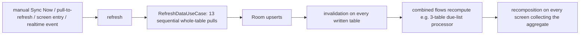

# Performance Diagnosis and Plan — 2026-10-20

> Read-only diagnosis of the reported **slow Android data loading**, built from the repaired
> vault and the source at HEAD `0972ed9`. No application code was changed in this phase.
> Tags: **[M]** = measured in source (line-verified), **[S]** = code-based suspicion whose
> *magnitude* needs a device run (see § Measurement before implementing).
> Companion: [[Quality/Documentation Repair 2026-10-20]] (Phase 1). Out of scope here but
> still open: NCC-002 ([[Quality/Bug Register]]).

## The load path at a glance

Every arrow above is real and cited below; what a device would add is *how long* each leg
takes — that is what the [S] tags are for.

## Findings (ranked by expected impact)

### F1 · Any realtime event or screen entry can trigger a full-database re-pull [M]

- `PatientListViewModel` init runs `refresh()` → `refreshDataUseCase()` at **screen entry**
  (`app/src/main/java/com/neochildclinic/feature/patient/presentation/PatientListViewModel.kt:96-99`).
- Realtime is trigger-only, with **no self-echo filter**: this device's own uploads generate
  Postgres events that re-enter the same `refresh()`
  (`app/src/main/java/com/neochildclinic/core/sync/RealtimeChangeSubscriptions.kt:23-26`,
  the subscription loop at `:52-83`).
- `RefreshDataUseCase` pulls **13 tables sequentially**, each repository round-trip selecting
  the *whole* table (`feature/sync/domain/RefreshDataUseCase.kt:47-60`,
  `feature/patient/data/PatientRepositoryImpl.kt:91-94`), then upserting it.
- Deduping exists (`SingleFlight` at `RefreshDataUseCase.kt:47,49`, the
  `_isRefreshing` guard at `PatientListViewModel.kt:121-122`), but the *cost per trigger*
  stays ~15 HTTP round trips + full-table upserts + the invalidation storm of F2/F4.

**Smallest fix:** scope the trigger. Give `RefreshDataUseCase` an optional table-scope
parameter and have realtime-driven and screen-entry refreshes call only their own tables'
existing repository refresh methods; keep the full pipeline for manual Sync Now and
pull-to-refresh. One parameter, ten call sites reviewed, sync semantics untouched.
Effort **M**.

### F2 · The dashboard counts four numbers by materializing three tables [M]

`feature/dashboard/presentation/DashboardViewModel.kt`:

- `patientCount()` (`:415`) and `wasteCount()` (`:431`) are real COUNT queries
  (`data/local/dao/PatientDao.kt:51-52`) — the right shape.
- `inventoryStockCounts()` (`:417-419`) loads the **entire inventory list** and counts
  low/out-of-stock in Kotlin.
- `borrowedCount()` (`:421`) loads **all active borrow records** to take `.size`.
- `dueCount()` (`:423-430`) is the heaviest: `getDueList()` combines
  `getAllVaccinations()` + `getAllReminders()` + `getAllPatients()` and re-runs
  `ReminderDueListProcessor.process` over all three on **any write to any of the three
  tables** (`feature/reminder/data/ReminderRepositoryImpl.kt:86-94`), then classifies every
  row again in Kotlin.

**Smallest fix:** SQL COUNT queries for the inventory and borrowed tiles (their predicates
are plain column booleans); for the due tile, split a count-only path that skips the patient
flow and add `distinctUntilChanged` on the processed result. The processor's day-boundary
logic must stay in Kotlin — do not try to port it to SQL.
Effort **S–M**.

### F3 · Dashboard init re-pulls two todo tables, then does one local query per row [M]

Every `DashboardViewModel` construction calls `patientTodoRepository.refresh()`, which
selects **all** rows of `consultation_todos` and `vaccination_todos`
(`is_deleted = false`, no limit) and then calls `getConsultationTodoById` **per remote row**
before inserting (`data/.../PatientTodoRepositoryImpl:31-32`). Two HTTP pulls + an N+1 on
every dashboard entry.

**Smallest fix:** one `SELECT id …` per table into a `Set`, then insert only missing rows
and keep the per-row queue-guard read only where an existing row is found. Same semantics,
2 subqueries instead of 2·N.
Effort **S**.

### F4 · Unbounded queries everywhere in the hot paths [M shape / S magnitude]

136 of 230 `@Query` are `SELECT *`, only 46 carry a LIMIT (measured); the big screens
(patients, due list, inventory, statistics) render whole tables, and the patient search uses
leading-wildcard `LIKE` including a correlated subquery over a JSON-ish `vaccineNames`
column (`data/local/dao/PatientDao.kt:46-47`, also `:66`, `:69`). Room **indices are present**
(72 declarations in `app/schemas/com.neochildclinic.data.local.database.AppDatabase/33.json`),
but Kotlin-side counting/filtering (F2) and `LIKE '%…%'` bypass them by design. Finance
report queries order by
`COALESCE(transaction_date, substr(timestamp,1,10))`, which cannot use the
`transaction_date` index (FinanceDao; schema 33.json).

**Smallest fix:** wire the already-written paginated DAO methods for the worst lists first —
they exist but are untested (`feature` DAO methods tracked in [[Technical Debt]]); keep the
rest as is. The finance sort needs a migration + query change: **defer**.
Effort **M–L** (paging), needs a product decision.

### F5 · Not one screen collects lifecycle-aware [M]

88 `collectAsState()` uses, 0 lifecycle-aware; 22 `stateIn(WhileSubscribed(5000))`; 5
`distinctUntilChanged`. Aggregates keep recomputing while the app is backgrounded, and every
invalidation re-emits a fresh aggregate object.

**Smallest fix:** start with the five hottest screens only (Dashboard, Patient List,
Statistics, Inventory, Due list). `collectAsStateWithLifecycle` needs
`androidx.lifecycle:lifecycle-runtime-compose` — **a dependency decision for you** (it may
already be in the graph; verify `app/build.gradle.kts` first). Without the artifact, the
no-new-dependency alternative is `repeatOnLifecycle` in a `LaunchedEffect`, which is more
code per screen.
Effort **S per screen (M total)**.

### F6 · Date formatters constructed per row in several screens [M, minor]

`DateTimeFormatter.ofPattern(...)` runs per card/row at:
`feature/.../PatientRecordCards.kt:180` (per card),
`feature/statistics/.../StatisticsDateUtils.kt:36,156` (per item),
`TodayPatientsScreen.kt:106`, `MilestonePatientsScreen.kt:51` (per item),
`ReceiptFormatter.kt:135`, `WidgetWorker.kt:93`, and `AddPatientScreen` ×3. Cheaper sites
already `remember {}` the formatter — copy that pattern.
Effort **S**.

## Constraints this plan respects

- **Offline-first / sync semantics:** the queue and push path are untouched; realtime stays
  a trigger-only input (`RealtimeChangeSubscriptions.kt:23-26`); scoped refreshes reuse the
  same repository methods the pipeline already calls.
- **Clean Architecture / MVVM:** every change is inside repositories, DAOs, or ViewModels;
  no layer hops, no new abstractions.
- **Supabase RLS / auth / soft-delete:** untouched; scoped pulls keep the same
  `is_deleted` filters as today's whole-table pulls.
- **No new dependencies** except the one flagged in F5 as an explicit decision for you.
- **No patient/token data in logs:** nothing proposed adds a log line beyond the existing
  row-count logs (`PatientRepositoryImpl.kt:93`).

## Measurement before implementing (no device run happened in this phase)

Two numbers turn every [S] into an [M] and make F1's fix provable:

1. Cold start → first meaningful dashboard paint (Android Studio profiler / `log`-free
   `reportFullyDrawn`), before and after.
2. Manual Sync Now duration and the invalidation storm it causes (frame + CPU trace),
   before and after.

No Macrobenchmark (that would add dependencies/tooling); the studio profiler is enough to
rank and to verify.

## Implementation order (if approved)

| # | Item | From | Effort | Verification |
|---|---|---|---|---|
| 1 | Scoped refresh (F1) | F1 | M | unit test: realtime trigger runs only the scoped repositories' refreshes; manual path unchanged |
| 2 | SQL counts for tiles (F2) | F2 | S | DAO tests for the two count queries; dashboard unit test keeps unchanged tile behaviour |
| 3 | Todo refresh batching (F3) | F3 | S | repository test: same local end-state with queued rows preserved, 2 subqueries |
| 4 | Due-count split + `distinctUntilChanged` | F2 | S | reminder repository test: no duplicate emissions, count unchanged |
| 5 | Lifecycle-aware collection on 5 screens | F5 | S/M | manual profiler check; no behaviour change |
| 6 | Formatter `remember {}` (F6) | F6 | S | trivial; spot-check by test on the shared util if any |
| 7 | Paginated list wiring | F4 | M–L | pending your UX decision; DAO methods are currently untested |

Items 6 and the finance-sort index work are the tail; item 7 is the only one that can ship
later without blocking the others.

## Implemented 2026-10-20 (items 1–4, approved)

Nothing committed; the changes sit uncommitted in the working tree (`git status` shows only
the app sources named here, the two doc scripts, `.gitignore`, and the vault notes).

| Item | What changed | Verification |
|---|---|---|
| 1 · scoped refresh | `RefreshTables` + per-table FK closures and `stepsFor` at the file bottom (`feature/sync/domain/RefreshDataUseCase.kt:153-179`), `invoke(vararg)` with the step gate (`:49`, `:58`); `PatientListViewModel.init` and its realtime observer now request only PATIENTS + VISITS + CONSULTATIONS (`feature/patient/presentation/PatientListViewModel.kt:101,117,126-127`). Manual sync, pull-to-refresh and the background reconciler still run the full pipeline (empty scope = unchanged behaviour). | `RefreshTablesTest` 6/6, incl. the "every entry is mapped" invariant |
| 2 · dashboard tiles | `stockTileCounts` derives the two inventory tiles from a narrow batch projection reusing the SAME `InventoryUtils.isExpired` predicate - no SQL date-port, no drift (`feature/inventory/data/InventoryTileCounts.kt:8,19`; repository `:136`); borrowed tile counts in SQL (`data/local/dao/BorrowDao.kt:29`); dashboard swapped (`feature/dashboard/presentation/DashboardViewModel.kt:415-419`) | `InventoryTileCountsTest` 5/5 (zero-batch, expired, orphan-batch rules); `BorrowDaoCountTest` compiles, executes in the `android-instrumented` CI job |
| 3 · todo refresh | `PatientTodoRepositoryImpl.refresh()` batches: one queue-guard read + one snapshot per table, both AND the writes inside one transaction (`feature/patient/data/PatientTodoRepositoryImpl.kt:43,54`); identical synced rows are no longer REPLACE-written | `TodoUpsertsForRefreshTest` 5/5 |
| 4 · due-today tile | New pure `ReminderDueListProcessor.dueTodayCount` keeps the ACTIVE filter the tile must have — `stats().dueToday` leaks terminal rows and was NOT reused (`feature/reminder/data/ReminderDueListProcessor.kt:102`); `getDueTodayCount` combines only the two tables it reads and dedupes equal counts (`feature/reminder/data/ReminderRepositoryImpl.kt:128`); `getDashboardStats` dropped its dead patients read (`:119`) | `ReminderDueListProcessorTest` 4/4 pins "terminals never count even when their date is today" |

Full suite after implementation: **297 unit tests passed, 0 failed** (44 classes, 4 new);
`compileDebugAndroidTestKotlin` BUILD SUCCESSFUL. Item 5 (needs the
`lifecycle-runtime-compose` dependency decision), item 6 (formatter `remember {}`) and
item 7 (paginated list wiring) remain deferred, as decided.
