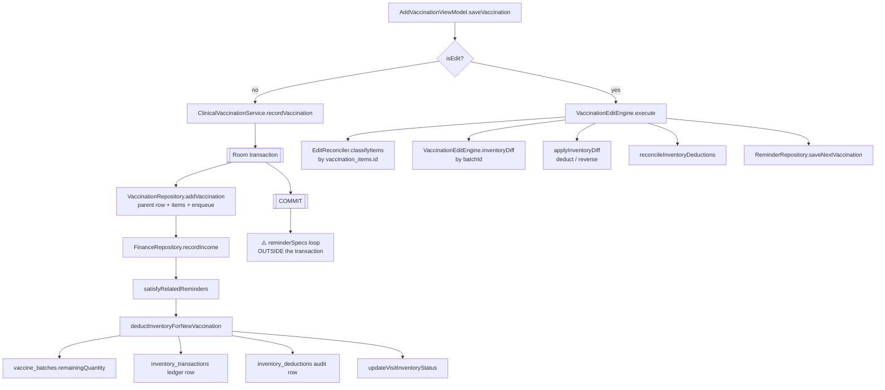

# Vaccination Management

> Recording and editing a vaccination — the highest-risk business logic in the app.
> Related: [[Inventory Management]] · [[Due Vaccination]] · [[Patient Management]] ·
> [[Room Database]]

## The write path



`AddVaccinationViewModel.kt:673-699` is the dispatch. `saveVaccination` spans `:485-706` —
**220 lines** mixing validation, scheduling, item building, reminder transform and dispatch.

## The create transaction — 9 tables

`feature/vaccination/domain/ClinicalVaccinationService.kt:41-89`:

```kotlin
val transactionGroupId = UUID.randomUUID().toString()
transactionRunner.run {                                    // :42  THE boundary
    vaccinationRepository.addVaccination(vaccination, transactionGroupId)
    if (isNew) financeRepository.recordIncome(...) else updateIncomeForVisit(...)
    if (isNew) satisfyRelatedReminders(vaccination, user)
    if (isNew) deductInventoryForNewVaccination(vaccination, user)
}
```

Atomic with respect to: `patient_visits`, `vaccination_items`, `finance_transactions`,
`reminders`, `vaccine_batches`, `inventory_transactions`, `inventory_deductions`,
`sync_queue`, `audit_logs`. ✅ This is the best-transacted path in the app.

⚠️ **Not atomic:** the "Next Vaccination" reminder rows written at
`AddVaccinationViewModel.kt:687-698`, each in its own transaction, *after* the visit is
committed. See [[Known Bugs]].

## Stock deduction during create

`ClinicalVaccinationService.kt:92-157`, per item:

```kotlin
try {
    inventoryRepository.deductStockFromBatch(
        batchId = item.batchId, quantity = item.quantity,
        transactionType = InventoryTransactionType.VACCINATION,
        visitId = vaccination.id, givenDate = vaccination.dateGiven)   // :105
    inventoryRepository.insertInventoryDeduction(
        InventoryDeduction(..., status = "COMPLETED", ...))            // :107-116
} catch (e: CancellationException) { throw e }                          // :118-119
catch (e: InsufficientStockException) {
    inventoryRepository.insertInventoryDeduction(
        InventoryDeduction(..., status = "FAILED", errorMessage = e.message))  // :128-137
}
```

Then `visit.inventoryStatus` is set at `:146`:

```kotlin
val finalStatus = when {
    completedCount == vaccination.items.size -> InventoryStatus.COMPLETED
    completedCount > 0                       -> InventoryStatus.PARTIAL
    else                                     -> InventoryStatus.FAILED
}
```

The design intent — a shortfall records a `FAILED` ledger row and **still saves the visit** —
is stated explicitly in `InsufficientStockException.kt:7-11`.

⚠️ **But the catch is too narrow.** `deductStockFromBatch` throws two plain
`IllegalStateException`s that escape it (`InventoryRepositoryImpl.kt:435` "Batch not found",
`:445` "batch had already expired on the vaccination date"). Either propagates out of the
transaction and **rolls back the visit, its items, the finance row and the inventory status**
— exactly the outcome the design was written to avoid. See [[Known Bugs]].

## Editing — the diff model

`feature/vaccination/domain/VaccinationEditEngine.kt`.

### Item rows: matched by id, never by name

`EditReconciler.classifyItems` (`:30-82`) compares `vaccination_items.id`:

| Case | Action |
|---|---|
| id unchanged, `sameItem` true (8 fields incl. `batchId`, `quantity`, `mrp`, `netRate`, `expiryDate`) | keep |
| id unchanged, fields changed | DELETE old + CREATE new UUID |
| id in old, not in new | DELETE |
| id in new, not in old | CREATE (reusing the incoming id if it is not already taken, `:50-53`) |

### Stock: diffed by batch

```kotlin
// VaccinationEditEngine.kt:21-31
fun inventoryDiff(old: Vaccination, new: Vaccination): Map<String, Int> {
    val oldByBatch = old.items.groupingBy { it.batchId }.fold(0) { t, i -> t + i.quantity }
    val newByBatch = new.items.groupingBy { it.batchId }.fold(0) { t, i -> t + i.quantity }
    return (oldByBatch.keys + newByBatch.keys)
        .associateWith { batchId -> (newByBatch[batchId] ?: 0) - (oldByBatch[batchId] ?: 0) }
        .filterValues { it != 0 }
}
```

Negative = reverse, positive = deduct. ⚠️ **Diffed by `batchId` only, not by vaccine** — two
different vaccines sharing a batch net into one delta (tested and accepted at
`VaccinationEditEngineTest.kt:43-49`).

### Apply

`applyInventoryDiff` (`:115-170`):

- `delta > 0` → `deductStockFromBatch`, with `allowExpired = batchAlreadyUsed` (`:146-147`),
  so a batch already consumed by this visit stays usable.
- `delta < 0` → `reverseDeduction`, **capped** at
  `minOf(-delta, completedByBatch[batchId])` (`:157`) — you can never reverse more than the
  ledger says actually moved.

### Ledger rewrite

`reconcileInventoryDeductions` (`:184-215`) deletes every deduction for the visit and
re-derives one row per current item, with a 5-branch status inference:

```kotlin
val status = when {
    shortfall != null                       -> "FAILED"
    exact != null                           -> exact.status
    forVaccine.isEmpty()                    -> "COMPLETED"
    forVaccine.none { it.status == "COMPLETED" } -> "FAILED"   // ⚠️ the bug
    else                                    -> "COMPLETED"
}
```

✅ No orphaned rows — `deleteForVaccination` clears the set first
(`InventoryDeductionDao.kt:17-18`).

⚠️ **The 4th branch is wrong.** See [[Known Bugs]] — an edit that *increases* quantity on a
previously-`FAILED` batch moves real stock but writes a `FAILED` ledger row, so the deletion
reversal never restores the dose.

### Verified edit scenarios

| Scenario | Correct? | Why |
|---|---|---|
| Same vaccine, different batch | ✅ | two deltas; reverse capped at ledger, new batch must pass expiry |
| Same batch, different dose count | ✅ | single delta |
| **Increase qty on a previously-FAILED batch** | ❌ | [[Known Bugs]] |
| Changing patient | N/A | not reachable — no patient picker on the edit route (`:632` always uses `patient.id`) |
| Payment-only edit | ✅ | `inventoryDiff` empty, `reconcileInventoryDeductions` never called (`:99-101`) |

## Deletion — retry-safe

`VaccinationRepositoryImpl.deleteVaccination` (`:387-506`):

1. `getActiveVaccinationById(id) ?: return` — idempotency latch (`:390`).
2. Reverse stock from `getCompletedForVaccination` (`:404-413`) — `FAILED` rows are skipped.
3. Delete the deduction ledger (`:422`).
4. Reminders → items → finance → the visit (`:432-485`).
5. **Parent DELETE enqueued last** (`:487-493`), children before it.

The comment at `:366-386` states the contract explicitly: a remote failure never reverts
local state.

## Next-due-date and scheduling

⚠️ **There is no clinical schedule engine in this codebase.** `Vaccine.doseSchedule`
(`domain/model/Vaccine.kt:13`) is **write-only** — declared and mapped
(`data/local/entity/VaccineEntity.kt:26`, `:125`, `:138`) with **no reader anywhere**.
Exhaustive grep for `plusDays|plusMonths|plusWeeks|plusYears` returns 19 hits, **none** in
`feature/vaccination`, `consultation`, `inventory`, or `reminder`.

Next-due dates are **free-text staff entry**. `AddVaccinationLogic.validateNextGroups`
(`:105-127`) checks only that Type and Due Date are non-blank. Type is a fixed list
(`core/common/Constants.kt:12-14`): `Routine`, `Booster`, `Catch-up`, `Travel`, `Other`.

The one **correct and tested** computation:

```kotlin
// domain/model/Vaccination.kt:62-66
val nextDueDate: String
    get() = nextVaccinations
        .minByOrNull { PatientUtils.parseDate(it.dueDate)?.time ?: Long.MAX_VALUE }
        ?.dueDate ?: ""
```

It parses rather than string-compares, because `Constants.DATE_FORMAT = "d MMM yyyy"` is not
zero-padded — `"16 Oct 2026"` sorts before `"9 Oct 2026"` as text. Pinned by 6 tests.

That same non-padded-format hazard is **live in four other places** in the inventory layer.
See [[Inventory Management]] and [[Known Bugs]].

## Consultation interaction

`feature/consultation/domain/ConsultationEditEngine.kt` is **53 lines** and has **zero
stock or vaccination interaction** — its constructor takes only `transactionRunner`,
`consultationRepository`, `financeRepository` (`:13-15`).

The only coupling is through the shared visit header: `recordConsultation` inserts a
`Visit(visitType = "CONSULTATION")` (`ClinicalVaccinationService.kt:172-186`), which has no
`vaccination_items` — so the deletion reversal loop has nothing to reverse. ✅ Consistent.

`deleteConsultation` calls the **DAO** directly (`ConsultationRepositoryImpl.kt:183`), not
`VaccinationRepositoryImpl.deleteVaccination`, and enqueues `VISIT DELETE` rather than
`VACCINATION DELETE`. ✅ Correct, and easy to break in future.

## Confirmed findings

See [[Known Bugs]] for full severity and reproduction. Vaccination-specific:

1. ⚠️ `applyInventoryDiff` deducts on `delta > 0` **without consulting the ledger**; the
   ledger is only consulted for the reversal cap. Combined with branch 4 of
   `reconcileInventoryDeductions`, a dose can leave the shelf with no ledger record.
2. ⚠️ A reminder-loop failure after commit shows an error but leaves the visit and its
   stock deduction saved — retrying creates a **second** visit, because `vaccinationId` is
   regenerated per attempt (`:554`) while item ids come from stable UI row ids, and
   `vaccination_items` uses `OnConflictStrategy.REPLACE` (`VaccinationItemDao.kt:12-13`).
3. ⚠️ `reverseDeduction` and `deductStockFromBatch` are called from `applyInventoryDiff`
   **without** the `transactionGroupId` the engine already computed (`:65`), so reversal and
   edit upload in different sync groups.
4. ⚠️ Two `IllegalStateException`s from `deductStockFromBatch` bypass the
   `InsufficientStockException` recovery path and roll the whole visit back.

## Related

- [[Inventory Management]] — the stock rules this note depends on
- [[Due Vaccination]] — where the reminder rows from the transaction gap land
- [[Offline-First Architecture]] — `transactionGroupId` and why it matters
- [[Testing]] — the pure functions are tested; every orchestrator is not
