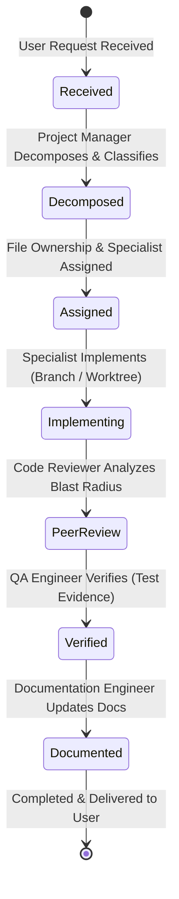

# Agent Coordination & Orchestration Protocol

**Ecosystem**: Google Antigravity Multi-Agent Engineering Team  
**Orchestration Primitive**: Project Manager + Dynamic Python Workflows (`run_workflow`)  

---

## 1. Task Lifecycle & State Transitions

Every engineering task follows a strict 7-stage lifecycle:



---

## 2. Parallel vs. Sequential Execution Rules

### 2.1 When Parallel Execution is Permitted
Parallel execution (using `parallel([items], fn)`) is permitted **only** when all of the following hold:
1. **Zero File Overlap**: Each agent owns completely disjoint file paths.
2. **Pre-Agreed Interface**: Any shared interface or data contract is already finalized and frozen.
3. **Independent Context**: The work does not rely on intermediate results from a concurrent agent.

*Valid Parallel Example*:
- Agent A (`database-engineer`): Audits Room schema JSON files.
- Agent B (`security-auditor`): Audits Supabase RLS policies in `supabase/migrations/`.
- Agent C (`qa-engineer`): Reviews unit tests in `app/src/test/`.

### 2.2 When Sequential Execution is Mandatory
Sequential execution (using `pipeline([items], fn)` or chained `await agent()`) is **strictly enforced** when tasks have causal dependencies:

```text
Step 1: Architecture Decision (software-architect)
            ↓ (approves package placement and domain interface)
Step 2: Database Migration & Schema (database-engineer)
            ↓ (emits Room v35 schema and migration)
Step 3: Repository & Feature Logic (android-developer)
            ↓ (implements domain model and UI state)
Step 4: Independent Peer Review (code-reviewer)
            ↓ (approves diff and blast radius)
Step 5: Automated Verification (qa-engineer)
            ↓ (passes JVM unit tests)
Step 6: Documentation Reconciliation (documentation-engineer)
```

---

## 3. Communication Protocol

Subagents communicate with the parent orchestrator via structured return values and notifications:
- Every agent invocation defines a clear `schema` (JSON Schema or string).
- Agents return findings upon task completion.
- When an agent encounters an architectural violation or security issue outside its scope, it reports the issue to `project-manager` for escalation rather than attempting an uncoordinated fix.
