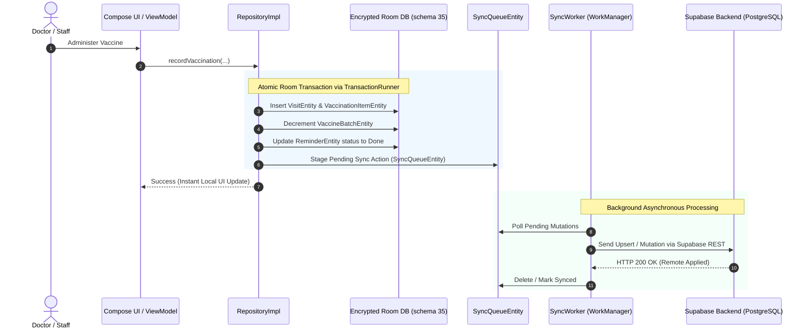

# Project Architecture

**Architecture Style**: Clean Architecture + MVVM (Model-View-ViewModel) + Offline-First Single-Source-of-Truth  
**Module Structure**: Single-module Android project (`:app`), package `com.neochildclinic`  

---

## 1. High-Level Dependency Graph

```text
       Presentation Layer (Jetpack Compose UI + ViewModels)
                              │
                              ▼
           Domain Layer (Use Cases + Domain Models)
                              │
                              ▼
             Data Layer (Repository Implementations)
                 │                           │
                 ▼                           ▼
    Local Persistence (Room schema 35) Remote Cloud (Supabase REST / RLS)
        [SQLCipher AES-256]           [PostgreSQL + Edge Functions]
```

---

## 2. Layer Definitions & Boundaries

### 2.1 Presentation Layer (`com.neochildclinic.feature.<name>.presentation`)
- **UI Toolkit**: Pure Jetpack Compose with Material 3. Zero XML layouts.
- **State Holders**: Android `ViewModel` instances injected with `@HiltViewModel`.
- **UI State**: Exposed via Kotlin Coroutine `StateFlow<UiState>` collected with `collectAsStateWithLifecycle()`.
- **Navigation**: Compose Navigation with strongly-typed routes defined in `com.neochildclinic.app.Routes`. Cross-feature navigation passes primitive IDs only.
- **Rules**:
  - Views NEVER observe Room DAOs or Supabase clients directly.
  - ViewModels communicate exclusively through domain repository interfaces.

### 2.2 Domain Layer (`com.neochildclinic.domain` & `feature.<name>.domain`)
- **Independence**: 100% pure Kotlin. No dependencies on Android SDK, Compose, or Room.
- **Models**: 35 domain data models in `com.neochildclinic.domain.model` (e.g., `Patient`, `Vaccine`, `VaccinationItem`, `Batch`, `Consultation`, `Expense`).
- **Repositories**: Interface contracts located in `feature/<name>/domain/repository/` defining business data operations.
- **Rules**:
  - Domain models represent business truth, isolated from database entities or JSON serialization nuances.

### 2.3 Data Layer (`com.neochildclinic.data` & `feature.<name>.data`)
- **Repository Implementations**: Implement domain repository contracts (e.g., `PatientRepositoryImpl`, `VaccineRepositoryImpl`).
- **Local Persistence**: Room schema 35 (library 2.8.5) with SQLCipher encryption located in `data/local/`:
  - 25 SQLite entities (`*Entity.kt`)
  - 21 Data Access Objects (`*Dao.kt`)
  - Type converters for complex medical fields, dates, and JSON payloads.
  - Room migrations from v17 through v35 (18 hops).
- **Remote Integration**: Supabase client (`data/remote/`) handling PostgreSQL tables via Supabase PostgREST, Supabase Auth JWT sessions, and Realtime listeners.
- **Cloudflare Integration**: `data/backup/` mediating AES-256-GCM encrypted `.nccb` disaster-recovery containers with Cloudflare R2 via Edge Worker.

---

## 3. Offline-First Synchronization Engine

The sync engine (`core/sync/`) implements an offline-first, local-first architecture:



### Key Synchronization Invariants:
1. **Reads are Local**: Screens read exclusively from Room via reactive Flow streams. Offline users experience zero latency or loading spinners.
2. **Atomic Writes**: Multi-table operations run within `TransactionRunner` to eliminate partial states if an app crash occurs mid-write.
3. **Outbox Guarantee**: Network mutations are written into `SyncQueueEntity` in the exact same database transaction as the business entity.
4. **Conflict Resolution**: Client timestamps and server-side PostgreSQL triggers (`stock_trigger_*`) guarantee inventory consistency even during out-of-order sync deliveries.
5. **Session Safety**: Clearing app state on logout purges in-memory caches (`CacheRegistry.clearAll()`) while ensuring pending `SyncQueue` mutations are safely preserved or flushed.
