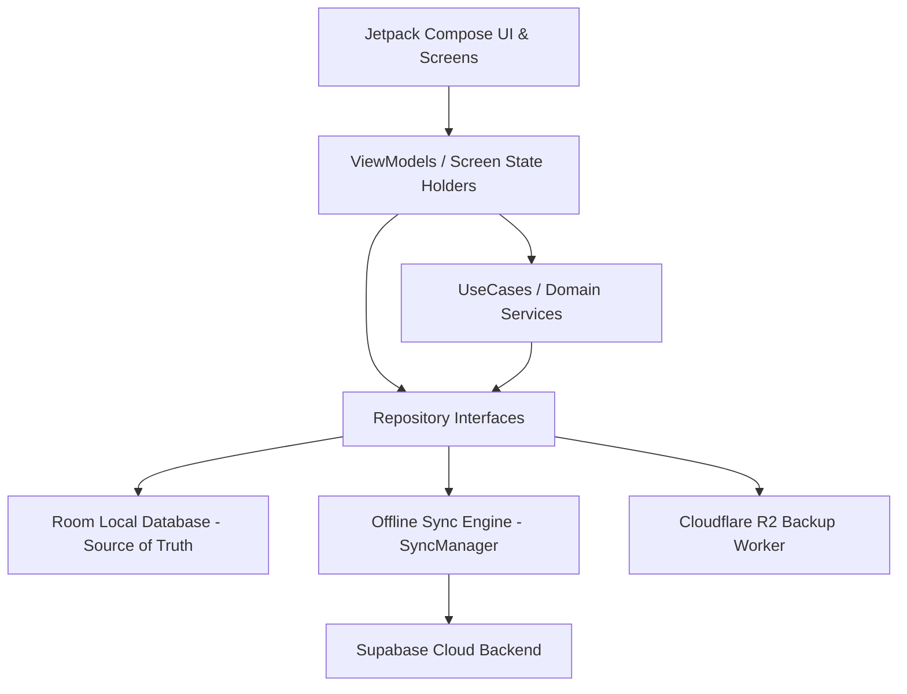

# Neo Child Clinic — Architecture Assessment

## 1. Architectural Overview & Design Patterns

Neo Child Clinic is built on modern Android development standards, pairing Clean Architecture with a reactive MVVM presentation layer and an offline-first data synchronization engine:

### Core Architecture Pillars:
1. **Unidirectional Data Flow (UDF)**:
   - Composables observe UI state exposed as Kotlin `StateFlow` from ViewModels.
   - User interactions emit events or call ViewModel methods, which execute coroutines on structured scopes.
2. **Offline-First Persistence**:
   - Room (v33) serves as the immediate source of truth for read and write operations.
   - Writes record pending mutations into a local `sync_queue` table in atomic Room transactions.
   - `SyncManager` asynchronously uploads queued operations to Supabase using exponential backoff, single-flight locking, and transactional reconciliation.
3. **Domain Layer Independence**:
   - `domain/model/` contains pure Kotlin data structures (`data class`, `enum`, `sealed interface`) with no Android or database framework imports (`android.*`, `androidx.room.*`, `io.github.jan.supabase.*`).
   - Complex domain business logic is encapsulated in focused domain engines (e.g. `ClinicalVaccinationService`, `VaccinationEditEngine`, `EditReconciler`, `FinanceCalculator`, `ExpenseValidator`).
4. **Dependency Injection**:
   - Hilt manages dependency lifetimes: `@Singleton` for repositories, database instances, sync managers, and cache registries; `@HiltViewModel` for screen state holders.

---

## 2. Package Boundaries & Architectural Analysis

### 2.1 Strengths & Proven Patterns
- **Feature Packaging**: Each business domain (`patient`, `vaccination`, `inventory`, `finance`, `consultation`, `doctor`, etc.) is cleanly self-contained within `com.neochildclinic.feature.<name>`.
- **Repository Interface Separation**: Repositories declare interfaces in their feature's `domain/repository/` folder and implement them in `data/`, guaranteeing that presentation and domain layers depend solely on abstractions.
- **Transaction Safety**: The app enforces database transactional integrity through `TransactionRunner` (`AppDatabase.runInTransaction`). Multi-table mutations (such as recording a vaccination with item rows, inventory deduction, and next-dose reminders) execute within a single atomic commit.
- **Memory Caching**: `MemoryCache` and `CacheRegistry` prevent stale UI reads while respecting memory lifecycle constraints during logout and database restore events.

### 2.2 Identified Friction Points & Architectural Assessments

#### 1. Global Session Management Placement
- **Observation**: `AuthViewModel` resides in `core/security/` rather than `feature/auth/presentation/`.
- **Assessment**: This was a deliberate architectural decision. `AuthViewModel` is not a simple login screen form holder; it orchestrates app-wide session states, biometric lock screens (`LockScreen.kt`), account isolation dialogs, and blocks logout when un-synced work exists in `sync_queue`.
- **Architectural Verdict**: Retain in `core/security/`. It is a core system controller rather than an isolated feature screen.

#### 2. Synchronized Upload Core vs Feature Sync
- **Observation**: `SyncRepositoryImpl.kt` and `SyncUploader.kt` live in `core/sync/`, while `SyncScreen.kt` and `SyncViewModel.kt` live in `feature/sync/`.
- **Assessment**: `core/sync/` contains the cross-cutting sync engine executed by `WorkManager` in the background regardless of whether the UI is open. `feature/sync/` represents only the manual sync UI and conflict visualization.
- **Architectural Verdict**: Correct boundary. Background infrastructure remains in `core/`, user-facing management screen in `feature/`.

#### 3. Room Database Schema Dependency
- **Observation**: Entities in `data/local/entity/` map 1:1 to Room schema version 33.
- **Assessment**: Room stores the fully qualified class names of entities in schema files (`app/schemas/com.neochildclinic.data.local.database.AppDatabase/33.json`).
- **Architectural Verdict**: Entity class names and packages MUST NOT be altered without a database migration. They are correctly located in `data/local/entity/`.

#### 4. ViewModel Combine Boilerplate
- **Observation**: Screens combining 5+ Flows use private holder types (`RefreshState` in `PatientListViewModel.kt:215`, `Quad` in `VaccineInventoryViewModel.kt:111`).
- **Assessment**: Kotlin Coroutines stdlib historically only provides typed `combine` overloads up to arity 5.
- **Architectural Verdict**: Handled cleanly with typed holder structs without leaking across screen boundaries.

---

## 3. Coupling & Dependency Rules

1. **Presentation -> Domain / Data**:
   - ViewModels inject Repository interfaces or UseCases.
   - UI Composables never directly reference Room DAOs or Supabase clients.
2. **Feature -> Feature**:
   - Features communicate via Compose Navigation routes with primitive arguments (IDs, dates).
   - Features do not directly inject other features' ViewModels or DAOs.
3. **Core Independence**:
   - `core/common`, `core/designsystem`, and `core/ui` have zero dependencies on `feature/*`.
   - `core/sync` depends on data layer DAOs and entities to perform generic table upserts.
4. **Backend Contract Alignment**:
   - Supabase RLS policies and server-side stock triggers mirror local Room transaction rules (e.g., preventing negative inventory and checking active staff roles).

---

## 4. Architectural Recommendations for the Repository

1. **Clarify Documentation Hierarchy**: Consolidate sprawling root guides into structured subdirectories (`docs/getting-started/`, `docs/architecture/`, `docs/operations/`, `docs/quality/`).
2. **Protect Knowledge Base**: Maintain `docs/Knowledge_Base/` in its exact Obsidian-compatible location, maintaining strict compliance with `validate_docs.py` and all 1,064 citations.
3. **Preserve External Conventions**: Keep `supabase/` and `cloudflare/backup-worker/` at repository root level to adhere to Supabase CLI and Cloudflare Wrangler toolchain standards without breaking CI/CD pipelines.
4. **Provide Navigation Clarity**: Author `where-things-belong.md` to establish unambiguous rules for where future developers place new components, screens, database entities, and migrations.
