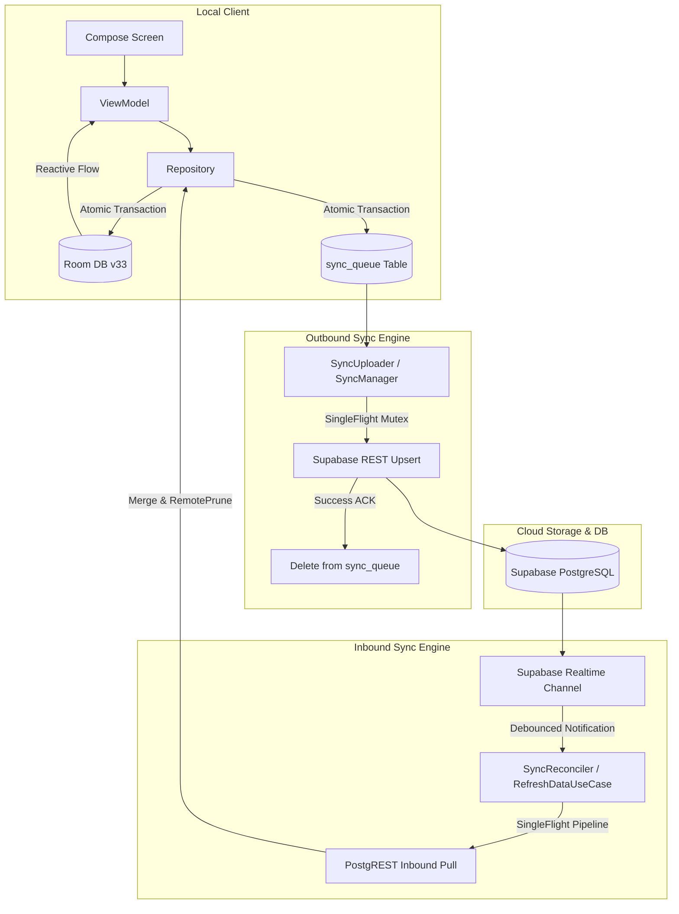

# Neo Child Clinic — Offline-First Synchronization Architecture

This document describes how Neo Child Clinic maintains bidirectional, deterministic data consistency between the local Room database and Supabase.

---

## 1. Ownership & Architecture Matrix

| Layer | Responsibility |
|---|---|
| **Room Database (v33)** | **Local Source of Truth**: All UI screens read exclusively from Room via reactive Kotlin `Flow`s. Handles offline writes, transaction boundaries, foreign-key cascade integrity, and local mutation queues (`sync_queue`). |
| **Supabase Backend** | **Cloud Source of Truth & Coordination**: Persisted cross-device records, authentication, Row Level Security (RLS) enforcement, server-generated sequences (e.g. clinic receipt numbers), and Realtime Postgres notifications. |
| **Feature Repositories** | **The Single Bridge**: UI screens never choose between Room and a network call. All read paths are strictly `UI → ViewModel → Repository → Room Flow → UI State`. |
| **`sync_queue` + `SyncUploader`** | **The Outbound Pipeline**: The only mechanism that writes from Room to Supabase. |
| **Realtime + `RefreshDataUseCase`** | **The Inbound Pipeline**: Realtime events act as guarded invalidation triggers, provoking a single-flight inbound pull through repository interfaces. |

---

## 2. Outbound Synchronization (Local → Cloud)

1. **Atomic Room Transaction**: Any domain mutation (e.g., recording a patient vaccination) executes inside `TransactionRunner.run`. The entity record write and its corresponding `sync_queue` entry commit together in the same SQLite transaction.
2. **Immediate UI Responsiveness**: Composables react immediately to Room database emissions. The UI never hangs waiting for network acknowledgements.
3. **Queue Processing**: `SyncRepositoryImpl.processNextItems()` drains the queue:
   - Rows are marked `SYNCING`.
   - Payload is uploaded to Supabase using idempotently keyed upserts.
   - Rows are deleted from `sync_queue` **only after** an HTTP 2xx acknowledgement.
   - Transient failures revert to `PENDING` with exponential backoff.
   - Hard failures transition to `FAILED` with error classification, surfaced to staff on `SyncScreen`.
4. **Single-Flight Execution**: In-process `SingleFlight` concurrency locks prevent duplicate upload workers from running concurrently.
5. **Foreign Key Order Preservation**: Queue entries are ordered by `transactionGroupId`, guaranteeing that parent records (e.g. `PatientEntity`) are committed on the server before child records (`VaccinationEntity`).

---

## 3. Inbound Synchronization (Cloud → Local)

1. **Triggers**: Realtime Postgres changes, user pull-to-refresh on lists, app foregrounding, and network connectivity recovery.
2. **Invalidation Semantics**: Realtime WebSocket payloads are treated as cache invalidations, not raw data insertions. They trigger a guarded pull via `RefreshDataUseCase`.
3. **Merge, Not Replace**:
   - A remote row is written only if there is **no pending local mutation** in `sync_queue` for that ID.
   - Local un-synced edits always take precedence over incoming remote changes (`isUnsynced` guard).
4. **Remote Pruning**: When another clinic staff member deletes a record, `RemotePrune` identifies local rows that are marked synced but no longer present in the remote table, safely pruning them from SQLite.

---

## 4. Conflict Resolution Matrix

| Scenario | Resolution Rule |
|---|---|
| Remote row newer (`updated_at`) & local has no pending sync row | Remote wins → written to Room |
| Local row has an active row in `sync_queue` | Local is authoritative → pull skips it |
| Entity has no `updated_at` (e.g., financial line items) | Local edit takes precedence |
| Hard delete on remote | Propagated via `RemotePrune` for rows without pending local queue entries |
| Soft delete (`reminders.is_deleted`) | Excluded from active queries; retained for historical audit |
| Out-of-order delivery | Idempotent upsert on natural primary key collapses duplicates |

---

## 5. Account Isolation & Logout Safety

- **Unsynced Work Protection**: When a staff member taps "Sign Out", the app inspects `sync_queue`. If unpushed mutations exist, sign-out is strictly blocked until the queue is flushed or the user explicitly confirms "Erase & Sign Out" in a high-severity dialog.
- **Cache Invalidation**: Switching clinic accounts drops memory caches via `CacheRegistry.clearAll()` and resets the SQLite database to prevent cross-tenant data leakage.
