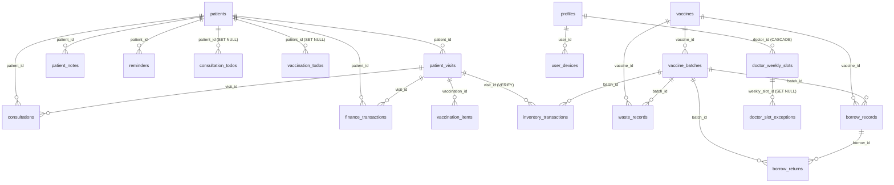

# 01 — Schema and Relationships

**Scope:** tables, columns, primary keys, foreign keys, nullability, and type contracts as evidenced by migrations, the schema catalogue CSV, the hand-applied scratch SQL, and the Android entities.
**Important limitation:** 15 of 23 tables have no `CREATE TABLE` in the repository (`SQL-001`). The CSV has **no constraint or index rows**, so foreign keys, checks, and indexes on the base tables cannot be read from it. Conclusions about live FKs are `Probable` or `Requires Verification`.

---

## 1. Table families

| Family | Tables | Definition source |
|---|---|---|
| Patient core | `patients`, `patient_visits`, `patient_notes`, `vaccination_items`, `vaccines`, `vaccine_batches` | hand-applied; no repo DDL |
| Inventory ledger | `inventory_transactions`, `waste_records`, `borrow_records`, `borrow_returns` | ledger/waste/borrow base tables hand-applied; `borrow_returns` migration 8 |
| Clinical | `consultations`, `consultation_todos`, `vaccination_todos` | `consultations` hand-applied; todo tables migration 6 |
| Reminders | `reminders`, `personal_vaccine_reminders` | `reminders` hand-applied; personal reminders migration 7 |
| Finance | `finance_transactions`, `expenses`, `receipt_sequences` | transactions hand-applied; expenses migration 10; sequences migration 4 |
| Staff/identity | `profiles`, `user_devices` | hand-applied; auth-managed |
| Scheduling | `doctor_weekly_slots`, `doctor_slot_exceptions` | migration 11 |
| Audit/ops | `audit_logs`, `api_write_rate_limits`, `todo_notification_events` | audit logs hand-applied; rate limits migration 16; notification events outside repo |

---

## 2. Declared relationships

### 2.1 From migrations (authoritative where present)

| Child column | Parent | On delete | Evidence |
|---|---|---|---|
| `consultation_todos.patient_id` | `patients.id` | `set null` | `20260825_patient_todos.sql:8` |
| `vaccination_todos.patient_id` | `patients.id` | `set null` | `20260825_patient_todos.sql:27` |
| `personal_vaccine_reminders.vaccine_id` | `vaccines.id` | `set null` | `20260901_personal_vaccine_reminders.sql:13` |
| `doctor_weekly_slots.doctor_id` | `profiles.id` | `cascade` | `20260911_doctor_availability_slots.sql:24` |
| `doctor_slot_exceptions.doctor_id` | `profiles.id` | `set null` | `20260911_doctor_availability_slots.sql:132` |
| `doctor_slot_exceptions.weekly_slot_id` | `doctor_weekly_slots.id` | `set null` | `20260911_doctor_availability_slots.sql:133` |
| `patient_visits.availability_slot_id` | `doctor_weekly_slots.id` | `set null` | `20260911_doctor_availability_slots.sql:122` |
| `consultations.availability_slot_id` | `doctor_weekly_slots.id` | `set null` | `20260911_doctor_availability_slots.sql:125` |
| `consultations.doctor_id` | `doctor_weekly_slots.id` (?) | `set null` | `20260911_doctor_availability_slots.sql:134` — **type conflict**, see §3 |
| `vaccination_items.vaccination_id` | `patient_visits.id` | not stated | `20260822_vaccination_items_snapshot.sql` assumes the column |

### 2.2 From the hand-applied scratch file (not authoritative)

`.artifacts/712413f3-ddb1-48f7-8e1b-47a0109fd12e/scratch/missing_tables.sql` contains the only DDL for the core tables. It already contradicts the current catalogue, which proves it is stale:

| Scratch definition | Catalogue / current code | Conflict |
|---|---|---|
| `inventory_transactions.vaccination_id` → `patient_visits(id)` (`:27`) | column is `visit_id` (`CSV`) | column renamed or never applied |
| `inventory_transactions.timestamp timestamptz` (`:32`) | `timestamp text` (`CSV`) | type changed |
| `inventory_transactions.vaccine_id/batch_id NOT NULL` (`:24-25`) | both nullable (`CSV`) | nullability changed |
| `inventory_transactions` has no `created_at/updated_at/created_by/updated_by` | catalogue has all four | altered later |
| `audit_logs.timestamp timestamptz NOT NULL` (`:56`) | `timestamp text NULL` (`CSV`) | type changed |
| `audit_logs.patient_id` → `patients(id)` with **no ON DELETE** (`:67`) | unknown live | delete-blocking risk |
| `patient_notes.patient_id` → `patients(id) ON DELETE CASCADE` (`:45`) | unknown live | — |
| `waste_records.vaccine_id/batch_id` → parents, no delete action (`:73-74`) | unknown live | delete-blocking risk |
| `inventory_transactions.patient_id` → `patients(id)` no action (`:26`) | unknown live | delete-blocking risk |
| `inventory_transactions.vaccination_id` → `patient_visits(id)` no action (`:27`) | unknown live; current column `visit_id` | delete-blocking risk |

**Consequence:** the repository cannot answer “what are the live foreign keys?”. Any FK-dependent finding must be checked against `pg_constraint` before a fix is designed.

### 2.3 Relationship diagram (declared only)



The diagram shows **declared** intent, not verified live constraints. Edges without a migration citation are inferred from column names or from the scratch file.

---

## 3. Type and contract mismatches

| # | Object | Server type | Client / other side | Risk | Evidence |
|---|---|---|---|---|---|
| 1 | `consultations.doctor_id` | `text` | `ConsultationEntity.doctorId: String`; migration adds FK to `doctor_weekly_slots.id` (`uuid`) | FK creation fails, or stores a name/label not a UUID | CSV; `20260911…:134`; `ConsultationEntity.kt:35` |
| 2 | `patient_visits.doctor_id` | `text` | `VisitEntity.doctorId: String`; same migration adds FK to `uuid` | same | CSV; `20260911…:137` |
| 3 | `doctor_weekly_slots.doctor_id` | `uuid` | `DoctorAvailabilityEntities.kt` uses `String` | serialization works only because both are strings on the wire; server rejects non-UUID | `20260911…:24` |
| 4 | `vaccine_batches.updated_at` | `text` | `VaccineBatchEntity.updatedAt: String` | lexical comparison / parse skew | CSV |
| 5 | `consultations.created_at/updated_at` | `text` | `ConsultationEntity` strings | conflict checks compare text | CSV; `ConsultationEntity.kt:41` |
| 6 | `audit_logs.timestamp` | `text` (default `(now())::text`) | `AuditLogEntity.timestamp` string | ordering, retention cast, index | CSV; `supabase/migrations/20261025…:15` |
| 7 | `inventory_transactions.timestamp` | `text` | `InventoryTransactionEntity.timestamp` string | conflict comparison | CSV; `SyncUploader.kt:173` |
| 8 | `waste_records.date_wasted` / `expiry_date` | text in entity path | CSV shows `date_wasted date`, `expiry_date date` | mixed parsing | CSV; `WasteRepositoryImpl` |
| 9 | `finance_transactions.transaction_date` | `date NOT NULL` | `FinanceEntity.transactionDate: String?` | a null would be rejected by PostgREST | CSV; `FinanceEntity.kt` |
| 10 | `patient_visits.date_given` | `text NOT NULL` | `VisitEntity.dateGiven: String` | text date arithmetic | CSV |

**Root cause:** the base schema was created outside the repository, so the app’s Kotlin types and the database’s Postgres types evolved independently. Nothing in CI compares them. `SQL-005`, `SQL-027`, `SQL-029`.

---

## 4. Nullability and default mismatches that can fail sync

| Table.column | Server | Client | Failure |
|---|---|---|---|
| `finance_transactions.transaction_date` | `NOT NULL` | nullable, resolved from `visitId` | a non-visit income row sends `null` → 23502 |
| `inventory_transactions.quantity` | `NOT NULL` | `Int` | fine |
| `vaccine_batches.remaining_quantity` | unknown NOT NULL? | `Int` | `uploadBatch` sends literal `0` on create (`SQL-008`) |
| `patient_visits.date_given` | `NOT NULL` default `(now())::text` | non-null | fine |
| `reminders.due_date` | `NOT NULL` | `String` | fine |
| `consultations.amount` | `NOT NULL` | `Double` | fine |
| `audit_logs.user/module/entity_type/entity_id/action` | nullable in CSV | non-null in app | server accepts, but content is unchecked (`SQL-019`) |
| `profiles.deleted_by` | `uuid` (per migration comment) | text label in other tables | profiles deletes use service role; fine today |

---

## 5. Soft-delete columns (schema view)

`20260925_business_soft_delete_columns.sql:30-55` adds `is_deleted boolean not null default false`, `deleted_at timestamptz`, `deleted_by text`, and an index on `is_deleted` to **18 tables**:

`patients`, `patient_visits`, `vaccination_items`, `consultations`, `reminders`, `personal_vaccine_reminders`, `finance_transactions`, `expenses`, `borrow_records`, `borrow_returns`, `waste_records`, `consultation_todos`, `vaccination_todos`, `vaccines`, `vaccine_batches`, `doctor_weekly_slots`, `doctor_slot_exceptions`, `patient_notes`.

But:

- The current app **hard-deletes** every entity except `ReminderEntity`; only `ReminderEntity.kt:78-80` declares the trio.
- Room 31→32 deletes rows marked deleted and drops the columns from 18 tables (`AppDatabase.kt:385+`).
- Server pull paths still filter `is_deleted = false` (e.g. `FinanceRepositoryImpl.kt:394-400`, `ExpenseRepositoryImpl.kt:126`, `ProfileRepositoryImpl.kt:45`).
- Old v31 clients can still send soft-delete UPDATEs; the columns remain, so those writes succeed and create server rows that new clients never pull.

`SQL-028` covers the behavioural inconsistency; this section records the schema half.

---

## 6. Findings introduced here

### SQL-001 — Fresh database cannot be reconstructed from the repository

- **Severity:** Critical
- **Confidence:** Confirmed (static absence)
- **Object:** 15 of 23 catalogue tables; `todo_notification_events`; missing `20260911_todays_patient_notifications.sql`
- **Workflow:** environment rebuild, disaster recovery, staging, CI, new developer onboarding
- **Root cause:** base schema was built in the Supabase dashboard / scratch SQL before `supabase/migrations` was tracked. `.gitignore` history confirms migrations were ignored; only 4 files replayed against a hand-built schema (`supabase/.gitignore:5-8`).
- **Failure scenario:** `supabase db reset` on a clean project applies migration 1, which loops over `pg_tables` and adds audit columns to whatever exists. The 15 core tables do not exist, so later migrations that `alter table public.patient_visits`, `public.vaccine_batches`, `public.inventory_transactions` fail or silently skip; RLS is never enabled on those tables because `to_regclass(...) is null` guards skip them (`20260929000000…:62-64`). The result is either a hard failure or a database with no core tables and no RLS.
- **Impact:** no reproducible environment; recovery depends on an untracked dashboard state; RLS may be absent on core tables after a rebuild.
- **Evidence:** migration-created tables = 9 (`grep 'create table if not exists'`); catalogue tables = 23; `20261016…:13` states `todo_notification_events` was “created by a migration that is not in this repository”; `20260911_doctor_availability_slots.sql:147` references the missing `20260911_todays_patient_notifications.sql`.
- **Correction:** add an idempotent `00000000000000_baseline_schema.sql` that creates the 15 missing tables with their live columns, keys, and FKs, generated from a `pg_dump --schema-only` of the real database and reviewed. Add `todo_notification_events` and the missing notification migration. Add a CI job that replays all migrations on an empty Postgres.
- **Regression test:** `supabase db reset` on an empty database must succeed, then `verify_security.sql` must show RLS enabled on all 24 business tables.
- **Live check:** required — capture `pg_dump --schema-only` and compare with the CSV before writing the baseline.

### SQL-002 — Catalogue/migration drift

- **Severity:** High
- **Confidence:** Confirmed
- **Object:** `api_write_rate_limits` (migration-created, absent from CSV); `todo_notification_events` (neither); `receipt_sequences` (present in both)
- **Workflow:** schema review, drift detection
- **Root cause:** the CSV is a manual snippet, not a generated schema dump.
- **Failure scenario:** an engineer trusts the CSV as the schema of record and omits `api_write_rate_limits` from a rebuild; `enforce_write_rate_limit` then fails on every write, or the table is recreated without RLS/revokes.
- **Impact:** incorrect schema assumptions; security controls missing after rebuild.
- **Evidence:** Python CSV parse (23 tables); `20260929001000_write_rate_limit.sql:6`; `20261016…:13`.
- **Correction:** replace the CSV with a generated `pg_dump --schema-only` artifact, or delete it and point to the baseline migration.
- **Regression test:** CI diff between a live schema dump and the repo baseline; fail on any table/column/constraint difference.
- **Live check:** yes.

### SQL-005 — Server type drift

- **Severity:** Medium
- **Confidence:** Confirmed
- **Object:** `consultations.doctor_id text`, `patient_visits.doctor_id text`, `doctor_weekly_slots.doctor_id uuid`; `consultations.created_at/updated_at`, `vaccine_batches.updated_at`, `audit_logs.timestamp`, `inventory_transactions.timestamp` are `text`
- **Workflow:** FK creation, sync conflict checks, audit retention, date parsing
- **Root cause:** base tables were hand-created with `text` timestamps; later features assumed `timestamptz` and UUID doctors.
- **Failure scenario:** `20260911…:134` adds `consultations.doctor_id → doctor_weekly_slots(id)`; if existing rows contain a display name or empty string, the `ALTER TABLE` fails (or the column is never FK’d because the migration is guarded). Text timestamps sort lexically and must be cast for date comparisons.
- **Impact:** migration failure; wrong conflict resolution; audit retention errors.
- **Evidence:** CSV rows; `20260911…:134,137`; `20260911…:24`.
- **Correction:** migrate the affected columns to `uuid`/`timestamptz` in a versioned migration after a data audit; keep the app’s JSON strings compatible by relying on PostgREST’s implicit casts during the transition.
- **Regression test:** schema assertion test that the columns have the intended types; a sync test that a consultation with a doctor UUID round-trips.
- **Live check:** yes — inspect actual column types and existing values first.

### SQL-027 — Nullable transaction date vs `NOT NULL`

- **Severity:** Low
- **Confidence:** Confirmed
- **Object:** `FinanceEntity.transactionDate: String?` vs `finance_transactions.transaction_date date not null`
- **Workflow:** income/expense creation outside a visit
- **Root cause:** client model allows null; server does not.
- **Failure scenario:** `resolveTransactionDate(visitId)` returns `null` when `visitId` is null (`FinanceRepositoryImpl.kt:55-62`); the row is queued and fails on upload with 23502. Current callers pass a `visitId` for VACCINATION income, so this is latent, not currently reproduced.
- **Impact:** queued finance row stuck; revenue missing after sync.
- **Evidence:** CSV; `FinanceRepositoryImpl.kt:55-62,89`.
- **Correction:** make the client resolve a date from the record’s timestamp when `visitId` is null, or make the property non-null and fail at the call site.
- **Regression test:** unit test `resolveTransactionDate(null)` returns a non-null date, or a repository test that a non-visit income is accepted.
- **Live check:** no.

### SQL-029 — Text timestamps

- **Severity:** Medium
- **Confidence:** Confirmed
- **Object:** `audit_logs.timestamp`, `inventory_transactions.timestamp`, `consultations.created_at/updated_at`, `vaccine_batches.updated_at`
- **Workflow:** audit listing, retention, conflict checks, ledger ordering
- **Root cause:** base schema used `text` with `(now())::text` defaults.
- **Failure scenario:** `order("timestamp", DESCENDING)` sorts text; `timestamp::timestamptz` raises on malformed values (`SQL-020`); `isoToLong` cannot parse Postgres’ space-separated form (`SQL-030`).
- **Impact:** wrong “latest” row in audit/ledger views; retention failure; conflict skew.
- **Evidence:** CSV; `AuditLogRepositoryImpl.kt:26`; `20261025…:15-16`.
- **Correction:** add `timestamptz` columns, backfill with `to_timestamp` guarded by a regex/exception block, keep the text columns for one release, then drop them.
- **Regression test:** insert known timestamps and assert `ORDER BY` returns chronological order.
- **Live check:** yes.

---

## 7. Live checks required before schema fixes

```sql
-- Read-only. Run on a disposable/staging clone, never production during clinic hours.
select c.relname as table_name, c.relrowsecurity, c.relforcerowsecurity
from pg_class c join pg_namespace n on n.oid = c.relnamespace
where n.nspname = 'public' and c.relkind = 'r'
order by 1;

select conrelid::regclass as child, conname, pg_get_constraintdef(oid) as def
from pg_constraint
where contype = 'f' and connamespace = 'public'::regnamespace
order by 1, 2;

select table_name, column_name, data_type, is_nullable, column_default
from information_schema.columns
where table_schema = 'public'
order by table_name, ordinal_position;
```

No such query was run in this audit; no database client is installed.
